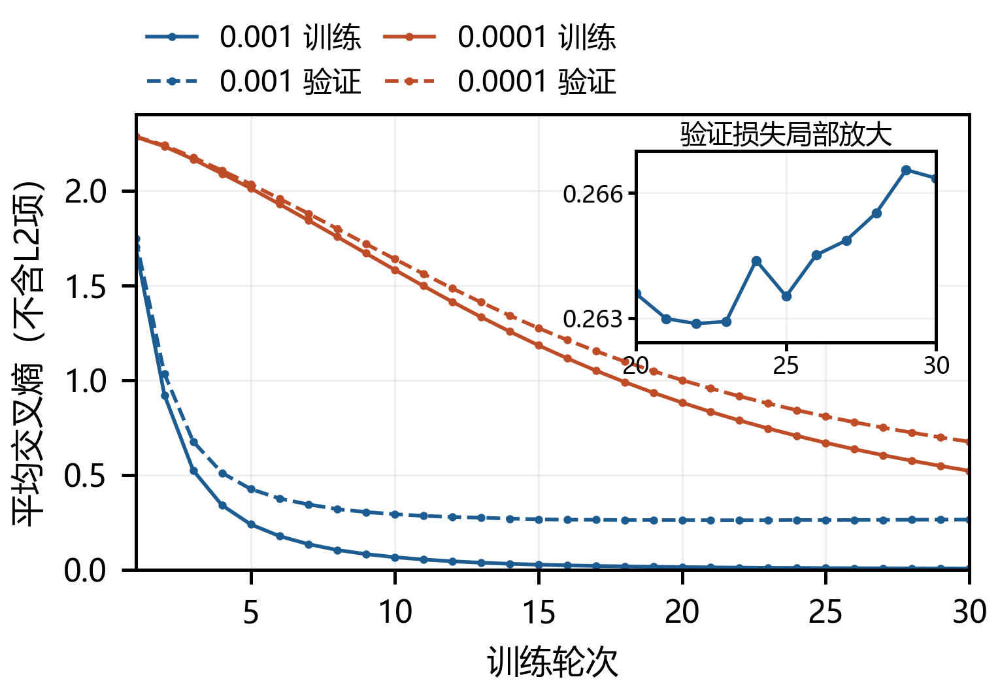
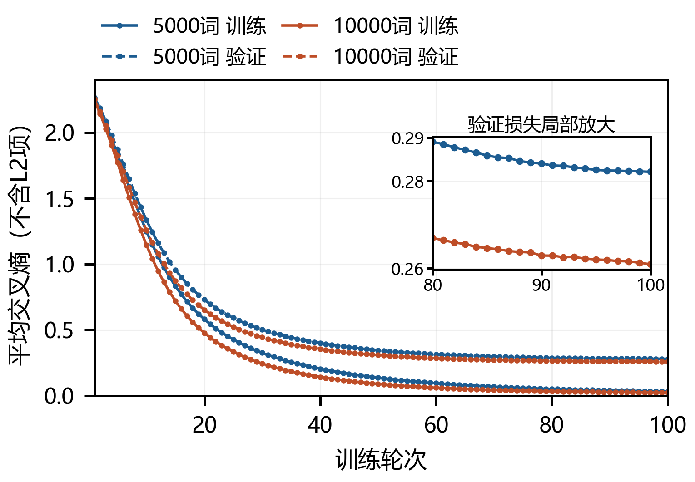

代码仓库：https://github.com/lingkun-Zhang/contemporary-ai-lab

# 文本分类实验报告

姓名：张凌琨　学号：10241900443

## 1 实验设置与问题

本实验用TF-IDF表示文本，比较逻辑回归、MLP和线性SVM。7368篇有标签文本按类别比例分为训练5894篇、验证1474篇，划分种子42；词表和IDF只在训练部分拟合。2457篇无标签测试文本留到最终预测，不参与调参。MLP使用ReLU、Adam和64篇的批次；文中的损失是平均交叉熵，不含L2项，训练仍有正则化。

看到训练准确率接近100%、验证集却仍有差距时，我首先怀疑是过拟合。后来发现，这个判断还不够具体。我把差距拆成三个问题：模型有没有学够，约束和类别权重是否合适，文本表示有没有丢掉可用信息，再分别做对照检查。

为补齐之前漏记的数据，按已有阶段参数统一重跑了29个配置。本文的图表取自这次重跑；参数、逐轮数据、每20轮摘要和错例另存于实验记录。旧记录与重跑结果分开保留。

## 2 先检查模型是否学够

逻辑回归先用5000词做基线。增大C、减弱正则化后，验证效果有明显改善；但C从10增至100只少错2篇，继续改C的收益已经很小。接着使用MLP，并记录训练过程，检查训练与验证的差距究竟是怎样出现的。

图1比较相同50神经元、alpha=0.001、30轮预算下的两组学习率。降低学习率后，曲线确实较平稳，但训练准确率只有95.74%，训练损失还在明显下降。这时验证表现较低，不宜马上解释成过拟合；它也可能只是还没有学够。

为把轮数影响分开，重跑时保留了其余参数相同的30轮与60轮对照。小学习率组的验证准确率从89.21%升至90.98%。因此，平稳的曲线不等于训练完成，小学习率需要与训练预算一起考虑。后续对照采用学习率0.0001，统一训练100轮，比较末轮结果。

高学习率组则出现了另一种情况：验证损失在第22轮最低，之后略有回升，训练损失却继续下降。这提示后段训练可能没有继续改善泛化。两组现象不能用同一种解释概括；本次为统一比较保留固定轮数，早停可以作为下一步检验。

图 1　训练与验证损失均取每轮完整数据上的均值。右上角放大高学习率组第20至30轮的验证损失，坐标范围单独标明。

<!-- COLUMNBREAK -->

## 3 正则化和加权能否修正错误

如果差距主要来自约束不足，增强正则化应有机会改善验证表现。固定学习率0.0001、50神经元和100轮，将alpha从0.005提高到0.05后，训练拟合程度下降了，但验证准确率也从91.59%降至90.43%。原先想靠更强约束改善差距的办法没有奏效。

L2是在分类损失之外增加权重大小的惩罚。它可以抑制对训练样本的过度依赖，也可能压制有用的区分信息。因此，训练拟合下降本身不是改进，仍要看验证文本是否分得更好。另外，MLP的alpha越大惩罚越强，逻辑回归的C越大惩罚却越弱，不能把这两个参数按同一方向理解。

接着检查错例的类别分布。类别2的召回率较低，于是只提高已有训练文本中这一类的权重，验证样本仍只用于评价。权重设为1.5倍并作均值归一后，修正了6篇错误，也新增了1篇错误，平均交叉熵略升。提升不大，但它回答了一个更具体的问题：强调薄弱类别，是否会影响其他类别？

| 原文片段（样本索引） | 真类 | 普通→加权 |
|---|---:|---:|
| 3520：information about this drive. Switch settings, geometry..etc. | 2 | 7→2 |
| 6878：I'm running a 286dx-25 with a 85mb hdd. I also have windows 3.1 | 1 | 1→2 |

表 1　第一条是按验证行序找到的首条修正，第二条是唯一新增错误。片段省去个人信息；标签仍沿用数据中的编号。

第二条文本同时提到硬件和系统软件，加权后类别2与1的概率十分接近，最后被判为2。这个例子说明了代价：加权调整的是模型对类别的重视程度，并没有补充区分这些文本的信息。它能修正部分错误，也可能把边界附近的正确样本推向另一类，所以没有继续提高权重。逻辑回归的类别7权重对照也有类似取舍，完整结果留在记录中。

从训练目标看，更大的权重会提高分错这一类的代价，使这些样本对参数更新的影响增加。分类边界由多个类别共同决定，变化也会影响其他类别。因而查看错例时同时保留“错变对”和“对变错”，才能判断改善是怎样发生的，而不是只挑修正成功的文本。

## 4 增加容量有多大帮助

随后回到未加权的MLP，检查模型容量。25个神经元增至50个时只少错1篇，50个增至100个时少错7篇；后一次的参数量也约翻倍。增加容量有帮助，但收益并不均匀，不能只因为训练拟合更高就继续加大网络。

为检查这点小幅优势是否只来自一次训练，用三个训练种子复验了50与100宽。100宽都高约0.4至0.5个百分点，因而后续表示实验固定为100神经元、alpha=0.005，其他训练设置不变。这几次仍用同一验证集，只说明优势在所试的训练随机状态下重复出现，不能当成三折交叉验证。

<!-- PAGEBREAK -->

## 5 表示更复杂，效果未必更好

### 5.1 短语实验暴露了特征预算的取舍

单个词不能直接表达词间关系，因此尝试加入双词短语。原先希望局部关系能帮助分类，结果验证准确率反而从92.06%降至90.50%。检查词表后发现，5000个名额变成3137个单词和1863个短语：这不是保留全部原有单词再增加短语，而是让两者共同占用有限名额。

这为退步提供了一个可能原因。短语带来新信息的同时，也可能替换掉原本有用的单词。TF-IDF的数值和特征内容也发生了变化，所以仅凭这一组实验还不能断定原因就是名额竞争。但它让我重新检查原先的想法：特征形式更复杂，不代表最终保留下来的信息就更多。

由此，后续问题从“还能加入什么特征”转为“原有单词是否被词表上限截断”。扩大单词词表可以直接检查这一点，便成为接下来的对照。

这个实验中总特征数和网络参数量都没有增加，变化的是具体进入模型的特征。短语未必比被替换的单词更有区分度。如果以后继续检验，可以保留原有单词词表，再额外增加短语，与当前固定总名额的方案比较。这样可分别考察短语带来的收益和替换单词的代价，相关对照本次尚未做。

### 5.2 词频缩放让我重新区分两种指标

又尝试对数词频，希望减弱同一个词反复出现的影响。它比普通词频多错4篇，平均交叉熵却从0.2821降至0.2701。准确率看最终类别是否正确，交叉熵看真实类别得到的概率，两者并不一定同向变化。

单条文本的交叉熵是-log p(真实类别)，不仅关心分没分对，也关心模型给真实类别多少概率。边界附近少量文本换了预测类别，会使准确率下降；与此同时，其他文本的真实类别概率提高，整体交叉熵仍可能下降。因此两种指标需要一起看，不能用其中一个完全代替另一个。

因此，这个改动不能简单概括为完全无效，但它没有改善本实验优先考虑的分类准确率，后续仍用普通词频。低损失和少错分是不同的观察角度，需要说明选择依据。

对数词频实验沿用同一词表和IDF，改变的是重复次数到特征值的映射，随后仍作归一化。词出现得更频繁时，其相对影响不再按原来的方式增加。保留相同词表使这个对照更容易解释，但也不能仅凭损失下降，就断言模型的概率已经得到良好校准。

### 5.3 换分类器也没有直接解决问题

在同样的5000词TF-IDF上补做线性SVM对照。调大C后，它仍未超过逻辑回归或100宽MLP。换分类器未突破已有结果，下一步便检查三者共同使用的输入特征。

逻辑回归与线性SVM使用相同的文本表示和数据划分，区别在训练目标和约束方式。前者的分类损失为交叉熵，后者强调分类间隔。TF-IDF输入稀疏且高维，线性模型也能利用各词的加权组合。因此先比较同一输入下的结果，再扩大共同词表，能把换模型与改表示这两类尝试分开。

于是对三个模型做相同方向的扩词表对照，检查改善是否只出现在MLP上。SVM未启用概率输出，只比较分类准确率；它的C对照和支持向量记录另存于完整实验记录中。

<!-- COLUMNBREAK -->

## 6 扩词表对照与最终选择

将单词词表上限从5000扩至10000，各模型保留自身其他设置：逻辑回归和SVM均为C=100，MLP沿用前述100宽、低学习率和100轮配置。三者都不加权，使用普通词频和相同的数据划分。

| 模型 | 5000词 | 10000词 |
|---|---:|---:|
| LR C=100 | 91.45% | 93.01% |
| MLP 隐藏100 | 92.06% | 92.88% |
| SVM C=100 | 91.04% | 91.79% |

表 2　最终验证准确率。MLP统一比较第100轮，不分别选各组最好的一轮。

图 2　扩词表后MLP的验证损失较低。右上角放大第80至100轮，主图仍保留全部训练与验证逐轮点。

三个模型都得到改善，说明输入表示值得检查，而不只是某个网络的训练参数需要调整。这与短语实验的失败并不矛盾：短语在固定名额内替换了一部分单词，扩词表则允许保留更多单词。两次尝试虽然都在改特征，但对原有信息的处理不同。

这还不能证明改进全来自新增单词。扩词表也改变了归一化后的输入，MLP的参数量和初始化过程也会变化。当前结果支持所试的10000词配置；词表继续扩大是否更好，本次没有验证。

最终按验证准确率选择10000词、C=100的逻辑回归。它比MLP只少错2篇，而MLP的交叉熵更低，因此这个选择是准确率优先下的取舍，不是所有指标都由LR胜出。

回看这些尝试，最初“训练接近100%，所以加正则化”的判断过于简单。曲线帮助区分了训练不足与后段验证反弹，错例说明了加权的代价，短语实验则引出了词表预算的问题。失败的改动没有带来涨分，却帮助缩小了后续要检查的范围。

虽然验证文本没有参与模型更新，多次根据同一验证集选参数，仍可能让选择适应该划分的特点。三个训练种子只检查训练随机性，不能替代新的数据划分。后续可以先固定候选，再通过多个分层划分检查结论是否稳定；这些对照本次未做，当前结果也不能视为独立测试成绩。

最终选定后，用全部7368篇有标签文本重拟合词表、IDF和模型，按2457篇测试文本原行序生成单列、无表头和索引的prediction.csv。原验证集此时也参与重训，不再为新模型报分；报告成绩属于先前留出阶段。测试无标签，不报告其准确率。
