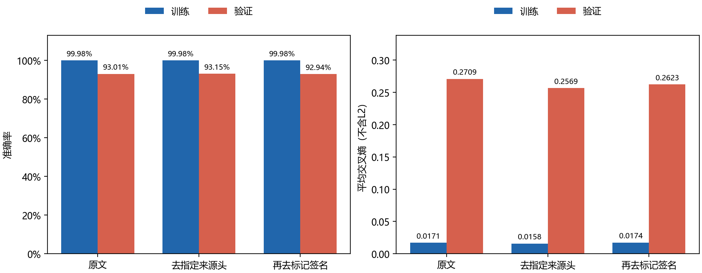

# 邮件头与签名清洗对照

## 问题与设置

原来的实验主要改变模型和TF-IDF参数。这次检查另一个问题：当前分类效果是否依赖发件人、机构等来源信息？删除这些信息后，表现是否更好？继续删签名是否还会改善？

使用相同的7368篇有标签文本，训练5894篇、验证1474篇。数据文件和两个划分的哈希与原实验一致。三组均使用10000词上限、普通单词TF-IDF、LR C=100、L2、L-BFGS、迭代上限1000、种子42，不加权。各组分别只在处理后的训练部分拟合词表和IDF，再变换验证文本。不读取测试集，不重新选择C，也没有改动提交模型或prediction.csv。

原文组重新训练了一次，准确率、交叉熵、错分数、词表和IDF哈希全部复现原来的`lr_vocab10000`结果。时间只记录本次运行，不与旧耗时混用。

## 清洗规则

1. 仅把首个空白行前、能按字段与折行解析且含From和Subject的前缀认作邮件头。删除预先列出的来源字段及其折行，保留Subject、Keywords、Summary和未知字段。字段全集见`protocol.json`。
2. 在上一组基础上，只识别独立一行的`-- `（两个短横线后有一个空格），从最后一个这种标记删到末尾。普通`--`、带引用前缀的标记和普通结尾段落不作签名处理。未识别头部时，签名规则仍可单独运行。
3. 不删除样本或改变标签。不能可靠识别的邮件头保留，不根据验证准确率调整规则。签名识别仍是启发式，不保证绝无误删或漏删。

训练部分5889篇的头部被识别并清理，另5篇因格式不满足条件而保留；验证部分1474篇均被识别。第三组又清理了训练1560篇、验证369篇的标记签名。三组均没有空文本或零特征行。字符差值包含换行归一化，不代表纯来源信息的字符量。

## 实测结果

| 处理 | 训练准确率 | 验证准确率 | 训练交叉熵 | 验证交叉熵 | 验证错误数 |
|---|---:|---:|---:|---:|---:|
| 原文 | 99.98% | 93.01% | 0.0171 | 0.2709 | 103 |
| 去指定来源头 | 99.98% | 93.15% | 0.0158 | 0.2569 | 101 |
| 再去标记签名 | 99.98% | 92.94% | 0.0174 | 0.2623 | 104 |

三组实际特征数均为10000，LR参数量均为100010，均收敛且没有警告。比较图显示完整的训练/验证末次拟合指标；LR没有在此记录逐轮训练过程，因此没有人为生成轮次曲线。原报告中的MLP逐轮曲线没有改动。

| 成对比较 | 修正错误 | 新增错误 | 预测类别改变的文本 |
|---|---:|---:|---:|
| 原文 → 去指定来源头 | 26 | 24 | 63 |
| 去指定来源头 → 再去签名 | 15 | 18 | 43 |
| 原文 → 去来源头与签名 | 30 | 31 | 75 |

“预测类别改变”也包括从一种错类变为另一种错类，不等于修正数加新增错误数。

## 结果说明

去来源头后，准确率提高约0.14个百分点、少错2篇，交叉熵也下降。但这不是简单地把2篇错题修正：实际修正了26篇，又新增24篇错误，大部分收益与代价相互抵消。仅看总体准确率会掩盖分类边界的变化。

继续删除标记签名，反而比只去头多错3篇，交叉熵也回升。它仍比原文的交叉熵低，却比原文多错1篇。这再次说明低损失和少错分并不总是同向，也不支持“删得越多越好”。

这组结果说明，在当前划分和配置下，移除指定来源字段后仍能取得相近的验证效果。不能据此声称原模型完全没有使用来源信息，或清洗后的模型在新来源文本上一定更好。Subject、未知头字段和引用内容仍保留；词表、IDF和归一化后的输入也随清洗变化。签名中可能含有主题线索，规则也可能误删或漏删，这些机制尚未逐一验证。

本次只验证一个固定划分，提升幅度很小，也没有为清洗组重新调C。暂不凭少错2篇替换提交模型。若继续研究，优先抽查修正与新增错误，并在预先固定的其他划分上复验；不挑最好的一次作为最终结论。

## 文件与复查

- `protocol.json`、`split.json`：固定规则、模型配置、原始行索引及划分哈希。
- 各组`metrics.json`、`classification_report.json`、`confusion_matrix.json`：训练与验证指标及分类表现。
- 各组`validation_predictions.json`：全部1474篇验证文本的原行索引、标签、预测与概率，不含原文。
- 各组`cleaning_audit.json`：覆盖率、字段计数、变更索引、变换前后的文本哈希，不含字段值。
- `summary.json`：三组完整指标、成对修正/新增错误索引、原文组复现检查。
- `source_snapshot.py`、`session.json`：实际训练源码、环境与输入哈希。当前入口后来仅增加重绘选项并移动图例，训练快照未改。
- `figure_source.json`：图源与重绘说明；`checksums.json`：本目录文件校验。

这次记录是原29组实验之外的补充，不修改旧记录。两页报告的5.4节摘录三组实测指标与双向错分分析，完整规则、覆盖率和逐样本结果保留在本目录。
