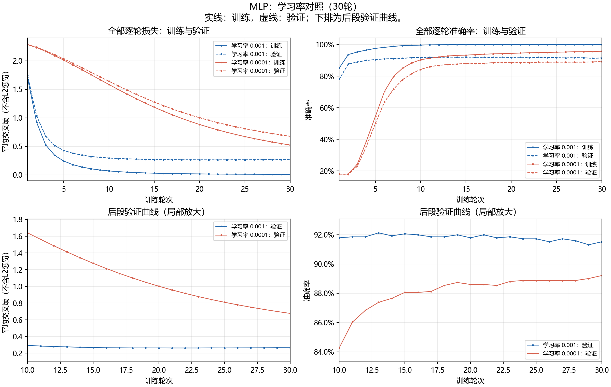
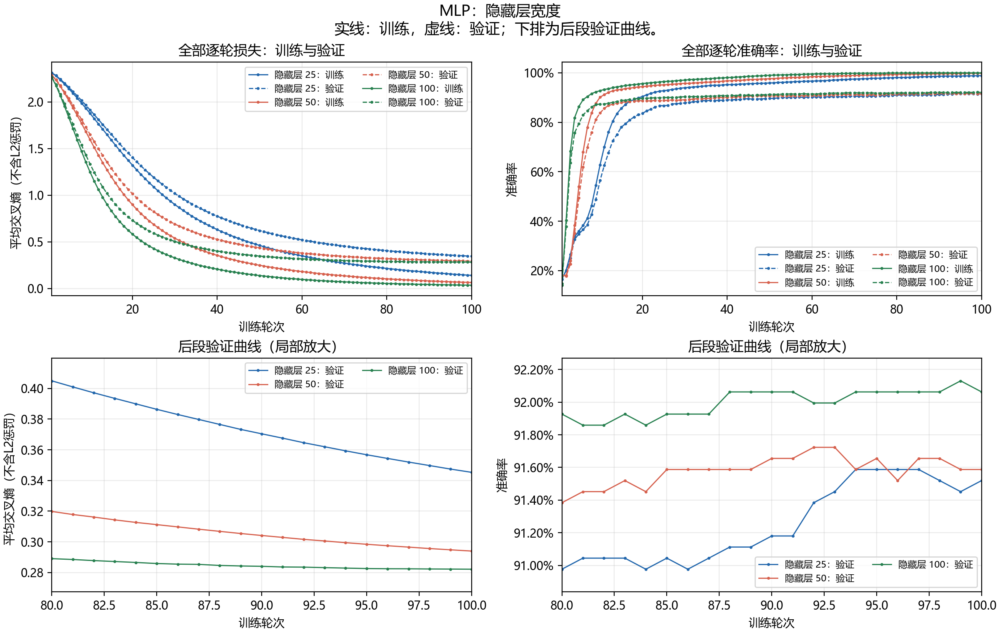

# 实验结果分析与图像索引

本文分析按阶段参数重跑的29组配置。两页报告见 `../report/report.pdf`，旧日志在 `history/` 中。

数据划分固定为训练5894篇、验证1474篇，划分种子42。词表和IDF只使用训练部分拟合。以下“损失”均指重新评估得到的平均交叉熵，不含L2惩罚；模型训练仍有正则化。所有比较都使用设定训练轮数的末轮结果，不挑各组中途的最高准确率。

## 1. 先用逻辑回归建立基线：减弱正则化确实有帮助，但收益会变小

最开始需要回答的问题是：模型还没学好，还是已经能拟合训练集，却不能很好地预测没见过的文本？因此同时看训练和验证表现，而不只看一个准确率。

| C | 训练准确率 | 验证准确率 | 训练交叉熵 | 验证交叉熵 | 验证错分 |
|---:|---:|---:|---:|---:|---:|
| 0.1 | 89.97% | 84.19% | 1.489920 | 1.546028 | 233 |
| 1 | 96.69% | 89.82% | 0.521863 | 0.686007 | 150 |
| 10 | 99.92% | 91.32% | 0.109097 | 0.360176 | 128 |
| 100 | 99.98% | 91.45% | 0.018036 | 0.296177 | 126 |

C越大，正则化越弱。从0.1增加到10时，训练和验证准确率都明显提高，说明较强的限制确实妨碍了这组模型拟合数据。但从10增加到100，验证集只少错2篇，准确率增加约0.14个百分点，收益已经很小。

训练99.98%、验证91.45%存在差距，但不能仅凭训练接近100%就认定后续问题全是过拟合。此时继续只改C可能没有多少收益，需要考虑训练方法和文本特征是否合适。

图：[逻辑回归C对照](../figures/LR_C.png)。横轴是C，不是训练轮数。

## 2. MLP先研究学习率：曲线更平稳，不等于相同预算下效果更好

这一组保持50个隐藏神经元、alpha=0.001、批次64、训练30轮，只改变初始学习率。

| 学习率 | 训练准确率 | 验证准确率 | 训练交叉熵 | 验证交叉熵 | 验证错分 |
|---:|---:|---:|---:|---:|---:|
| 0.001 | 99.98% | 91.52% | 0.008339 | 0.266353 | 125 |
| 0.0001 | 95.74% | 89.21% | 0.523190 | 0.676614 | 159 |

学习率0.001下降更快，验证交叉熵在30轮中有7次小幅上升；0.0001的验证交叉熵更平稳，但30轮末的交叉熵仍高、准确率也更低。减小学习率解决的是更新幅度问题，也可能让优化变慢。因此，“波动少了”不是完整的成功标准，还要问是否给了足够训练时间。

这组能得出的结论是：在相同30轮预算下，0.001表现更好。不能把它扩展成“0.0001一定不行”，也不能仅看平滑程度选择参数。

在学习率0.001组里，还能观察到一个具体的后期现象：验证交叉熵第22轮为0.262870，到第30轮升到0.266353，而训练交叉熵仍在降低。这比单看“训练99%”更能提示后期继续拟合的收益与风险。该组验证准确率最高点在第13轮，为92.13%，与最低交叉熵所在轮并不相同；对照表仍采用第30轮结果。

## 3. 再检查训练轮数：要在相同alpha下比较

之前从早期30轮走到后来的100轮，中途也改过alpha。把这两个结果直接相减，会混淆轮数和正则化的影响。因此把两种alpha的轮数研究分开。

| alpha | 轮数 | 训练准确率 | 验证准确率 | 验证交叉熵 | 验证错分 |
|---:|---:|---:|---:|---:|---:|
| 0.001 | 30 | 95.74% | 89.21% | 0.676614 | 159 |
| 0.001 | 60 | 98.46% | 90.98% | 0.363888 | 133 |
| 0.005 | 50 | 97.61% | 90.64% | 0.434576 | 138 |
| 0.005 | 60 | 98.39% | 90.91% | 0.379186 | 134 |
| 0.005 | 100 | 99.78% | 91.59% | 0.293982 | 124 |

同为alpha=0.001时，30→60轮少错26篇；同为alpha=0.005时，50→100轮少错14篇，验证损失也下降。因此早期小学习率模型并不只是“泛化不好”，还存在训练预算不足的可能。

这并不说明轮数越多越好，也没有证明100轮已经完全收敛。这里只看到：在已经测试的预算范围内，继续训练仍然有收益。

50/60/100轮组的前段曲线会重合，因为其他条件和随机状态相同，只在不同轮数停止。重合不是漏画。

图：[alpha=0.001的30/60轮](../figures/MLP_epochs_alpha001.png)、[alpha=0.005的50/60/100轮](../figures/MLP_epochs_alpha005.png)。逐轮数据仍保存；另可查看[每20轮摘要](MLP每20轮摘要.md)。

## 4. 针对训练—验证差距尝试加强正则化：这次并没有改善

固定50个隐藏神经元、学习率0.0001、批次64和100轮，比较alpha=0.005与0.05。alpha越大，L2正则化越强。

| alpha | 训练准确率 | 验证准确率 | 训练交叉熵 | 验证交叉熵 | 验证错分 |
|---:|---:|---:|---:|---:|---:|
| 0.005 | 99.78% | 91.59% | 0.063502 | 0.293982 | 124 |
| 0.05 | 98.83% | 90.43% | 0.219936 | 0.430056 | 141 |

加强正则化后训练准确率降低，说明约束确实影响了拟合；但验证集也更差，少量旧错误被修正的同时出现更多新错误：修正11篇、新增28篇，净多错17篇。

在这组训练预算下，alpha=0.05没有解决问题，较强约束或其与优化的配合可能限制了有效学习。不能因为训练准确率更低，就把它说成“成功防止过拟合”；也不能由此说正则化没有用，结论仅限于这两组参数。

这次训练—验证准确率差距也没有缩小：约从8.19变成8.40个百分点。它进一步说明，压低训练准确率本身不是目标，最终仍要检查验证效果。

图：[MLP正则化对照](../figures/MLP_regularization.png)。

## 5. 从错例出发调整类别权重：要同时记修正与新增错误

这里没有把验证集中答错的文本加入训练。做法是改变训练集中某个类别的相对权重，并将全局权重均值归一为1；验证集照常、不加权评估。目标类别来自错误分析，因此这些结果仍属于验证集引导的模型选择，不是独立测试。

逻辑回归对类别7加权：

| 类别7相对权重 | 验证准确率 | 验证交叉熵 | 错分 | 相对普通组修正/新增 |
|---:|---:|---:|---:|---:|
| 1 | 91.45% | 0.296177 | 126 | 基线 |
| 1.5 | 91.72% | 0.297097 | 122 | 6 / 2 |
| 2 | 90.91% | 0.302743 | 134 | 3 / 11 |

权重1.5净少错4篇，但交叉熵略升；加到2反而净多错8篇。更关注某一类，可能改善该类，也会改变其他类别的判别结果，不能无限增加权重。

MLP对类别2加权，基线为50个隐藏神经元：

| 类别2相对权重 | 验证准确率 | 验证交叉熵 | 总错分 | 类别2召回率 |
|---:|---:|---:|---:|---:|
| 1 | 91.59% | 0.293982 | 124 | 81.63% |
| 1.5 | 91.93% | 0.295981 | 119 | 85.03% |

MLP修正6篇、新增1篇，净少错5篇；类别2漏分从27篇降到22篇，但其他类别被误收为2的数量由29变为30。它有小幅帮助，却不是“给错题加权就能全面变好”：准确率提高而交叉熵略差，仍有取舍。

全局权重均值为1，也不意味着每个小批次的权重和相同，因此不能把这个MLP实验理解为完全不影响正则化相对尺度的纯粹改动。

图：[逻辑回归类别7权重](../figures/LR_weight.png)、[MLP类别2权重](../figures/MLP_weight.png)。逐样本修正/新增记录保存在`reproduction_20261014/comparisons/`，不是只挑有利错例。

## 6. 再改变模型容量：100个隐藏神经元略好，随后用训练种子检查

固定学习率0.0001、alpha=0.005、100轮和5000词表。

| 隐藏神经元 | 参数量 | 训练准确率 | 验证准确率 | 验证交叉熵 | 验证错分 |
|---:|---:|---:|---:|---:|---:|
| 25 | 125285 | 98.85% | 91.52% | 0.345304 | 125 |
| 50 | 250560 | 99.78% | 91.59% | 0.293982 | 124 |
| 100 | 501110 | 99.97% | 92.06% | 0.282150 | 117 |

25→50的准确率差很小；50→100少错7篇、交叉熵也略降，但参数量约翻倍。这提示增加容量有一定作用，需要同时考虑收益与成本，不能只看训练准确率提升。

为避免只看一次初始化，又固定数据划分，比较3个训练种子：

| 训练种子 | 50个验证准确率 | 100个验证准确率 | 差值/百分点 |
|---:|---:|---:|---:|
| 42 | 91.59% | 92.06% | +0.47 |
| 43 | 91.86% | 92.27% | +0.41 |
| 44 | 91.59% | 92.06% | +0.47 |

这3次都支持100个略好，说明结论在这几个训练随机状态下重复出现。但它们共用同一份验证集，不是3折交叉验证，也不能据此声称统计显著或对所有新数据都稳定。不同宽度下，同种子也不代表完全相同的初始化或打乱顺序。

种子对照图：[42](../figures/MLP_seed42.png)、[43](../figures/MLP_seed43.png)、[44](../figures/MLP_seed44.png)。全部保存，不只留下得分最高的种子43。

## 7. 尝试补充短语信息：在固定词表上限下反而变差

以100个隐藏神经元为基线，词表上限同为5000，仅单词与“单词+双词短语”对照。

| 特征方案 | 单词数 | 短语数 | 验证准确率 | 验证交叉熵 | 验证错分 |
|---|---:|---:|---:|---:|---:|
| 仅单词 | 5000 | 0 | 92.06% | 0.282150 | 117 |
| 单词+短语 | 3137 | 1863 | 90.50% | 0.326140 | 140 |

新方案修正17篇，却新增40篇错误，净多错23篇。这不是成功实验，但很有分析价值：短语加入后不是在原来5000个单词上额外补充信息，而是占用了同一上限，使1863个单词特征的位置被短语替代。

“词表竞争”是一个与记录相符的可能解释，但不是已经证实的唯一原因；TF-IDF数值、稀疏模式和具体词义信息也改变了。不能据此断定短语特征普遍无效。

图：[单词与短语对照](../figures/MLP_ngram.png)。

## 8. 调整词频表示：准确率与交叉熵给出了不同答案

保持单词词表、IDF、网络和训练预算，比较普通词频与对数词频。

| 词频方案 | 验证准确率 | 验证交叉熵 | 验证错分 | 修正/新增 |
|---|---:|---:|---:|---:|
| 普通词频 | 92.06% | 0.282150 | 117 | 基线 |
| 对数词频 | 91.79% | 0.270132 | 121 | 12 / 16 |

对数词频净多错4篇，但平均交叉熵更低。准确率只看最高概率对应的类别是否正确；交叉熵还看真实类别得到的概率。许多样本的概率变得更有利，同时少数样本跨过分类边界变成错分，这两件事可以同时发生。

因此不能只凭一个指标说这组“全面更好”或“完全没有用”。若按最终准确率选择，保留普通词频；若关注概率表现，这组结果值得讨论，但交叉熵降低本身不能证明概率校准已经改善。

图：[普通与对数词频](../figures/MLP_tf_scaling.png)。

## 9. 换成线性SVM：算法名称不保证表现更好

使用的是`SVC(kernel="linear")`，未启用概率预测。5000词表、同一划分，对照C。

| C | 训练准确率 | 验证准确率 | 验证错分 | 支持向量数 |
|---:|---:|---:|---:|---:|
| 0.1 | 87.60% | 81.21% | 277 | 5370 |
| 1 | 98.61% | 90.23% | 144 | 4057 |
| 10 | 99.98% | 90.71% | 137 | 3986 |
| 100 | 99.98% | 91.04% | 132 | 3984 |

减弱正则化改善了这组SVM的拟合，但C=100仍低于5000词表的逻辑回归91.45%和100宽MLP92.06%。这说明“换SVM应该更好”的预期在当前配置下没有实现，不能把算法名当成保证。

C=0.1时训练—验证差距较小，但两边准确率都低。差距小不是单独的优化目标，还要看模型是否学到了足够信息。

SVC没有这次所用接口下的逐轮日志，也没有启用概率，所以不编造交叉熵或epoch曲线。支持向量数也不是神经网络参数量。

图：[线性SVM的C对照](../figures/SVM_C.png)。

## 10. 最后回到共同的输入特征：扩词表是三种模型都受益的改动

经过学习率、正则化、权重、模型容量和表示方式的实验，再问：模型效果是否也受5000词表限制？每种模型保持其自身其他设置，只把上限增至10000。

| 模型 | 5000词准确率 | 10000词准确率 | 提升/百分点 | 错分变化 | 验证交叉熵变化 |
|---|---:|---:|---:|---|---|
| LR，C=100 | 91.45% | 93.01% | +1.56 | 126→103 | 0.296177→0.270880 |
| MLP，隐藏100 | 92.06% | 92.88% | +0.81 | 117→105 | 0.282150→0.260955 |
| 线性SVM，C=100 | 91.04% | 91.79% | +0.75 | 132→121 | 未计算交叉熵 |

LR修正29篇、新增6篇；MLP修正23篇、新增11篇；SVM修正34篇、新增23篇。三者净错分都减少，比单独某个分类器的小参数改动更一致地支持“输入特征值得重视”。

不过扩词表不只是“增加几个新词”：输入维度、归一化后的特征值都可能改变，MLP参数量从501110增为1001110。它是一组有益的特征配置变化，不是已经隔离出所有机制的因果证明，更不表示词表越大越好。

当前LR比MLP少错2篇，但MLP交叉熵更低。把LR作为按准确率选择的候选可以；不能把这2篇差别说成逻辑回归在所有情况下都明显优于MLP。

图：[逻辑回归扩词表](../figures/LR_vocabulary.png)、[MLP扩词表](../figures/MLP_vocabulary.png)、[SVM扩词表](../figures/SVM_vocabulary.png)。

## 怎样读曲线、怎样记录每20轮

曲线已经全部保存：17张MLP单组图在`reproduction_20261014/runs/组名/curves.png`，17张参数/过程对照图在`../figures/`。每张对照图另有`*_图源.json`，记录所用文件与校验值。

MLP曲线使用每一轮记录，而不是只取20、40、60轮。`MLP每20轮摘要.csv`和[摘要说明](MLP每20轮摘要.md)便于查看第1轮、每20轮和最后一轮，但不替代完整`history.csv`。

每轮损失是对整个训练集或验证集重新评估的平均值，不是一个小批次的瞬时损失，所以可能很平稳，甚至一直下降。记录中17组训练交叉熵确实都逐轮下降；其中5组验证交叉熵出现过小幅上升，其余没有。不能要求它们必须循环波动，也不人为添加波动。

准确率则可能出现台阶：验证集1474篇，每少错1篇约增加0.068个百分点，几轮预测类别没变时准确率就保持不变。

判断过拟合时要一起看训练—验证差距和验证曲线是否恶化。训练达到99%以上只能说明对训练样本拟合很高。这里不少验证交叉熵到100轮仍下降，不能单靠训练准确率就宣布已经证明过拟合，也不能宣布完全没有泛化问题。

## 这条研究路线可以怎样总结

先建立可比较的基线，发现减弱正则化的收益趋缓；再用训练曲线分辨“更新波动”与“训练不够”；随后针对差距和错例尝试正则化、加权与网络容量。短语没有达到预期，对数词频暴露了准确率和概率损失的取舍，SVM也没有自动胜出。最后扩大共同词表，三类模型均改善，提示问题不只在分类器，也在输入特征。

这条路线值得展示的不是“最后冲到93%”，而是每一步都有问题、控制条件、结果和结论边界，失败尝试也推动了下一步。

需要保留的限制：同一验证集被反复用于选择参数，有选择偏差；3个训练种子不等于独立数据划分；没有额外带标签测试集来确认这些差异。当前没有在全部7368篇上做最终重训，也没有生成本次官方`prediction.csv`或提交作业。

写两页报告时，应从这份完整记录中选择能说明推进过程的内容，不是把17张图全部塞进去。用于展示“横轴训练轮次、训练与验证同时出现”的图应选MLP曲线，不拿LR/SVM的C参数图冒充训练轮次图。
