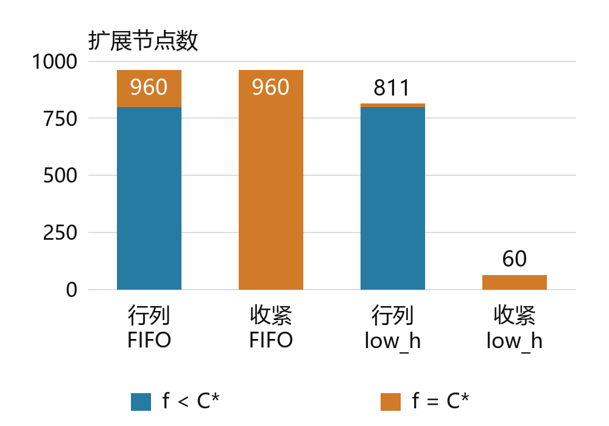
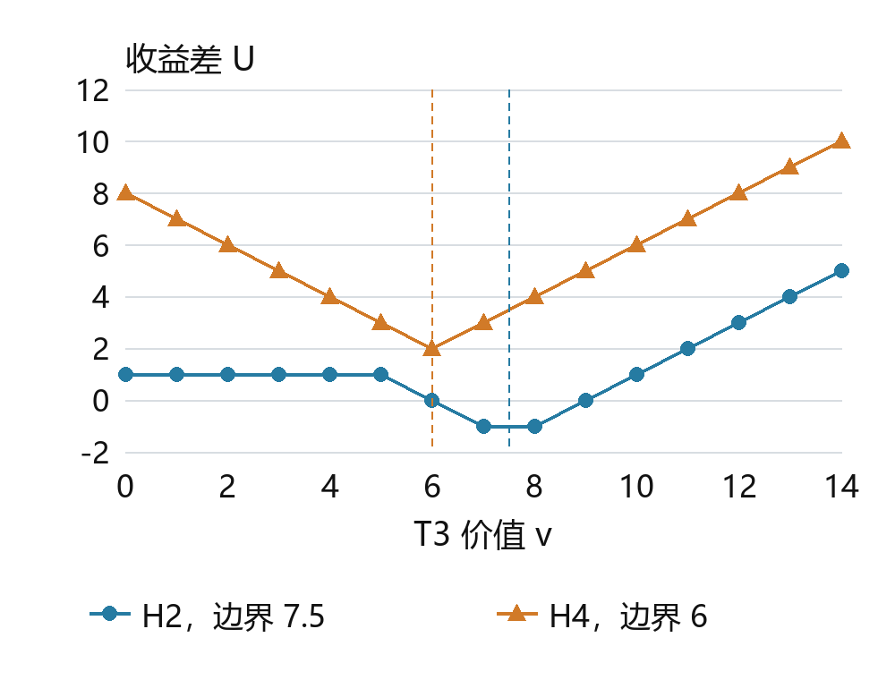

GitHub 仓库　[https://github.com/lingkun-Zhang/contemporary-ai-lab](https://github.com/lingkun-Zhang/contemporary-ai-lab)

# 当代人工智能实验课　实验二 搜索算法

姓名：张凌琨　学号：10241900443

## 实验目标与研究问题

实现A*、Minimax和Alpha-Beta后，我用四个正式样例核对答案。接着比较访问量和总时间，检查同一改动在不同地图和树上是否仍有效。遇到异常结果，我先固定输入和其他设置，再改变一个条件寻找原因。

## 输入输出与实验方法

### 四题输入输出约定

坐标从0开始，按(row,col)书写。题一、二的文本依次为起点、终点和二维列表；题一字符加引号，题二S/E/X可不加。均支持--input与--stdin。

| 题目 | 主要输入内容 | 正式输出 |
|---|---|---|
| 一 | S/E/./X字符矩阵 | 含起终点的路径；无解[] |
| 二 | 非负整数及S/E/X矩阵 | 最小进入费；E免费，无解−1 |
| 三 | JSON树，内部children、叶value；可包tree_structure | MAX根值，逐层交替MAX/MIN |
| 四 | JSON的grid与treasures数组；元素含id、position、value | 样例6×6矩阵及H2/H4首步、U |

题四从地图标记或starts读取A/B，--depth默认比较2/4。四题省略输入时运行内置样例。

### 算法伪代码

g记最小已知到达费，h为剩余费用下界，f=g+h。堆按f取最小项，同分默认FIFO，low_h先取较小h。严格松弛允许改善后重新入堆，过期项出堆时跳过。

```text
算法1 A*(S,E)
g[S]←0; 其余 g←∞; parent←{}
OPEN←{(h(S),S,0)}
while OPEN≠∅:
  (f,u,gu)←pop_min(OPEN)
  if gu≠g[u]: continue
  if u=E: return 回溯(parent,E),gu
  for v in 合法邻格(u):
    a←gu+c(u,v)
    if a<g[v]:
      g[v]←a; parent[v]←u
      push(OPEN,(a+h(v),v,a))
return no_path
```

题一、二无解分别输出[]和−1，题四不可达为∞。题三Actions为孩子序列，Next取孩子并换玩家，忽略d，到叶返回叶值。题四按算法6转移，深度为0或无合法动作时返回U。op在MAX取max，在MIN取min，init分别为−∞与+∞。

```text
算法2 Minimax(s,d)
if Stop(s,d): return Eval(s)
v←init(s)
for a in Actions(s):
  v←op(v,Minimax(Next(s,a),d−1))
return v
```

```text
算法3 Alpha-Beta AB(s,d,α,β)
if Stop(s,d): return Eval(s)
v←init(s)
for a in ordered Actions(s):
  v←op(v,AB(Next(s,a),d−1,α,β))
  if MAX: α←max(α,v)
  else:   β←min(β,v)
  if α≥β: break
return v
```

α是MAX当前可保证的下界，β是MIN当前可保证的上界。α≥β时可跳过余下分支。根窗口为(−∞,+∞)，内部截断可能只返回界。

### 核心搜索复杂度

V、E为顶点数和边数，b为最大分支数，H为搜索深度。辅助空间和时间以搜索核心为口径，输入、验证、排序、轨迹与路径复制另计。

| 算法 | 时间 | 辅助空间 |
|---|---|---|
| A* 二叉堆 | O((V+E) log V) | 一般 O(V+E)，四邻 O(V) |
| Minimax | O(b^H) | DFS 栈 O(H) |
| Alpha-Beta 最坏 | O(b^H) | DFS 栈 O(H) |
| Alpha-Beta 理想 | O(b^⌈H/2⌉) | DFS 栈 O(H) |

A*假定简单图、估价O(1)且一致。每边至多扫描一次，懒删堆保留旧项，四邻E=O(V)。不一致启发若重开，按实际扫描A次、入堆P次计O(A+P log P)。DFS空间只计递归帧。

均匀b叉树在理想子序下读取b^⌈H/2⌉+b^⌊H/2⌋−1个叶，偶数H时为O(b^(H/2))。好候选先收紧窗口，余下分支只需给出足以截断的界。

### 随机生成与控制实验设计

手工反例定位机制，固定种子新图和新树检验适用范围。下表按输入统计，重复计时另计。

| 研究组 | 生成与固定条件 | 对照目的 |
|---|---|---|
| 题一 | 3尺寸×5障碍率×20种子=300记录；p=0为重复基线 | 同图改h/排序；有解无解分层 |
| 题二 | 200个不同地图—端点组合，含随机费用与零权；桶另设12图×7倍率 | 同图免费E；下界/排序/容器消融 |
| 题三 | Scout含18棵新随机树及4组镜像结构；共享度另设组 | 同树同序；计入全部探测重搜 |
| 题四 | 30个固定种子跨图输入；缓存另用4/6/8宝藏各6新输入 | 同深度MM/AB、顺序和缓存控制 |

Windows 11、Python 3.12.14。预热后随机交错计时。桶、Scout、增量缓存均为7块，每块分别测2/3/1次；题四样例和价值扫描7块，跨图排序和延迟查询5块，均每块3次。报告块均值的中位数及IQR。

用BFS/Dijkstra核对路径费用，完整枚举核对博弈。扩展不含目标，博弈访问含根。239项测试通过。

## 题目一 迷宫寻路

### 最短路径怎样得到

题一以当前位置(r,c)为状态，每次上下左右移一格，边代价均为1。曼哈顿距离 h(n)=|r−rE|+|c−cE| 是剩余步数下界：一步最多使行列差的绝对值之和减少1，障碍只可能迫使绕行，不能缩短这个必要距离。相邻格的 h 最多相差1，所以还满足 h(n)≤1+h(n′)，即一致性。

正式样例返回路径为：

```text
(0,0) → (0,1) → (0,2) → (1,2) → (1,3) → (1,4) → (2,4) → (3,4)
```

路径包含8个坐标，对应7次移动。起终点曼哈顿距离也是7，因此该路径达到下界；独立 BFS 同样得到7。沿这条路径，g 从0增到7，h 从7降到0，f 始终为7。

下面在相同输入上比较 h=0、曼哈顿/FIFO、曼哈顿/low_h。h=0使A*退化为一致代价搜索；本题单位费用下与BFS按相同距离层次搜索，但仍使用堆，运行开销不必相同。

| 场景 | 最短步数 | h=0/FIFO扩展 | 曼哈顿/FIFO扩展 | 曼哈顿/low_h扩展 |
|---|---|---|---|---|
| PDF样例 | 7 | 15 | 13 | 7 |
| 开阔40×40 | 78 | 1599 | 1599 | 78 |
| 强制绕路 | 64 | 588 | 527 | 318 |

长墙使曼哈顿20的查询绕行至64步，FIFO仍扩展527格。另测固定无解图，三种设置均遍历起点所在的105格连通区域，启发函数未减少这部分扩展。

### 为什么准确启发仍会搜索很多

开阔40×40图上，曼哈顿已等于真实剩余距离，FIFO仍和h=0一样扩展1599格。我固定地图、端点和h，只把同f排序改成low_h。每格最优g=r+c，h=78−r−c，f恒为78，主键无法区分候选。FIFO沿波前推进，low_h优先取h更小的格子，扩展降至78格。

开阔图换用low_h后，时间中位数从4.52516降至0.37323ms，堆峰值却从40增至77：沿一支深入时，其他候选仍留在堆里。正式样例固定FIFO、仅换启发，扩展15→13，时间差不足0.001ms。

### 地标数量与总运行时间

我用BFS预计算地标距离，以max(曼哈顿, |d(L,n)−d(L,E)|)作下界，由三角不等式保证可采纳。扫描地标数后固定k=0/1/2，重采15块，均计入建表和40次查询。

![图1 建表与40查询总成本。点为15块中位数，竖线为四分位区间[Q1,Q3]](报告图_双栏/图2.png)

长墙k=0/1/2总耗时59.703/19.162/22.629ms。第一个地标使扩展18483→2068，第二个只增加开销，k=1在15块均胜两侧。迷宫k=1与2的配对区间跨0，开阔图扩展相同且不建表最快。复验用原三张图，低点限于所测长墙。

### 走廊压缩是否与地标互补

把度2走廊内部收缩为等长边，查询时接回端点并还原格点路径。宏边保距且不短于端点曼哈顿，h仍一致。建图O(RC+V+E)，另计路径输出。

18图各做1/4/16/64查询。64次时压缩/原版low_h总耗时比中位为迷宫0.155、长廊0.067、随机障碍1.119、开阔1.819。61×61迷宫同模块不开/开压缩为191.964/29.014ms，压缩加地标为25.224ms。迷宫所测4或16次开始回本，开阔至64次仍慢。全部1152查询经BFS核对最短路。

## 题目二 加权地形

### 逐格收费与免费终点

题二最小化费用而非步数。边 u→v 的代价是进入 v 的权值，起点初始 g=0；按题目规定，进入 E 的最后一步收费0。正式样例的一条最优路径及费用如下。

| 次序 | 坐标 | 进入费用 | 累计费用 |
|---|---|---|---|
| 0 | (0,0) | 0 | 0 |
| 1 | (1,0) | 1 | 1 |
| 2 | (2,0) | 1 | 2 |
| 3 | (3,0) | 1 | 3 |
| 4 | (3,1) | 1 | 4 |
| 5 | (3,2) | 1 | 5 |
| 6 | (4,2) | 1 | 6 |
| 7 | (4,3) | 1 | 7 |
| 8 | (4,4) | 0 | 7 |

路径共8步，7次进入普通格各付1，最后免费，总费7。低费绕行可能更便宜，按步数找路无法比较进入费。

### 曼哈顿距离是否仍可采纳

原始曼哈顿距离在本题中不可采纳。若所有进入费都至少1，M=Manhattan可作下界；但本题进入E免费，邻E状态的真实剩余费用为0而M=1，已经高估。

令m为普通可通行格最低进入费，取下界：

h_c(n) = m × max(M(n,E)−1, 0)。

任意路径至少走 M 步，其中最后一次进入免费，其余至少 M−1次收费不低于 m。相邻非终点边上 h_c 至多下降 m，不超过进入费用；进入 E 前 h_c 已为0，因此免费边也满足一致性。如果普通格含0权，m=0，h_c安全退化为零启发。

为检验高估会不会改变答案，我用上排S、1、E和下排0、0、0构造2×3网格。直达收费1，绕下排收费0。原始曼哈顿高估绕行的余费并提前返回1，校正版得到0。这个零权反例补足了PDF正权样例无法检验的情形。

普通费均至少1时，M与max(M−1,0)在非终点只差常数1，样例仍可答对。加入0权后，在29个有解随机输入中，原M错11例，校正启发全部正确。

### 把地形结构加入下界

全局m忽略高费位置。我把到目标所跨行、列的最小进入费加总为h_rc。一步只跨一行或一列，估计的下降不超过实际进入费，因而一致。

行列下界还可以收紧：它重复使用了一次免费终点。目标行和目标列都因含 E 而最小费为0；若当前位置行列都未对齐，路径必须先进入目标行或目标列，再到达二者交点 E。这两次进入不可能都免费，至少一次目的格不是 E，费用至少 m。因此定义收紧版本：

B(n) = h_rc(n) + m × I[r≠r_E 且 c≠c_E]，h_t(n) = max(h_c(n), B(n))。

首次对齐一轴时，进入该行或列原计费为0。该步尚未到E，实际至少付m，能覆盖指示项的下降。进入E前后指示项均为0，所以h_t仍一致，预处理后常数次查表。

我用最优费用为83的31×31高费行列带检验收紧效果。固定low_h时，校正、行列和收紧下界的起点估计为59、82、83，扩展分别为850、811、60。我再换回FIFO，并按f相对最优费用C*的位置拆分节点数，检查这一下降依赖哪些条件。



相同 FIFO 下，row_column 有800个 f<C* 状态和160个 f=C* 状态，总计960；tight没有 f<C* 扩展，却仍有960个 f=C* 扩展，总数不变。换成 low_h 后，前者为800+11=811，后者为0+60=60。更强下界消除了最优边界之前的扩展，也可能把很多状态集中到边界；是否继续访问旁支由同分次序决定。

收益来自下界与排序的共同作用。普通0权使m=0，tight附加项消失；均匀正权图上几个安全下界也可能给出相同节点数。基础同轮高费带corrected/tight为4.443/0.823ms，零权高费带虽少扩展却可能更慢。

### 整数队列与费用单位归一化

一致整数h使d=c(v)+h(v)−h(u)非负。我用D=max d构造D+1个循环桶，桶内沿用同分规则，超过32768槽便回退到堆。归一化以正进入费的gcd换算桶下标，费用账本仍用原单位。

我在12张图上把普通费乘q=1、2、4、8、16、64、256，E保持免费。堆与桶的路径、有效出队次序一致，便可单独观察费用范围的影响。计时含h表、gcd和D扫描，并对照同模块堆及原tight+low_h。

31×31零权随机图取q=256时，槽数1793→8，空扫13568→53。两种桶均扩展836次，耗时14.046→8.907ms，原版为6.090ms。三张零权图的归一化/原桶耗时比中位在q=256时为0.657，在q=1时为1.031。168组配对比较均未快过原版，正式程序沿用原堆。

## 题目三 极大极小博弈树的最佳得分

### 样例回传与实际剪枝

正式JSON中的四个 MAX 子树叶对为(3,5)、(6,9)、(6,9)、(1,2)，完整子树值为5、9、9、2。两个 MIN 分别回传5和2，根 MAX 得到5。题目示意图较简略，输入实现以完整JSON为准；Python示例中的共享对象也保持同一展开博弈值。

左 MIN 的第一个孩子已返回5，因此其后 MAX 的 β=5。该 MAX 读到6后已有 α=6≥β=5，另一个叶9可以跳过，返回6。这里6只说明该子树值至少为6，完整真值仍为9；左 MIN 已经有更好的5，所以不需要知道更大的确切值。

Minimax共访问15次、读取8叶，左到右 Alpha-Beta访问14次、读取7叶。样例只省一个叶，策略准备与搜索时间中位约0.0389/0.0393ms，几乎相当。右 MIN 在最后一个孩子后也可能发生窗口交叉，但没有兄弟可省，因此“界交叉次数”与“有效剪枝次数”分开记录。

### 顺序怎样影响搜索与准备成本

我固定同一棵树和叶值，只改变子节点顺序，观察剪枝发生的位置和省下的访问量。真值优先序和逆序先完整求值，用来查看顺序可能带来的差距，准备时间也计入总成本。下表用分支数4、深度6、种子20261030的树。各方法根值一致。

| 方法 | 搜索访问 | 搜索叶 | 准备真值叶读取 | 策略准备与搜索中位ms |
|---|---|---|---|---|
| Minimax左序 | 5461 | 4096 | 0 | 11.626 |
| Alpha-Beta左序 | 1817 | 1181 | 0 | 4.989 |
| Alpha-Beta右序 | 700 | 451 | 0 | 1.843 |
| Alpha-Beta固定随机 | 1422 | 915 | 0 | 8.539 |
| Alpha-Beta真值优先 | 268 | 127 | 4096 | 7.482 |
| Alpha-Beta真值逆序 | 4720 | 3462 | 4096 | 22.915 |

真值优先把搜索叶数从左序的1181降到127，事前却要读4096叶。计入这部分开销，真值优先总耗时为7.482ms，左序为4.989ms。右序在这棵树上较早形成界。这个对照让我把排序获得的剪枝和产生顺序的代价一起计量。

三分支六层、叶值全为7时，α≥β访问125次、读53叶；严格α>β则为1093/729，与完整Minimax相同。相等已经足以排除后续分支，要求严格超过界会错失节省；两者根值仍正确。

### 缓存必须区分精确值与界

题三每次调用清表，键为节点对象和玩家，偏移u=0。Reuse在精确值、下界达到β或上界不高于α时成立。其余命中沿用原窗口。Bound用入口窗，v≤α₀为上界，v≥β₀为下界，其余为精确。

```text
算法4 TT(s,d,α,β)
if 题四且 Stop(s,d): return Eval(s)
k,u←Key(s,d),Offset(s)
if k in table:
  (z,t)←table[k]; v←z+u
  if Reuse(t,v,α,β): return v
α₀,β₀←α,β
v←AB(s,d,α,β)  # 子递归走 TT
t←Bound(v,α₀,β₀)  # 叶子为 exact
Store(k,v−u,t); return v
```

题三写入保留已有精确值和同类更紧的界。设X=MAX(6,9)，根为MAX(MIN(5,X), MIN(X,8))。第一次搜X在β=5时返回下界6。误作真值会使根返回6，正确结果为8。

固定展开结构与叶值，只改重复引用。强共享访问958→167，耗时4.159→1.524ms，纯树仍访问958次且4.332→9.615ms。另一个容量对照中，64项与不限容量均访问186次。重复子树已被覆盖后，扩容未继续减少访问。

### Scout探测省下的求值与重搜代价

¬t表示换玩家。EVAL精确求值，TEST用严格比较短路，q为真时对应any，为假时对应all。并列值无需重搜。

```text
算法5 Scout EVAL(n,t)
if leaf(n): return value(n)
v←EVAL(first(n),¬t)
op←'>' if t=MAX else '<'
for c in rest(n):
  if TEST(c,¬t,v,op): v←EVAL(c,¬t)
return v
TEST(n,t,v,op)
if leaf(n): return value(n) op v
q←(t=MAX)==(op='>')
for c in children(n):
  if TEST(c,¬t,v,op)=q: return q
return ¬q
```

固定顺序并计全部重搜，首候选最佳的4组Scout/同模块AB耗时比中位0.733。镜像后置改进时为1.980，读叶比2.900。18棵随机树左序仅8棵更快，重搜成本受首候选质量支配。

## 题目四 竞争环境下的宝藏分配（综合题）

### 距离矩阵与博弈状态

A、B和宝藏格进入费均为1。以h=m×Manhattan做A*，计算30个有序点对，对角为0。一般数值端点进入费可不同，程序分别计算正反方向。

| 来源/目标 | A | B | T1 | T2 | T3 | T4 |
|---|---|---|---|---|---|---|
| A | 0 | 12 | 10 | 4 | 8 | 8 |
| B | 12 | 0 | 8 | 8 | 4 | 10 |
| T1 | 10 | 8 | 0 | 6 | 6 | 12 |
| T2 | 4 | 8 | 6 | 0 | 6 | 6 |
| T3 | 8 | 4 | 6 | 6 | 0 | 6 |
| T4 | 8 | 10 | 12 | 6 | 6 | 0 |

完整矩阵中，曼哈顿/零启发扩展329/650次，耗时2.569/3.863ms，费用一致。N个宝藏需O(N²)次A*。只存距离占O(N²)，保留各对格点路径最坏占O(N²V)。

s=(pA,pB,M,SA,SB,t)，M是剩余宝藏，t是行动方。每步只取所选宝藏，已取格仍可通行，对手不挡路。负收益也可选。

```text
算法6 宝藏状态转移
s₀←(A₀,B₀,all,0,0,A)
Actions(s)←[i in M if D[p[t],Ti]<∞]
Next(s,i):
  s'←copy(s); z←Vi−D[p[t],Ti]
  p'[t]←Ti; S'[t]←S[t]+z
  M'←M\{i}; t'←other(t)
  return s'
```

深度减1后递归，d=0、M为空或无可达动作时返回U=SA−SB。严格改善时用当前动作接上子续走，根部返回首步和U。N个宝藏均可达时，第k层有N!/(N−k)!个节点，全深求和为O(N!)，样例访问65次、24叶。实现每个内部节点扫描N位候选，标签序核心时间粗界O(N·N!)。

### H2与H4为什么首步不同

两算法同深度根值一致。H2的Minimax访问17次，Alpha-Beta标签/逆/Gain序分别13/16/11次；H4为65次和47/46/37次。Gain序提前收紧界，却要支付排序成本；默认仍按标签访问。

为查清深度为何改变首步，我依次固定A的每个选择，再求该深度的最优续走。表中的每个分支另用完整求值核对，包含原搜索中被剪掉的分支。

| H | T1 | T2 | T3 | T4 | 最优首步 | 最优U |
|---|---|---|---|---|---|---|
| 1 | −1 | 2 | −1 | −1 | T2 | 2 |
| 2 | −4 | −1 | −2 | −4 | T2 | −1 |
| 3 | −4 | 2 | −1 | −4 | T2 | 2 |
| 4 | −5 | 1 | 3 | −7 | T3 | 3 |

H2先取T2，A即时收益6−4=2，B随后取T3，收益7−4=3，U为−1。H4的一条最优延续为T3→T1→T2→T4，收益按各玩家更新后的位置累计：

| 回合 | 玩家 | 移动 | 价值 | 路费 | 当次Gain | 累计U |
|---|---|---|---|---|---|---|
| 1 | A | A→T3 | 7 | 8 | −1 | −1 |
| 2 | B | B→T1 | 9 | 8 | 1 | −2 |
| 3 | A | T3→T2 | 6 | 6 | 0 | −2 |
| 4 | B | T1→T4 | 7 | 12 | −5 | 3 |

沿这条续走，A得−1，B得−4，U为3。B最后仍须执行亏5的动作。

H2只计双方第一次行动，未计第二次移动及剩余宝藏竞争；H4覆盖全部四回合，因此首取T3虽即时亏1，最终相对收益更好。H2的−1与H4的3处在不同截断时点，不能直接把差4称为首步策略提高4。统一用H4完整续走评价：浅层首选T2的分支值为1，最优T3为3，固定该首步造成的完整后悔值为2。

### 宝藏价值的两个决策边界

样例v=7时两种深度选了不同首步。我固定地图及其他价值，只把T3价值v从0扫到14。H2首取T2、T3的分支值分别为2−max(1,v−4,−3)和v−9，在7.5相交。H4四分支为2−v、8−v、v−4、−v，最优U=max(8−v,v−4)，T2/T3在v=6相交。正式v=7正好位于两处交点之间。



交点再用两种算法、三种顺序核验。H4在v=6时两首步同为2，H2在v=7.5时同为−1.5。顺序改变并列首步的选择，最优值相同。

### 跨地图检验排序与浅层决策

另外生成开放加权、单缺口墙和随机障碍各10图，只按连通与命名点互异等结构接收，不按性能筛选。全部距离对照Dijkstra，H1至H4、两算法、三顺序对照完整枚举。

H4标签序AB在30图均少于Minimax访问，时间却仅24图更短。Gain相对标签序22图少访问、3图相同、5图更多，时间19图快、11图慢。以同图H4完整续走评价浅层首步，标签序H1/H2/H3/H4命中最优为19/19/23/30图；后悔值中位虽均0，H2最大损失达32。

加深未必逐级改善。例如open_weighted_s202611104的H2/H3/H4完整后悔值为1/6/0；H3截于A第二次行动，未计B最后取宝，当前U更乐观。全部30图有2图出现H2到H3变差。

### 收益增量缓存何时有效

后续动作与已有分数无关，因此F_d(s)=U+V_d(pA,pB,M,t)。深度0时增量V₀=0。A对Gain+子增量取最大，B对子增量−Gain取最小，所以相同后续局面的增量相同。六宝藏两条历史的当前U为7/3，终值10/6，增量均为3。

算法4的键为(pA,pB,M,t,d)，偏移u=U。只存非终止态的v−U和续走。命中时加回当前U，并取回续走。Minimax存精确值，Alpha-Beta按入口窗分类。

双方位置各至多N+1种，固定根与H时，M决定轮次和剩余深度，故K=O(N²2^N)。每键只算一次的精确值记忆化需O(NK)时间和O(K)值空间。实存长度至H的续走，表空间O(HK)。界不足以截断时仍要重搜，候选排序与距离预计算另计。

四/六/八宝藏的非终止历史与结构状态为41/41、1237/457、69281/3537。每规模6个新输入。八宝藏增量AB/原AB的完整耗时比中位为标签序0.557、Gain序0.750，均6/6图更快。四宝藏无命中，六宝藏未稳定回本。H4标签序AB只计博弈搜索时，延迟查询在31图均少查；对同统计内核20图更快，对原版仅3图更快。完整任务还需计入建矩阵。

## 结论与适用范围

题一的开阔图主要受同f排序影响，地标和走廊压缩要靠重复查询摊销准备成本。正式小样例固定FIFO，曼哈顿较h=0少扩展2格，时间差不足0.001ms。

题二先处理免费E，再结合收紧下界与同分顺序。整数桶缩小后仍慢于原堆。堆清理使峰值1192→386，固定ρ重测15块仅2块更快，配对耗时差中位数为+3.769ms，故保留原实现。

题三的好子序可以提早截断。真值排序的预读和Scout重搜都占时间，采样q=8换30棵新树后有29棵更慢。共享较多时置换表更合算，容量覆盖常见子树后，继续增大也不再节省访问。

题四用同一H4终局比较首步。增量表在八宝藏组两种顺序均改善完整耗时，四宝藏没有重复命中。各规模用了不同地图，因此收益还取决于局面如何重复。我用最优值核对、整次调用的配对时间和新输入复验决定是否采用改动。
