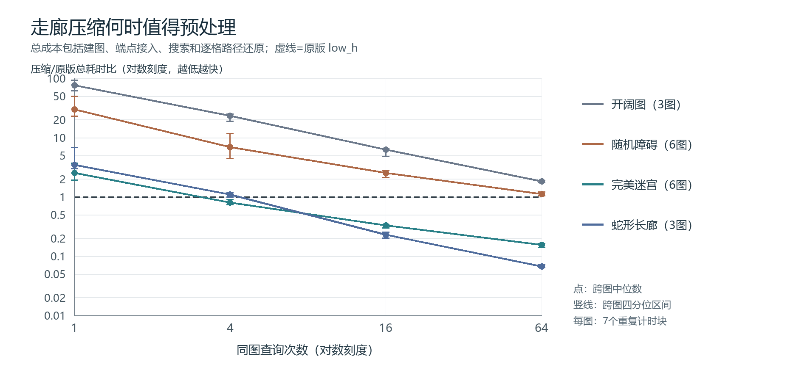

# 题一补充实验：精确走廊收缩及预处理回本条件

## 1. 想解决什么问题

之前的地标实验主要改进启发函数，但即使启发值较准确，A*仍可能把一条没有岔路的长走廊逐格加入堆。这里继续研究另一个问题：**在保持最短路径和逐格输出的前提下，能否先把没有决策分支的走廊缩成带长度的边？建图成本需要多少次查询才能摊回？**

这个问题不能只看搜索展开数。压缩需要扫描地图、记录走廊和处理查询端点，最后还要还原所有路径格子。因此实验同时比较单次和多次查询，完整成本作为主要指标，并保留开阔图、随机障碍图中的失败结果。

主要参考Harabor与Botea的[《Breaking Path Symmetries on 4-connected Grid Maps》](https://harabor.net/data/papers/harabor-botea-aiide10.pdf)（AIIDE 2010）。它在四邻接网格上删除部分节点，用有实际代价的宏边保持精确路径，并讨论被删除的查询端点如何接回。这里借鉴保距宏边的思路，实现度2走廊收缩，并检验任意端点接入与包含建图的总耗时；未实现该论文的矩形分解，因而不属于完整RSR或Contraction Hierarchies。

## 2. 实现与正确性

### 2.1 建图和任意端点接入

把每个可通行格看作顶点，四邻接可通行格之间连单位权无向边。保留度不为2的顶点，包括孤立点、走廊端点和分岔。两个保留点之间，由内部度2节点组成的极大链压成一条宏边，权重等于原链步数；弯折的走廊同样可以收缩。每条宏边保存原坐标序列，因而可以恢复逐格路径。

实现还处理了几个容易漏掉的情况：

- 全部顶点度都为2的连通分量是一条纯环，额外保留一个锚点；环不被误判为空图。
- 同一对锚点之间可能有多条走廊，分别保存；也保留自环，不按端点坐标覆盖边。
- 起终点从全部可通行格中选取。若端点落在被删除的内部格，用该格的走廊编号和偏移建立临时切分边；同一条走廊内的两个端点一起排序切分，避免只经两端锚点绕远。
- 查询只建立少量覆盖边，不复制整个索引，不缓存上一次查询答案，也不按连通分量提前拒绝无解查询。

### 2.2 为什么最短距离不变

单位正权图中的最短路径可以取为简单路径。进入一个非查询端点的内部度2节点后，一条简单路径不能立即原路返回，因此只能继续走向另一邻居。这样，路径经过一条走廊时，内部段可以整体替换为对应宏边，长度保持不变。

反过来，宏图中的每条边都有原网格坐标序列，展开后得到同代价的合法原图行走。因此原图路径可以映射到同长宏图路径，宏图路径也可展开到同长原图行走，两边最短距离相等。在线插入查询端点后，这个对应关系仍成立；纯环的锚点、平行宏边和自环都保留下来，避免破坏可达性。起终点相同则返回代价0的单点路径，无解返回空路径和-1。

### 2.3 Manhattan启发函数仍一致

设宏边连接u、v，其权重为走廊实际步数w。由Manhattan距离的三角不等式，

`h(u) ≤ Manhattan(u,v) + h(v) ≤ w + h(v)`。

故Manhattan在宏图上仍是可采纳且一致的下界。与地标结合时，原网格中的三角不等式下界也沿每条走廊成立；取它与Manhattan的最大值仍保持一致。地标仍从原图建表，地标未覆盖相关分量时跳过该项，不读取查询答案。

### 2.4 时间和空间的界限

令R、C为地图行列数，V、E为原图可通行顶点和边数，V′、E′为压缩图规模，ℓ为输出路径步数。建图检查地图、枚举原边并寻找走廊，时间为`O(RC+V+E)`；每个顶点最多四个邻居，邻接排序不改变这个界。

内部端点最多两个，临时切分的边数有常数上界。在本实验的一致启发函数及惰性堆实现下，一次查询的最坏时间可写为`O((V′+E′)log(V′+E′+1)+ℓ)`，其中ℓ不能省去。索引保留网格快照和原走廊序列，存储仍为`O(RC+V+E)`，并没有因为宏图顶点少就变成只占`O(V′)`。地图改变后应重建索引；本次不讨论动态地图和不同地形权重。

## 3. 实验设置与统计口径

正式运行前写入[protocol.json](results/corridor_study/protocol.json)，固定种子20261110、地图、端点、比较对象、查询数和计时规则，之后才开始预热、独立BFS核验与计时。

共有18张互不重复的地图：41×41、61×61、81×81三个尺度；每个尺度各有1张开阔图、1张蛇形长廊、2张独立种子DFS完美迷宫、2张障碍概率0.25的独立种子随机图。开阔图和蛇形图是在不同尺度上的确定性结构，不把它们说成多次随机生成的重复地图。独立比较单位是地图，7个计时块属于同图重复测量。

每图从所有可通行格采样64组不同的有序端点对，**不按是否可达筛选**。查询数1、4、16、64使用同一组64查询的前缀。总计1152组不同的地图—端点问题，其中1144组有解，8组无解，后者全部来自随机障碍图。

| 实现名 | 搜索图与启发函数 | 用途 |
|---|---|---|
| `grid_fifo` | 原网格，Manhattan，FIFO | 原基础对照 |
| `grid_low_h` | 原网格，Manhattan，同f优先较小h | 主要实际对照 |
| `bfs` | 原网格，普通队列BFS | 单位权图的实用对照 |
| `landmark_low_h` | 原网格，1个地标结合Manhattan，low_h | 已有较强方法 |
| `identity_low_h` | 同一宏图搜索内核，保留全部网格顶点，Manhattan | 控制新索引和内核开销 |
| `identity_landmark` | identity图，1个地标，low_h | 同内核地标对照 |
| `corridor_zero` | 压缩图，h=0，FIFO | 观察不使用启发信息的情况 |
| `corridor_fifo` | 压缩图，Manhattan，FIFO | 观察同f排序影响 |
| `corridor_low_h` | 压缩图，Manhattan，low_h | 走廊压缩方法 |
| `corridor_landmark` | 压缩图，1个地标，low_h | 检验图收缩与下界增强能否叠加 |

`identity_low_h / identity_landmark / corridor_low_h / corridor_landmark`构成同一搜索内核上的“是否压缩×是否使用地标”2×2对照。identity图按照正式网格的右、下、左、上顺序排列边；宏边按首步方向排序。在线切分仍可能改变边的生成顺序，因此不要求压缩前后搜索轨迹完全相同。

每张图、每种实现先预热一次完整64查询批次，丢弃预热耗时；正式执行7个块。每块随机打乱地图—查询数任务顺序，再打乱各实现顺序，全部串行运行，使用解释器默认垃圾回收。运行环境为Windows 11、Python 3.12.14；结果是本机测量，不直接外推到其他机器。

每个计时批次独立完成“建索引或地标表→端点接入→全部查询搜索→生成所有逐格路径”，其总时间为主要成本。分项时间只辅助解释；各项分别取中位数后不必严格相加等于总时间中位数。oracle、路径检查、写文件和画图放在计时范围外。独立BFS提供最短代价，同时逐个检查路径端点、坐标边界、障碍、相邻步以及路径长度。11520个预热结果、107100个正式结果全部通过；后者来自5040个计时批次，不是107100个独立问题。

对每张图先汇总7块耗时。耗时比定义为“候选时间中位数/对照时间中位数”，再取同类地图的中位数；小于1表示候选较快。快图数则按每图7个**配对总时间差**的中位数小于0来计数。这两个统计量定义不同，少数接近平台的比较可能方向不同。IQR表示相应重复块或地图之间的四分位范围，不作置信区间解释。

## 4. 61×61固定代表图

代表表按统一规则展示61×61、编号0的地图，未逐类挑选耗时最好的一张；两个迷宫副本、两个随机图副本及其他尺度均保留在原始表中。以下完整时间均为64查询、7块的总时间中位数，单位ms。

| 结构 | 原顶点→保留顶点 | 度2格占比 | 原网格low_h | BFS | 地标low_h | 压缩low_h | 压缩＋地标 |
|---|---:|---:|---:|---:|---:|---:|---:|
| 开阔图 | 3721→3717 | 0.11% | 28.115 | 226.664 | 37.360 | 51.134 | 62.152 |
| 蛇形长廊 | 1799→2 | 99.89% | 168.150 | 122.341 | 144.783 | 10.535 | 14.090 |
| 完美迷宫 | 1799→192 | 89.33% | 163.851 | 120.863 | 117.906 | 29.014 | 25.224 |
| 随机障碍 | 2820→2178 | 22.77% | 45.347 | 166.832 | 51.309 | 52.857 | 55.381 |

长廊中，大多数内部格没有路线选择，压缩后几乎只需处理查询端点和两端锚点。迷宫仍有分岔，但大量弯曲长链能整体跨过。开阔图中的内部格度通常为4，只有四个角为度2，方法几乎没有可收缩对象；随机图可收缩约23%的顶点，收益明显较小。这说明决定效果的是图的分岔和走廊结构，不能只用地图大小判断是否值得压缩。

同内核的61×61迷宫对照如下。展开数为64查询的累计值；identity统计逐格状态，压缩图统计宏图顶点，两者不是等价的格子检查次数。

| 同一内核设置 | 完整时间/ms | 展开状态数 |
|---|---:|---:|
| 保留全部节点＋Manhattan | 191.964 | 54354 |
| 保留全部节点＋地标 | 135.505 | 29606 |
| 压缩＋Manhattan | 29.014 | 5569 |
| 压缩＋地标 | 25.224 | 2281 |

压缩＋Manhattan相对identity的配对差中位数为-167.415ms，重复块IQR为[-197.182，-148.921]ms，7/7块更快，说明本例收益不是仅由换搜索内核造成。地标还能减少压缩后的搜索状态；不过本例“压缩＋地标−仅压缩”的配对差中位数为-1.766ms，IQR为[-5.575，0.076]ms，5/7块更快，时间优势没有展开数差距那样稳定，不能把两个方法的收益简单相乘。

压缩图内的排序也没有固定赢家：同一迷宫中`corridor_fifo`为27.820ms，略快于`corridor_low_h`的29.014ms；开阔图则分别为174.872ms、51.134ms。图收缩不能替代对启发函数和同f排序的分析。

## 5. 全部地图与查询次数

### 5.1 64次查询时是否真的回本

下表使用每类全部地图；耗时比按前述地图层级汇总，快图数按配对差判定。

| 地图类 | 图数 | 压缩/原网格low_h时间比 | 压缩较快图数 | 压缩/identity时间比 | 压缩较快图数 |
|---|---:|---:|---:|---:|---:|
| 开阔 | 3 | 1.819 | 0/3 | 1.031 | 0/3 |
| 蛇形 | 3 | 0.067 | 3/3 | 0.057 | 3/3 |
| 迷宫 | 6 | 0.155 | 6/6 | 0.142 | 6/6 |
| 随机障碍 | 6 | 1.119 | 1/6 | 0.866 | 6/6 |

随机图上，压缩相对同一内核的identity图确实省时，但大多数地图仍不足以抵消建图成本，完整任务不如原网格low_h。开阔图的宏图规模几乎不变，64查询时仍全部慢于原网格。结果保留全部地图，并按地图类型分别汇总。

加入已有地标后的比较也符合这个边界：

| 地图类 | 压缩＋地标/原网格地标时间比 | 前者较快图数 | 压缩＋地标/identity＋地标时间比 | 前者较快图数 |
|---|---:|---:|---:|---:|
| 开阔 | 1.664 | 0/3 | 1.031 | 2/3 |
| 蛇形 | 0.097 | 3/3 | 0.086 | 3/3 |
| 迷宫 | 0.198 | 6/6 | 0.179 | 6/6 |
| 随机障碍 | 1.065 | 1/6 | 0.873 | 6/6 |

开阔图最后一组的“中位耗时比略大于1”和“2/3图配对差略小于0”并非同一个统计量，不能据此认定可靠收益。相比之下，长廊和迷宫的差距较大、方向一致。压缩图中再加地标，迷宫6/6图的配对中位时间下降；蛇形图0/3下降，原因是图已经很小，额外地标表的成本不易摊回。随机图仅3/6下降，没有普遍叠加收益。

### 5.2 首次观察到回本的位置



图中的点是跨图中位耗时比，竖线是跨图IQR；每张图内部先汇总7个块。横轴仅测试1、4、16、64四个查询数，虚线1表示与原网格low_h持平。曲线展示的是预处理摊销，并不要求存在先升后降的性能极值。

| 地图类 | 1次比值 | 4次比值 | 16次比值 | 64次比值 | 各图首次在已测点更快 |
|---|---:|---:|---:|---:|---|
| 开阔 | 75.989 | 23.238 | 6.229 | 1.819 | 3图均未观察到 |
| 蛇形 | 3.436 | 1.093 | 0.231 | 0.067 | 1图为4次，2图为16次 |
| 迷宫 | 2.517 | 0.801 | 0.330 | 0.155 | 5图为4次，1图为16次 |
| 随机障碍 | 30.023 | 6.954 | 2.540 | 1.119 | 1图为64次，5图未观察到 |

所有地图在1次查询时，压缩相对原网格low_h的配对总时间差中位数都不占优。长廊与迷宫在4～16次这些已测点开始表现出收益。这个范围是本工作负载的观测结果，不能写成任意地图的精确回本阈值；查询前缀增加时也加入了不同难度的端点问题，并未证明耗时比严格单调。结果文件中`>64`只表示四个已测点均未观察到回本，不能据此断言继续增加次数一定会回本。

### 5.3 单列无解查询

随机图384组端点中376组有解、8组无解；无解分布为`random_41_0`两组、`random_41_1`两组、`random_81_0`四组。其他类别全部有解。以下展开数来自非计时的逐查询记录，按有解/无解分别累计：

| 随机图查询 | 问题数 | 原网格low_h | identity low_h | 压缩low_h | 原网格地标 | 压缩＋地标 |
|---|---:|---:|---:|---:|---:|---:|
| 有解 | 376 | 60721 | 60721 | 48456 | 54140 | 43394 |
| 无解 | 8 | 9779 | 9779 | 7601 | 9779 | 7601 |

无解时仍要穷尽起点可达的搜索区域；宏图展开状态少，不代表已经找到路径。正式计时以完整批次保存，没有重跑拆分计时，所以随机图时间表包含有解和无解的混合成本，不能称为“仅成功查询耗时”。

## 6. 可以得到什么结论

这次补充支持了一个有条件的结论：**静态地图上，如果大量度2格构成较长走廊，且同图有多次查询，把走廊收缩成精确宏边可以减少搜索状态，并在计入预处理和完整路径输出后获得收益。**这种结构在本实验的蛇形长廊和DFS迷宫中较明显，三个尺度都观察到了完整成本收益。没有走廊的开阔图，以及短分支较多的随机图，大多不值得为此额外建图。

还需要区分两部分收益。原网格API在每次查询时检查整张输入地图，而静态索引只在构建时检查一次。因此相对原网格的多查询时间差，同时含有验证摊销和搜索结构变化；同内核identity对照才更直接反映收缩带来的增益。在迷宫与长廊上，压缩明显优于identity；随机图也有同内核收益，却大多没有实际端到端收益。这个区别比只报告一个加速倍数更能说明方法何时适用。

这些数据没有证明能根据单一度2比例自动选出最佳算法。不同图的路径长度、走廊分布和查询难度也在变化；本次没有额外拟合选择阈值，也没有在计时后挑选地图。保留原A*作为正式入口，走廊索引作为静态多查询的独立扩展使用。

## 7. 复现和结果索引

在题一目录执行：

```text
python -B -m unittest test_corridor_astar
python -B run_corridor_study.py --seed 20261110 --repeats 7
python -B summarize_corridor_study.py --data results/corridor_study
```

结果目录已存在时，运行脚本会建立新的`rerun_时间戳`子目录，保存原有记录。复现计时允许因机器负载而变化，正确路径代价和固定地图结构应保持一致。原代码、实验算法和协议的SHA记录在manifest中，文档使用的所有地图均未删除或替换。

- [corridor_astar.py](corridor_astar.py)：索引、端点接入、宏图A*和路径展开。
- [run_corridor_study.py](run_corridor_study.py)：预先写协议、独立BFS检查和串行实验。
- [summarize_corridor_study.py](summarize_corridor_study.py)：仅用标准库复算跨图统计并生成[矢量曲线图](results/corridor_study/corridor_cost_curve.svg)。重跑实验另存后，将`--data`指向对应子目录；PNG为同数据的阅读副本。
- [protocol.json](results/corridor_study/protocol.json)、[manifest.json](results/corridor_study/manifest.json)：设计、环境、完整计数和校验摘要。
- [structures.csv](results/corridor_study/structures.csv)：原图/宏图规模、内部端点和同走廊查询数量。
- [query_stats.csv](results/corridor_study/query_stats.csv)：每查询的最短代价、展开和堆统计。
- [timings_raw.csv](results/corridor_study/timings_raw.csv)、[timing_summary.csv](results/corridor_study/timing_summary.csv)、[paired_deltas.csv](results/corridor_study/paired_deltas.csv)：全部计时块、分项汇总和配对差。
- [analysis.json](results/corridor_study/analysis.json)：代表图、全类别时间比和首次已测回本点的派生汇总。

本说明独立复算了原始计时到中位数、配对差的统计，核对manifest所列结果文件SHA，未发现记录不一致。图表只汇总保存数据，不改写原始耗时。本文件是补充实验说明，正文报告仍应遵守五页上限。
