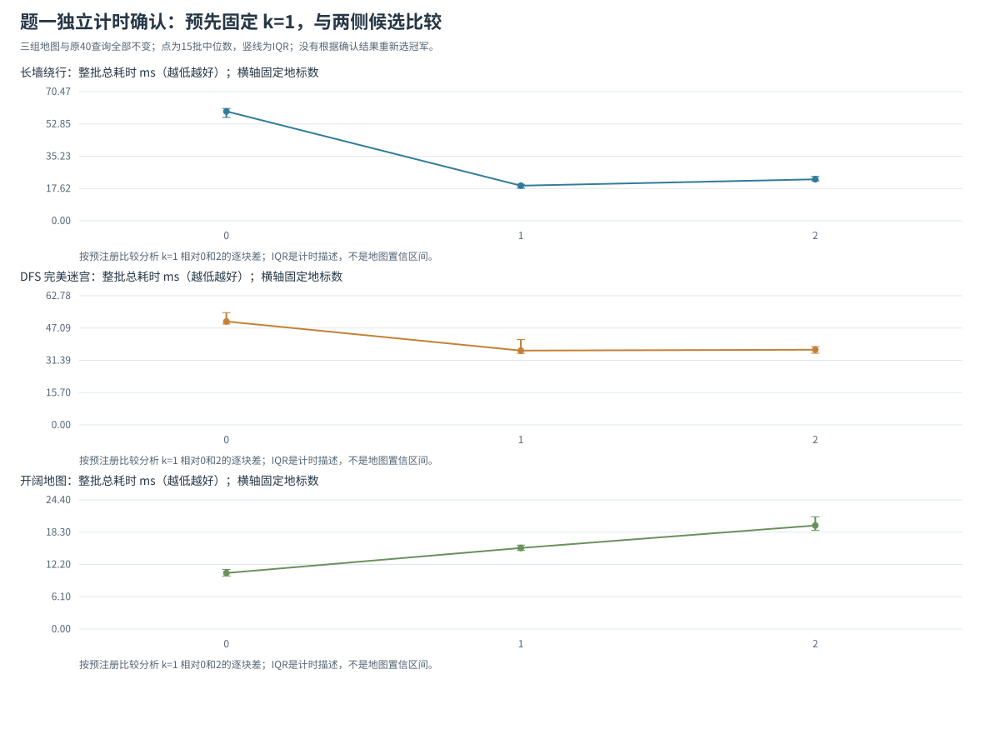

# 题一：固定候选的独立计时确认

## 1. 研究问题与预先固定的比较

前一轮地标数量调参用于提出候选：长墙的k=1处在成本低点，完美迷宫的k=1—2接近，开阔图不建地标更快。确认实验用新的计时块检查这些观察，关注参数仍为k=1。

候选固定为k=0、1、2，关注参数固定为k=1，主比较固定为同重复块的 `T1−T0` 与 `T1−T2`。不根据本组确认结果更换冠军或剔除不利输入。默认15个重复块、种子20261030；种子只改变候选的计时先后顺序。

## 2. 输入和协议

长墙、完美迷宫、开阔图及其各自40对查询，全部直接读取前轮 `results/landmark_tuning/reproducibility.json`，包括开阔图也不重新抽样。地标构建规则、查询次序、邻居顺序、low_h策略与费用目标相同。

程序在首个预热或测量求解器调用前，独占创建 `protocol.json`，保存候选、固定比较、描述性判据、重复数、种子、输入地图和全部查询，以及来源文件与源码哈希。最终元数据记录协议SHA256，采集结束还核对协议未变。

## 3. 计时与核验

每个配置先预热一整批；每次正式测量均独立建立k张地标表，再完整执行相同40次查询，直接计时从建表开始到全部路径返回。k=0不建表。完整调用包含验证、建表、启发计算、堆搜索和路径回溯；参考BFS、返回路径核验、绘图和写文件在计时外。

BFS在本组重新计算，不只相信前轮保存的距离。每批的所有查询检查最短费用、首尾、四方向连续性与障碍通行；每个k的路径和搜索计数在重复之间保持相同，独立建表的选点须符合原固定前缀。

总耗时报告中位数、Q1/Q3、IQR、最小和最大值。主比较先在每个重复块相减，随后汇总配对差，不能用两个边际中位数之差替代。负差偏向固定候选k=1；两组配对差的Q3均低于0可描述本工作负载中较一致的局部低点证据。IQR跨0、候选失利或排名改变均保留。

这些是固定三张地图上的新计时块，不是新的独立地图或全局参数验证。IQR是机器计时波动的描述，不是置信区间或显著性检验；本组不重新选冠军。

## 4. 复现与文件

```powershell
.\run_q1.cmd confirmation
```

已配置Python的环境可运行：

```powershell
python run_landmark_confirmation.py --repeats 15 --seed 20261030
```

默认首跑结果写入 `results/landmark_confirmation/`。若该目录已经有结果，复跑自动另建带时间戳的 `rerun_...` 子目录，避免覆盖既有协议和确认数据；也可用 `--output-dir` 明确另存位置。

| 文件 | 用途 |
|---|---|
| protocol.json | 预热前写定的候选、比较、输入和判据 |
| batch_raw.csv、candidate_summary.csv | 新整批原始值、固定候选的描述性汇总，不重选最佳k |
| fixed_pairs.csv | 预先固定k1对0、2的逐块差、中位数、IQR与方向次数 |
| query_details.csv | 每个地图—查询—k配置的路径、费用与计数 |
| confirmation_flags.csv | 预先定义的局部低点/重叠描述标志，不是显著性判断 |
| confirmation_total.svg | 新计时块的总成本与IQR |
| outcomes.json、reproducibility.json | 最短性核验、协议哈希、来源、环境与顺序 |

下节给出预先固定k=1后得到的新计时结果；方法与样例另见 [REPORT.md](REPORT.md)。

## 5. 最终确认结果与直接结论

本组135个整批、5400次计时查询执行完成；360个不同的地图—查询—k配置逐项核验独立BFS最短步数与合法路径，路径及搜索计数跨重复不变。三组地图和各40查询与发现阶段完全相同，协议在第一预热前写定且结束后SHA仍一致，关注参数始终为k=1。

| 工作负载 | k=0中位数 [Q1,Q3] ms | k=1中位数 [Q1,Q3] ms | k=2中位数 [Q1,Q3] ms |
|---|---|---|---|
| 长墙 | 59.703 [56.379,61.274] | 19.162 [17.768,19.896] | 22.629 [21.789,24.209] |
| 完美迷宫 | 50.279 [49.055,54.596] | 36.131 [34.771,41.520] | 36.552 [34.822,38.081] |
| 开阔图 | 10.587 [10.017,11.253] | 15.316 [14.845,15.861] | 19.570 [18.637,21.221] |



| 工作负载 | 预定差值 | 配对差中位数 [Q1,Q3] ms | k=1更快/更慢批数 |
|---|---|---|---|
| 长墙 | T1−T0 | -40.366 [-42.641,-38.272] | 15/0 |
| 长墙 | T1−T2 | -3.235 [-5.520,-2.657] | 15/0 |
| 完美迷宫 | T1−T0 | -14.147 [-17.961,-12.127] | 15/0 |
| 完美迷宫 | T1−T2 | 0.084 [-1.753,2.374] | 7/8 |
| 开阔图 | T1−T0 | 4.634 [3.690,5.109] | 0/15 |
| 开阔图 | T1−T2 | -5.174 [-5.533,-3.153] | 15/0 |

长墙的k=1在全部15个重复块中都快于k=0和k=2，两组配对差的Q3均低于0。按预先保存的描述性判据，原局部低点在该固定工作负载的新计时中保留。发现阶段的第一张表已把扩展总数从18483降到2068，增加第二张表不再减少扩展；新数据继续支持少量地标的收益与额外建表/查表开销之间存在低点。

完美迷宫的T1−T2中位数为+0.084ms，IQR跨0，k=1只有7/15批快于k=2；虽然边际总时间中位数仍以k=1略低，也不能据此称其稳定优于k=2。应继续保留k=1—2近似平台和排名波动的结论，不更换本组预定关注参数。

开阔图中k=1在15个块里均慢于k=0、快于k=2，体现单纯增加索引成本的负对照；这组负对照显示，地标数增加并不总能形成内部性能低点。

这些数据确认的是同一机器、相同固定工作负载上的新计时观察。它们不证明k=1适用于任意迷宫，也不是用15张独立地图作显著性检验。发现批与确认批分别保存，不把两轮时间拼接或只选较有利的一轮。
