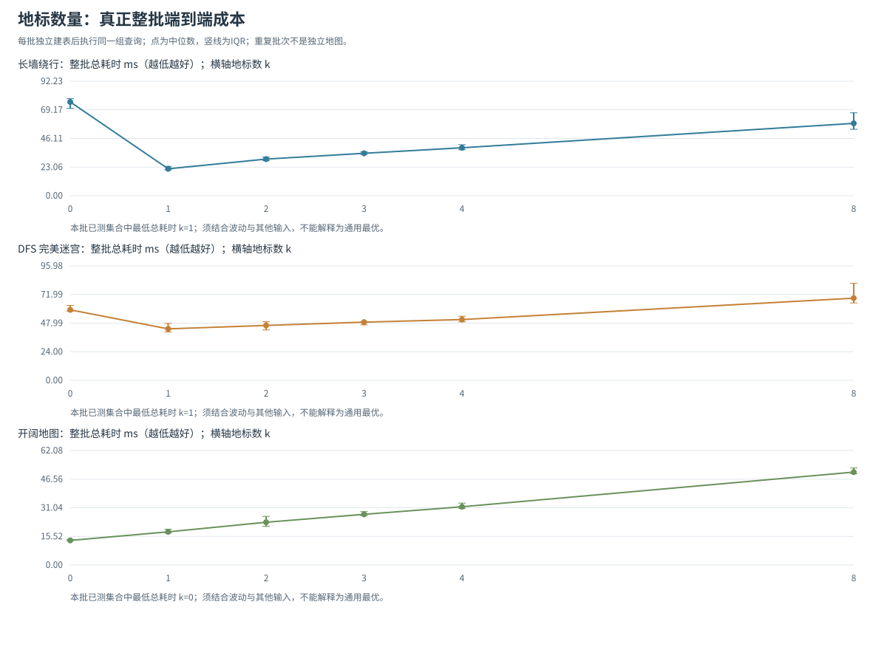

# 题一补充：地标数量的整批调参与局部选择

后续已用预先固定参数的新计时块作[独立计时确认](LANDMARK_CONFIRMATION.md)。本页属于调参发现阶段；最终结论应同时阅读确认结果，不能只选择较有利的一轮。

## 1. 问题与假设

旧拓展中，固定 40 次查询的成本按“一次建表实测值＋逐查询耗时中位数之和”估计。在长墙和完美迷宫上，k=0、1、2、4 已呈现 k=1 附近成本下降后回升。它提示少量地标可能已经提供足够下界，继续增加地标则增加建表与每节点查表开销。

本补充直接计时“独立建表＋全部查询”的整批墙钟区间，检查这个参数低点在重复测量下是否保留。它不以必须得到某种曲线形状为前提，也不把原分量估计与新整批毫秒值混为同一轮数据。

## 2. 控制变量与输入来源

- 地标候选为 k=0、1、2、3、4、8；k=0 使用正式曼哈顿基线，不建索引。其他 k 均按原确定性规则建立各自的 k 张地标表，取相同最大地标集合的前缀，未根据查询挑选地标。
- 长墙和完美迷宫的地图、40 对有序查询精确复用 `results/exploration/reproducibility.json`。旧输入已经排除原先四个地标作端点，新增第 5—8 个地标偶然与旧端点相同则只记录，不删除查询或重新抽样。
- 开阔 51×51 图作为独立新增负对照；在同一通行分量抽取固定 40 对查询，并排除最高 k 地标作为端点。该组用于观察没有障碍信息收益时，预处理与查表是否只有额外成本。
- 三图中每个 k 和每个重复批次使用完全相同的查询次序、地图、邻居顺序和 `low_h` 并列规则。最高 k 的审查索引只在计时外用于记录选点和输入来源，绝不复用于正式计时。

保存的 `query_source` 明确区分原工作负载复测与新增负对照。查询坐标、原最优距离、最大地标列表和新增地标命中端点次数均随结果保存。

## 3. 真正整批计时与核验

每个配置先执行一整批预热，再进行 9 个测量批次。每个重复块以固定种子打乱 k 的先后顺序，降低固定顺序与环境漂移之间的关联；垃圾回收保持解释器默认。

每一批的总计时从独立 `build_landmark_index(grid,k)` 之前开始，直到最后一个 A* 查询完成并返回路径后结束。k=0 跳过建表。整段包含地图验证、确定性地标选择、BFS 建表、启发函数构造、每次完整 A* 及路径回溯。预处理另有嵌套阶段计时，但整批总值直接实测，不用若干查询中位数相加替代。

独立参考 BFS、返回路径核验、保存文件和绘图均在整批区间外。每批所有查询都核对最短步数、首尾、四方向相邻性和障碍通行性；同 k 不同批的路径与搜索计数还必须相同。每批独立地标选择须等于审查索引对应前缀。

对总耗时与预处理报告中位数、Q1、Q3、IQR、最小与最大值，保存全部原始批值。加速比先在同一重复块中计算 `T(k=0)/T(k)`，再汇总这些比值，不用两个中位数的比代替配对汇总。候选相邻 k 的逐块耗时差也单独保存。

IQR 描述 9 个整批重复的机器计时波动，不是跨地图置信区间。这里只有三张固定地图，40 查询也不等于 40 张独立地图。已测候选中的中位数最低，只支持本批工作负载上的局部选择；若相近候选的范围重叠或排名波动，需要如实保留。

## 4. 结果与文件

### 4.1 整批结果与参数低点

本组正式测量包括三张地图、六个 k、每配置九个整批，共 162 个测量批次和 6480 次完整查询执行。720 个不同的地图—查询—k 配置均通过独立 BFS 最短步数与完整路径核验，同 k 的路径和搜索计数在所有重复中一致。预热批次没有冒充新的输入或正式计时样本。



长墙的整批中位耗时在 k=0、1、2、3、4、8 时分别为 75.543、21.680、29.512、34.177、38.641、58.302 ms。k=1 是已测集合中的内部低点；它在九个重复块中都快于 k=0，也都快于 k=2。该工作负载上，第一张地标表已把 40 查询的扩展总数从 18483 降到 2068，k=2 至 8 始终仍为 2068。更多表没有进一步减少 A* 工作，却把表条目由 2551 增至 20408，并增加逐节点查表与建表代价。这一机制解释了低点两侧的上升，而不只是在图上挑最小值。

完美迷宫的整批中位耗时依次为 59.123、43.171、46.055、48.811、50.986、68.919 ms。总耗时中位数同样在 k=1 最低，但 k=1 与 k=2 的差别缺乏稳定排序，必须结合波动解释：

| 比较 | k=1 总 ms 中位数 [Q1,Q3] | k=2 总 ms 中位数 [Q1,Q3] | 同重复块中 k=2 更快/更慢 |
|---|---|---|---|
| 长墙 | 21.680 [20.894,23.660] | 29.512 [28.169,31.178] | 0 / 9 |
| 完美迷宫 | 43.171 [40.619,47.766] | 46.055 [42.226,49.185] | 5 / 4 |

完美迷宫中 k=1、2 的 IQR 明显重叠，配对的 `T2−T1` 中位差为 −0.945 ms、IQR 为 [−3.451,5.667] ms。k=2 在五个块里较快、四个块里较慢，不能据边际总时间中位数宣称 k=1 稳定优于 k=2。配对加速比中位数 k=1 为 1.3649、k=2 为 1.3662，次序还略有反转；“总时间中位数最低”与“配对速度比中位数最高”是两个不同汇总量，不能互换或删去不合预期的结果。本组更支持 k=1—2 附近近似平台，随后继续加表的成本逐渐超过额外下界收益。

完美迷宫的扩展总数确实随 k 从 20100 降至 10515、9149、8850、8821、8660，但 k=8 的整批中位数已高于 k=0。扩展继续下降不等于端到端成本持续下降。

开阔图负对照中，所有 k 都扩展 1314 个状态，k=0 的中位总耗时 13.332 ms 最低；k=1 与 k=8 分别为 17.980、50.372 ms。这里没有人为制造内部极值：没有障碍下界收益时，额外准备和查表只有开销，最低点自然位于 k=0 边界。

配对加速比的完整曲线另见 [batch_speedup.svg](results/landmark_tuning/batch_speedup.svg)，主文以总成本曲线呈现参数规律，以临近候选配对表判断低点是否稳定。所有结论限定在这三图、固定查询工作负载和本批已测集合；没有证明任意地图的通用最佳 k，也不把 k=1—2 的细微时间排序当成确定规律。

### 4.2 原输入复用与偶然端点命中

长墙和完美迷宫均精确复用原先的地图与 40 查询，新跑法的计时先后种子为 20261029，而地图和旧查询仍来自原始种子 20261022 的保存文件。k=1—4 未命中任何查询端点；新增到 k=6 时，两图各有一次端点坐标偶然等于固定地标，k=8 的累计命中也仍各为一次。地标仍由地图独立选择，未读查询选点；保留这些查询并记录命中，避免换了输入再声称复测原低点。新开阔组没有地标端点命中，属于独立负对照。

本组直接测量整批墙钟，与旧“建表＋逐查询中位数之和”的估计同样支持部分工作负载存在地标成本低点，但毫秒值不拼接、不据跨轮差值宣称硬件提速。新增 k=3 和 k=8 用同轮测量补充右侧范围，未发现足以抵消其额外代价的第二个更低区间；这仍只是已测集合内的观察。

### 4.3 文件索引

下列文件保存在 `results/landmark_tuning/`：

| 文件 | 内容 |
|---|---|
| `batch_raw.csv` | 每张地图、每个 k、每个重复块的真实总耗时、嵌套建表耗时与工作计数 |
| `batch_summary.csv` | 总耗时/预处理/配对加速比的中位数、IQR、范围与已测候选最低点 |
| `paired_adjacent.csv` | 相邻 k 的逐重复块耗时差、方向次数与波动 |
| `query_details.csv` | 每个地图—查询—k 的独立最优费用、返回路径和搜索计数 |
| `batch_total.svg` | 参数 k 与整批总耗时；竖线为重复批次 IQR |
| `batch_speedup.svg` | 参数 k 与同重复块配对加速比；竖线为 IQR |
| `outcomes.json`、`reproducibility.json` | 核验结果、完整输入、旧工作负载来源哈希、选点、先后顺序与源码哈希 |

## 5. 复现

```powershell
.\run_q1.cmd tuning
```

已配置 Python 的环境中，等效命令为：

```powershell
python run_landmark_tuning.py --landmarks 0 1 2 3 4 8 --queries 40 --repeats 9 --seed 20261029
```

`--queries` 在原两图可取原 40 查询的前缀，默认完整复用；修改候选、查询数或工作负载后应重新整组计时，不能与另一轮毫秒值拼接。主复现数据保留原探索文件作为输入，不能只提交新 CSV 而丢掉该来源。

地标数增加后，下界收益与建表、查表成本同时变化。两侧候选帮助判断较低耗时来自局部成本权衡，还是仍位于未测范围的边界。所有配置均核对最短路径。
