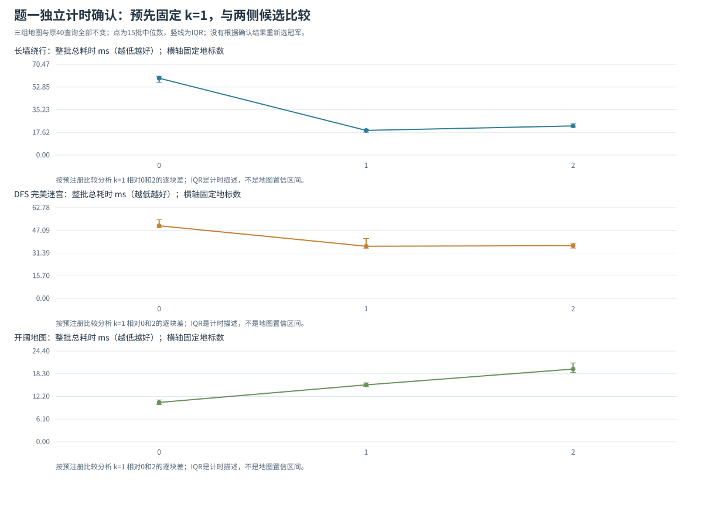

# 题一：A* 迷宫寻路

## 1. 实验目标与问题建模

按照《实验二要求_new(1).pdf》题一的要求，在二维迷宫中寻找最短路径。`S` 表示起点，`E` 表示终点，`.` 是可通行格子，`X` 是障碍。起点与终点均用从 0 开始的 `(行, 列)` 表示，每次只能向上、下、左、右移动，不能穿过障碍或越过地图边界，每次移动代价为 1。

一个状态就是当前位置 `(r, c)`。从该状态出发，检查四个相邻位置，保留在地图范围内且可通行的位置作为后继状态。找到路径后返回从起点到终点的完整坐标序列，包括两端；不存在路径时返回 `[]`。路径中的坐标数与移动步数不同，移动步数等于 `len(path) - 1`。

本实验除验证能否正确返回最短路径外，还比较零启发函数与曼哈顿距离启发函数的扩展节点数，并观察同优先级处理方式对搜索过程的影响。

### 1.1 关键问题

**A1 状态与优先队列。** 状态是当前位置；g是到达该格已走的步数，h是剩余代价下界，f=g+h决定主优先级。发现更小g时更新父指针并入堆，弹出时跳过已经过期的记录。

**A2 曼哈顿下界与终止条件。** 每步最多使行列差绝对值之和减少1，且收费1，所以曼哈顿不高于真实剩余步数，并满足相邻一致性。目标的有效记录弹出后即可结束；一般A*不能在首次生成目标时结束。

**A3 路径的形成。** 目标弹出后沿父指针逆向回溯。样例返回8个坐标、移动7步，达到曼哈顿下界7，独立BFS也得到7。最终路径与搜索中扩展过的全部格子是不同的对象。

**A4 启发函数与同分排序。** h=0按g搜索，曼哈顿加入目标下界；但开阔图中大量状态具有相同的最优f，FIFO仍可能探索整个平台。40×40图的zero/FIFO、Manhattan/FIFO、Manhattan/low_h扩展数为1599/1599/78。low_h只在f相同时优先较小h，保留最短路的主优先级。

## 2. 算法原理与实现

### 2.1 评价函数

A* 使用以下评价函数决定优先处理哪个状态：

\[
f(n)=g(n)+h(n).
\]

其中，`g(n)` 表示当前已知的从起点到状态 `n` 的最小移动步数；`h(n)` 表示从 `n` 到终点的剩余步数估计。程序对同一位置只保留已发现的最小 `g`，而不是把每条到达该位置的路径都作为独立状态保存。

在本题的四方向、单位代价条件下，采用曼哈顿距离：

\[
h(r,c)=|r-r_E|+|c-c_E|,
\]

其中 `(r_E, c_E)` 为终点。

### 2.2 为什么曼哈顿距离适用于本题

**可采纳性。** 从 `(r,c)` 到终点，至少需要改变 `|r-r_E|` 次行坐标和 `|c-c_E|` 次列坐标，一次移动只能改变其中一个坐标，且改变幅度为 1。因此，任何合法路径都至少需要 `|r-r_E| + |c-c_E|` 步。障碍可能使实际路径更长，但不会使它更短，所以 `h(n)` 不超过实际最短剩余代价。对不可达状态，真实剩余代价可视为无穷大，结论仍成立。

**一致性。** 对任意相邻可通行状态 `n` 与 `n'`，曼哈顿距离最多变化 1，因此：

\[
h(n)\le 1+h(n').
\]

每条边的代价正好为 1，且终点的估计值为 0，所以该启发函数一致。在满足本题规则时，A* 从优先队列取出终点后即可结束，得到最短路径。这里不能在“第一次发现终点”时立即结束，一般 A* 的最优性判断依据是取出终点时的优先级。

### 2.3 搜索步骤与数据结构

1. 初始化：起点 `g=0`，计算其 `h` 与 `f`，放入最小堆。
2. 从堆中取出当前优先级最低的记录。若它对应的 `g` 已经落后于该位置的最新最小值，则跳过这条旧记录。
3. 若当前位置是终点，则沿父指针回溯得到路径，反转后返回。
4. 否则按右、下、左、上的固定顺序检查四个邻居。设经过当前状态到邻居的新代价为 `tentative_g=g(current)+1`，只有该值严格小于邻居已有 `g` 时，才更新最小代价及父指针，并将新记录放入堆。
5. 堆为空且仍未到达终点，则返回 `[]`。

最小堆负责找到当前最值得处理的状态；最小代价表避免重复探索较差路径；父指针表只记录改进后的前驱，避免在每个堆元素中复制整条路径。每次回溯都从终点向起点进行，再反转为题目要求的顺序。

### 2.4 零启发函数与同优先级处理

对照方法设置 `h(n)=0`，此时 `f(n)=g(n)`，A* 退化为一致代价搜索。在本题所有移动代价都为 1 的条件下，它按路径步数逐层扩展，与广度优先搜索具有相同的最短路目标。

基础 A* 在 `f` 相同时按入队顺序处理（`fifo`）。拓展版本仍先比较 `f`，仅在 `f` 相同时优先处理较小 `h` 的状态（`low_h`），相应堆键可理解为 `(f, h, 入队序号)`。这种改动保持 A* 的主要评价标准，不改变本题中的最优路径长度，但可能改变最先返回哪一条同长路径、节点扩展顺序和扩展数。其收益依赖地图，不能事先断言它在所有情况下都更快。

Asai 与 Fukunaga 的研究说明同优先级处理是值得分析的问题，但其主要实验涉及含零代价动作的规划场景，与本题的单位代价迷宫不同。因此，本实验把该文献作为设计对照的参考，结论仍由本题的实测结果给出。

## 3. 实验设计与统计口径

### 3.1 正确性验证

使用独立的广度优先搜索作为单位代价迷宫的最短距离基准。检查内容包括：

- 返回路径的首尾是否为指定起终点；
- 路径中每个位置是否位于地图内且可通行；
- 相邻坐标的曼哈顿距离是否为 1；
- 返回的移动步数是否等于广度优先搜索得到的最短距离；
- 无解、起终点相同等边界情况是否按约定处理。

除 PDF 样例外，还使用固定随机种子的地图核验，确保每次复现使用相同输入。当前共有 50 个单元测试方法，含原有40项、整批地标调参5项及独立确认5项口径检查。新测试核对原查询精确复用、每批独立建表、完整墙钟边界、k=0 不建表和配对汇总。原有随机验证生成 300 张地图，每张分别运行三种设置，共进行 900 次与 BFS 的核对；另有 60 张随机地图，覆盖 4 个几何启发函数与 3 种并列策略，共 720 个配置。测试还覆盖 24 种邻居排列、地标下界的逐点可采纳性和逐边一致性、随机查询与非法输入。原有 300 张地图同时随机选择起终点，新增几何启发验证采用角落端点。另有基础对照实验的 14 张地图、42 组结果通过同样的最短距离与路径合法性检查。测试的目的在于检验路径与最短距离，不要求多条最短路径中必须返回某一条特定序列。

### 3.2 对照设置

每张地图均使用相同的起点、终点与邻居检查顺序，运行以下三种方法：

| 方法 | 启发函数 | `f` 相同时的处理方式 | 比较目的 |
|---|---|---|---|
| 零启发对照 | `0` | 入队顺序 | 观察未使用目标距离信息时的搜索范围 |
| 基础 A* | 曼哈顿距离 | 入队顺序 | 检验启发信息是否减少扩展 |
| 拓展 A* | 曼哈顿距离 | 较小 `h` 优先，再按入队顺序 | 检验并列处理是否影响扩展 |

本次运行使用 Python 3.12.14（64 位）和 Windows 11。地图包括 PDF 样例、开阔地图、强制绕路、无解、多条最短路径，以及 9 张随机地图：

| 场景 | 尺寸和构造 |
|---|---|
| PDF 样例 | 5×5，起点 `(0,0)`，终点 `(3,4)` |
| 开阔地图 | 40×40，无障碍，从 `(0,0)` 到 `(39,39)` |
| 强制绕路 | 25×25，第 12 列的第 0 至 23 行是墙，从 `(2,2)` 到 `(2,22)`，只能经最底行绕墙 |
| 无解地图 | 15×15，第 7 列整列封闭，起终点分别为 `(7,2)` 与 `(7,12)` |
| 多条最短路径 | 15×15，第 5 至 9 行、第 6 至 8 列是墙，从 `(7,1)` 到 `(7,13)`，可从上下两侧绕行 |
| 随机地图 | 30×30，障碍生成概率为 15%、25%、35%，每种概率 3 张，从 `(0,0)` 到 `(29,29)`；强制将端点设为可通行 |

随机地图基准种子为 `20261022`，第 `d` 组障碍概率、第 `i` 张地图使用 `20261022 + 100*d + i`，其中 `d,i` 均从 0 开始。该整数只作为随机种子，不表示日期。地图不根据是否有解筛选，生成概率也不等于每张地图精确的障碍比例；实际比例和全部格子保存在 JSON 中。

主要比较扩展节点数，辅助比较堆操作和运行时间。每种场景和设置预热 1 次，然后测量 7 批，每批搜索 10 次；先求每批平均单次耗时，再报告这些平均值的中位数与最小值。计时使用 `time.perf_counter_ns()`，关闭追踪，包含输入校验和少量循环开销；不包含 BFS 核验、轨迹收集、地图生成、绘图和文件读写，垃圾回收保持默认。小地图的单次耗时较短，不能仅凭一次耗时判断算法优劣。

### 3.3 统计口径

本节中的“节点”是地图格子对应的状态，不是路径中的坐标副本。发现一个新格子、把记录加入堆、取出堆记录、展开邻居是不同事件。同一位置可能因 `g` 改进而多次入队，因此“堆弹出次数”与“扩展节点数”不能混用；过期堆记录被跳过时也不能算作新的扩展。

| 字段 | 本实验口径 |
|---|---|
| `expanded_nodes` | 实际展开邻居的次数，不含目标节点 |
| `generated_nodes` | 入堆记录数，含起点及每次成功松弛的新记录，可能重复计同一状态 |
| `popped_nodes` | 弹出记录数，含目标和过期记录 |
| `max_frontier` | 物理堆峰值，含尚未弹出的过期记录 |
| `stale_pops` | 已有更小 `g`、因此跳过的过期堆记录数 |
| `reopened_nodes` | 已扩展状态以更小 `g` 再次实际扩展的次数 |
| `unique_reached` | 已发现有效 `g` 值的不同格子数，含起点 |

目标节点从堆中取出后直接结束，因此它计入弹出数，不计入扩展数。路径长度以移动步数计；有解情况下等于 `len(path)-1`。无解不能用一个空路径的 `len(path)-1` 推断出正常路径长度。

## 4. 实验结果

以下数据来自本次实际运行保存的 `results/comparison.csv`；完整环境、输入地图、路径与源码 SHA256 在 `results/reproducibility.json` 中。节点数不受重复计时波动影响，时间仅反映本次运行环境。

### 4.1 PDF 样例的最短路径

三种设置均返回以下路径：

```text
[(0, 0), (0, 1), (0, 2), (1, 2), (1, 3), (1, 4), (2, 4), (3, 4)]
```

路径先向右移动至 `(0,2)`，由于 `(0,3)` 是障碍而向下到 `(1,2)`；随后沿第 1 行向右绕过障碍，再沿第 4 列向下到达终点。所有相邻坐标都仅在一个方向改变 1，且经过的格子均可通行。路径包含 8 个坐标，即 7 次移动。

起终点的曼哈顿距离为 `|0-3|+|0-4|=7`，是任何合法路径长度的下界；程序恰好找到 7 步的合法路径，因此仅由下界与该路径即可证明其最优，独立 BFS 也得到 7 步。

以 `low_h` 版本为例，实际有效出队过程如下，其中最后一行是取出目标，不展开邻居：

| 次序 | 坐标 | `g` | `h` | `f` |
|---:|---|---:|---:|---:|
| 1 | `(0,0)` | 0 | 7 | 7 |
| 2 | `(0,1)` | 1 | 6 | 7 |
| 3 | `(0,2)` | 2 | 5 | 7 |
| 4 | `(1,2)` | 3 | 4 | 7 |
| 5 | `(1,3)` | 4 | 3 | 7 |
| 6 | `(1,4)` | 5 | 2 | 7 |
| 7 | `(2,4)` | 6 | 1 | 7 |
| 8 | `(3,4)` | 7 | 0 | 7 |

每前进一步，`g` 增加 1、`h` 减少 1，`f` 保持 7。基础版本还扩展了其他同为 `f=7` 的节点，而 `low_h` 优先选择较小 `h`，本样例中沿最短路径直接到达目标。完整的三种顺序见 `results/sample_trace.csv`，图见 `results/sample_search_comparison.svg`。


### 4.2 不同启发函数的比较

三种设置在每张地图上得到的最短步数完全一致，也均与 BFS 一致。下表中的扩展数不含目标节点；`-1` 表示无解，此时路径为 `[]`。

| 场景 | 最短步数 | `h=0/FIFO` 扩展数 | 曼哈顿/FIFO 扩展数 | 曼哈顿/`low_h` 扩展数 |
|---|---:|---:|---:|---:|
| PDF 样例 | 7 | 15 | 13 | 7 |
| 开阔 40×40 | 78 | 1599 | 1599 | 78 |
| 强制绕路 | 64 | 588 | 527 | 318 |
| 无解地图 | -1 | 105 | 105 | 105 |
| 多条最短路径 | 18 | 197 | 80 | 39 |
| 随机 15% #1 | 58 | 740 | 529 | 94 |
| 随机 15% #2 | 58 | 765 | 664 | 154 |
| 随机 15% #3 | 58 | 764 | 591 | 89 |
| 随机 25% #1 | 58 | 671 | 284 | 103 |
| 随机 25% #2 | 58 | 666 | 453 | 147 |
| 随机 25% #3 | 58 | 699 | 446 | 96 |
| 随机 35% #1 | 58 | 518 | 235 | 137 |
| 随机 35% #2 | -1 | 3 | 3 | 3 |
| 随机 35% #3 | 62 | 548 | 250 | 216 |

代表场景的耗时如下，单位是毫秒/次，数值是 7 批平均单次耗时的中位数：

| 场景 | `h=0/FIFO` | 曼哈顿/FIFO | 曼哈顿/`low_h` |
|---|---:|---:|---:|
| PDF 样例 | 0.03571 | 0.03474 | 0.02195 |
| 开阔 40×40 | 4.29150 | 4.52516 | 0.37323 |
| 强制绕路 | 1.84373 | 1.53170 | 0.93701 |
| 无解地图 | 0.24604 | 0.26577 | 0.25170 |
| 多条最短路径 | 0.52616 | 0.24278 | 0.12678 |

CSV 还保留了每批结果与最小值，便于检查波动。PDF 样例中曼哈顿/FIFO 比零启发少扩展 2 个节点，两者的中位耗时相差不足 0.001 ms。这种几十微秒规模的结果容易受启发计算、调度与计时波动影响，不宜据此声称稳定加速；节点数的确定差异与时间收益应分别判断。

扩展节点减少率按以下口径计算：

\[
\text{减少率}=\frac{N_{\text{对照}}-N_{\text{方法}}}{N_{\text{对照}}}\times 100\%.
\]

当分母为 0 时不计算该比率。基础 A* 相对零启发在样例、强制绕路、多条最短路径上的减少率分别为 13.33%、10.37%、59.39%，在开阔地图和固定无解地图上都是 0%。

强制绕路地图的起终点曼哈顿距离只有 20，但墙迫使路径先向下走到第 24 行、再向右越过墙、最后向上返回，因此最短长度为 `22+20+22=64`。忽略墙的曼哈顿估计偏弱，基础 A* 仍搜索较大范围，这解释了其减少率只有 10.37%。

固定无解地图把起点与终点完全隔开。三种设置都必须耗尽起点所在的 15×7 连通区域，因而扩展数均为 105；目标方向的信息不能证明墙后不可达。随机 35% #2 的起点连通区域仅含 3 个格子，同样三种方法都扩展 3 个状态后返回无解。保留这些无解数据，避免只挑选有利于启发搜索的地图。

9 张随机地图中的每一种方法均保持最短路正确性，`low_h` 在本组有解地图上减少了扩展数。但每种障碍概率只有 3 张地图，而且连通性差异很大，这些结果不足以推断普遍的“障碍越多，搜索越快”或“`low_h` 一定最优”规律。全部场景的节点数图见 `results/expanded_nodes_comparison.svg`。

### 4.3 同 `f` 处理的影响

开阔地图中，对任意格子 `(r,c)`，已知最短前向代价是 `g=r+c`，到终点的曼哈顿估计是 `h=78-r-c`，因此所有格子的 `f` 都是 78。基础 A* 使用 FIFO 处理这些并列状态，最终在目标之前扩展 1599 个格子，与零启发完全相同。这是一个具体反例：即使启发函数在该地图上恰好等于真实剩余距离，只要有大量同 `f` 状态，也不保证扩展节点数小。

`low_h` 在相同 `f` 下优先沿更接近终点的状态前进，仅扩展 78 个格子，相对基础版本减少 95.12%。本次中位耗时从 4.52516 ms 降至 0.37323 ms，约为原来的 8.25%。耗时下降幅度与节点下降幅度不完全相同，因为每次调用仍需扫描整张输入地图进行校验，并且堆操作和启发值计算也有成本。

此外，开阔地图中 `low_h` 的物理堆峰值为 77，基础 FIFO 为 40。沿某个方向深入时，会留下更多待处理的旁支，因此扩展数显著减少并不等于堆峰值也更小。强制绕路地图中，两者扩展数为 527 与 318，减少 39.66%，但堆峰值也从 34 增至 63。图见 `results/open40_search_comparison.svg` 与 `results/detour_search_comparison.svg`。


随机 35% #3 中，基础曼哈顿版本弹出 9 条过期记录，`low_h` 弹出 14 条；两者的 `reopened_nodes` 都为 0。这说明“更短路径使同一格子重新入队”与“已经扩展的格子再次被扩展”不同。一致启发函数允许节点在首次扩展前获得更好的 `g`，旧堆条目仍可能存在；正确跳过这些条目才能避免把堆操作误计为新的节点扩展。本次 42 组结果的重新扩展数均为 0，与一致性分析相符。

### 4.4 五组拓展探究

为检查样例之外的地图结构和参数影响，在相同最短路规则下设置五组实验，详细设计、数据与证明见 [EXPLORATION.md](EXPLORATION.md)：

| 探究 | 实测证据与解释 |
|---|---|
| 四种几何启发 × 地图结构 | 同为 51×51、同端点、50 个障碍，分散障碍与长墙的曼哈顿扩展为 48 与 1297；障碍分布比单独的密度更能解释差异 |
| 规模密度与随机端点 | 300 张地图、1200 配置，有解/无解分别统计中位数与 IQR；p=0.4 各尺寸仅 1 张有解图，明确保留样本不足的局限 |
| 同障碍数移动缺口 | 缺口从第 1 行移至第 49 行，最优路长从 48 变为 144、曼哈顿扩展从 48 变为 1297，而起点估计始终为 48 |
| 24 种邻居顺序 × 3 种同 `f` 策略 | 样例 `low_h` 扩展为 7—13，中位数 10；长墙三种策略共同扩展 1224 个 `f<C*` 状态，差异发生在 `f=C*` 平台 |
| 固定地标障碍感知下界 | 长墙 1/2/4 地标均降至 144 次扩展；更多地标未继续减节点，却增加建表和存储，需比较单次总成本及同地图 40 次查询的摊销 |

拓展共有 1956 个正式搜索配置，全部核对 BFS 最短距离和路径合法性；配置数不是独立地图数。地标模块用三角不等式构造可采纳、一致的下界，并记录选点、BFS建表和距离表条目。查询阶段的节点节省与这些额外成本分别计量；原始数据和6张图保存在 `results/exploration/`。

### 4.5 搜索容器、正确性边界与统计证据

另外比较容器成本、重开规则、连通预检和地图间波动，完整分析见 [BONUS_REPORT.md](BONUS_REPORT.md)：

| 新问题 | 关键证据 |
|---|---|
| 真正 BFS 与堆版零启发的性能差别 | 同内核仅换容器；另比较正式 A*。绕路样例中曼哈顿 FIFO 少扩展节点却比 BFS 更慢，说明需要同时看单位操作开销 |
| 可采纳但不一致启发为何需要重开 | 2×9 反例：正确版 8 步、冻结闭集版 10 步；36 个受控变体及随机图均保留失败与未失败案例 |
| 连通预检何时划算 | 两大区无解查询显著省时，小隔间同为无解却未摊销建表；每次保留一次整图验证 |
| 收益估计的稳定性 | 75 组地图配对审计、重复地图合并；样本不足不输出区间，区分 IQR 与探索性 bootstrap 区间 |

本组增加 3812 个搜索配置，其中 471 个是故意错误的冻结闭集消融。正确求解配置均核对最短距离及完整路径；消融返回的非最优结果作为理论失效证据，不用于题目答案。计时在各实验内部配对比较；42个基础配置与1956个拓展配置分别保存，未混入新的计时数据。

### 4.6 地标数量与完整查询成本

原拓展已经比较 k=0、1、2、4，但 40 查询成本采用一次建表加逐查询中位数的估计。本组完整保留长墙和完美迷宫的原地图、原 40 查询，增加 k=3、8，并加入开阔图负对照。每批从独立建表前计时至全部 40 次 A* 返回路径，九个重复块交错候选顺序，直接得到整批墙钟值。

发现阶段的完整成本曲线见 [batch_total.svg](results/landmark_tuning/batch_total.svg)；正文下一节另用新的确认计时检查预先固定候选，不将两轮毫秒数拼接。

长墙 k=0、1、2、3、4、8 的总耗时中位数为 75.543、21.680、29.512、34.177、38.641、58.302 ms。k=1 在已测集合中是内部低点，并在九个重复块里都快于 k=0 和 k=2。第一张表已把扩展总数从 18483 降到 2068，继续加表不再减节点，却增加建表、查表和距离表存储成本，所以参数两侧的变化有具体机制支持。

完美迷宫的总时间中位数也以 k=1 最低，但 k=1 的 IQR [40.619,47.766] ms 与 k=2 的 [42.226,49.185] ms 明显重叠；同块配对中 k=2 五次较快、四次较慢。其配对加速比中位数还以 k=2 略高，不能声称两种统计量都支持唯一、稳定的 k=1 最优。更合适的结论是本批 k=1—2 附近形成近似平台，随后继续加表的成本超过额外下界收益。开阔图所有 k 的扩展总数同为 1314，k=0 耗时最低，保留了没有内部最优的负对照。

本组 162 个整批、6480 次完整查询均核对独立最短路；720 个不同地图—查询—k 配置的路径与计数跨重复保持一致。IQR 是同一工作负载的重复计时波动，不是跨地图置信区间。原两图新增地标各偶然命中一个旧查询端点，仅记录而未重抽输入；选择地标的规则仍独立于查询。完整设计、配对低点表、负对照与结果索引见 [LANDMARK_TUNING.md](LANDMARK_TUNING.md)。

### 4.7 固定候选的新计时验证

前一节用于发现参数低点，本节预先固定k=1以及左右比较k=0、2，三图原40查询全部保留。15个新重复块的协议在预热前保存，随后才采集135个整批、5400次计时查询；360个不同配置全部核验独立最短路。候选不根据确认结果重新选择。



长墙k=0/1/2的整批总时间中位数为59.703/19.162/22.629ms，k=1在全部15块均快于两侧；T1−T2配对差中位数−3.235ms、IQR[−5.520,−2.657]，原局部低点在该工作负载保留。完美迷宫T1−T2为+0.084ms、IQR[−1.753,2.374]，k=1仅7块较快，仍应解释为近似平台；开阔图k=1比k=0在15块均慢，保留无收益条件。

本组是相同三图上的新计时块，不是独立地图泛化验证；IQR为描述性波动，不是置信区间。固定比较、输入来源和原始批值见 [LANDMARK_CONFIRMATION.md](LANDMARK_CONFIRMATION.md)。

## 5. 复杂度与局限

设可通行状态数为 `V`，相邻可通行格子之间的边数为 `E`。四方向网格每个状态最多有 4 个邻居，所以 `E=O(V)`。本实验的曼哈顿与零启发函数均一致，在正确处理过期记录的条件下，每个状态至多进行一次有效扩展，每条边只需要有限次检查。

使用允许重复入队的二叉堆时，总入队记录受成功松弛次数约束，为 `O(V+E)`，搜索过程的堆操作上界可写为 `O((V+E) log(V+E+1))`。设地图行列数为 `R,C`，每次调用还会遍历整张地图验证形状和字符，需 `O(RC)` 时间，因此完整调用的时间上界为：

\[
O\left(RC+(V+E)\log(V+E+1)\right).
\]

四方向网格中可简化为 `O(RC + V log(V+1))`。不含输入矩阵的辅助空间为 `O(V+E)`，在本网格条件下为 `O(V)`。这只是最坏情况上界，启发函数对实际扩展量的影响需要实测说明。若换成不一致启发函数并允许重新扩展，不能不加条件地沿用上述“每个状态至多扩展一次”的论证。

本实现针对静态、四方向、单位代价迷宫。若允许斜向移动、不同地形代价或移动中障碍变化，需要重新定义合法后继与启发函数，不能直接将本题的证明照搬。曼哈顿距离不包含障碍信息，长墙、凹形障碍等场景可能使估计偏弱。优化的评价应同时考虑最短路正确性、扩展数和实现开销。

## 6. 总结

曼哈顿距离为四方向单位代价搜索提供了安全的下界，但实际扩展量还取决于同f状态的处理。开阔图上的FIFO会搜索较大的最优f平台，low_h则能沿目标方向推进；长墙图中，忽略障碍使曼哈顿估计偏弱，需要引入地图结构信息。

地标实验体现了信息与成本之间的取舍。长墙的第一个地标已将40次查询的总扩展数从18483降至2068，第二个地标没有继续减少扩展，却增加建表和查表开销，因此固定负载在k=1出现局部时间低点。迷宫的k=1—2接近，开阔图不建表更快。选择策略需要结合地图结构、查询次数与完整计算成本，不能只按启发函数强弱或单次节点数判断。

## 7. 复现方法与参考资料

在本目录运行：

```powershell
.\run_q1.cmd tests
.\run_q1.cmd --input samples/pdf_sample.txt --details
.\run_q1.cmd experiments
.\run_q1.cmd explorations
```

在已经配置 Python 的其他环境中，等效命令为：

```powershell
python -m unittest discover -v
python maze_astar.py --input samples/pdf_sample.txt --details
python run_experiments.py --repeats 7 --batch 10 --seed 20261022 --output-dir results
python run_explorations.py --seeds 20 --repeats 3 --batch 3 --seed 20261022 --output-dir results/exploration
```

将 `results/` 中的数据与图像和报告一起保存，复现时使用环境 JSON 中记录的 Python 版本、地图种子及实验参数。题目规则以 PDF 为准，代码独立实现。

- Berkeley CS188，Informed Search：<https://inst.eecs.berkeley.edu/~cs188/textbook/search/informed.html>
- Red Blob Games，A* Implementation：<https://www.redblobgames.com/pathfinding/a-star/implementation.html>
- Asai, M. & Fukunaga, A. (2016). Tiebreaking Strategies for A* Search: How to Explore the Final Frontier. AAAI：<https://doi.org/10.1609/aaai.v30i1.10071>
- Corrêa, A. B., Pereira, A. G. & Ritt, M. (2018). Analyzing Tie-Breaking Strategies for the A* Algorithm. IJCAI：[论文](https://www.ijcai.org/proceedings/2018/655)。
- Goldberg, A. V. & Harrelson, C. (2005). Computing the Shortest Path: A* Search Meets Graph Theory. SODA：[作者公开论文](https://www.microsoft.com/en-us/research/wp-content/uploads/2005/01/soda05.pdf)。
