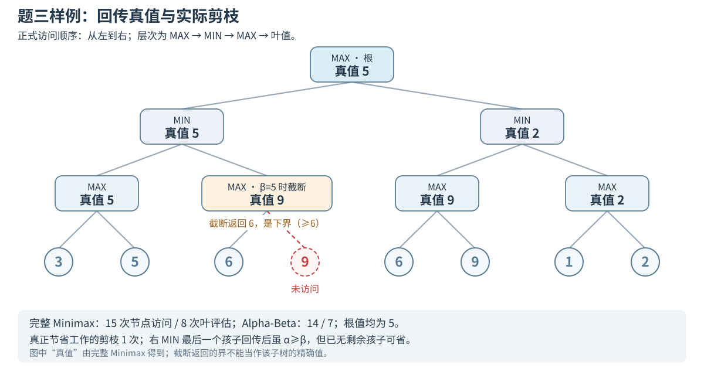
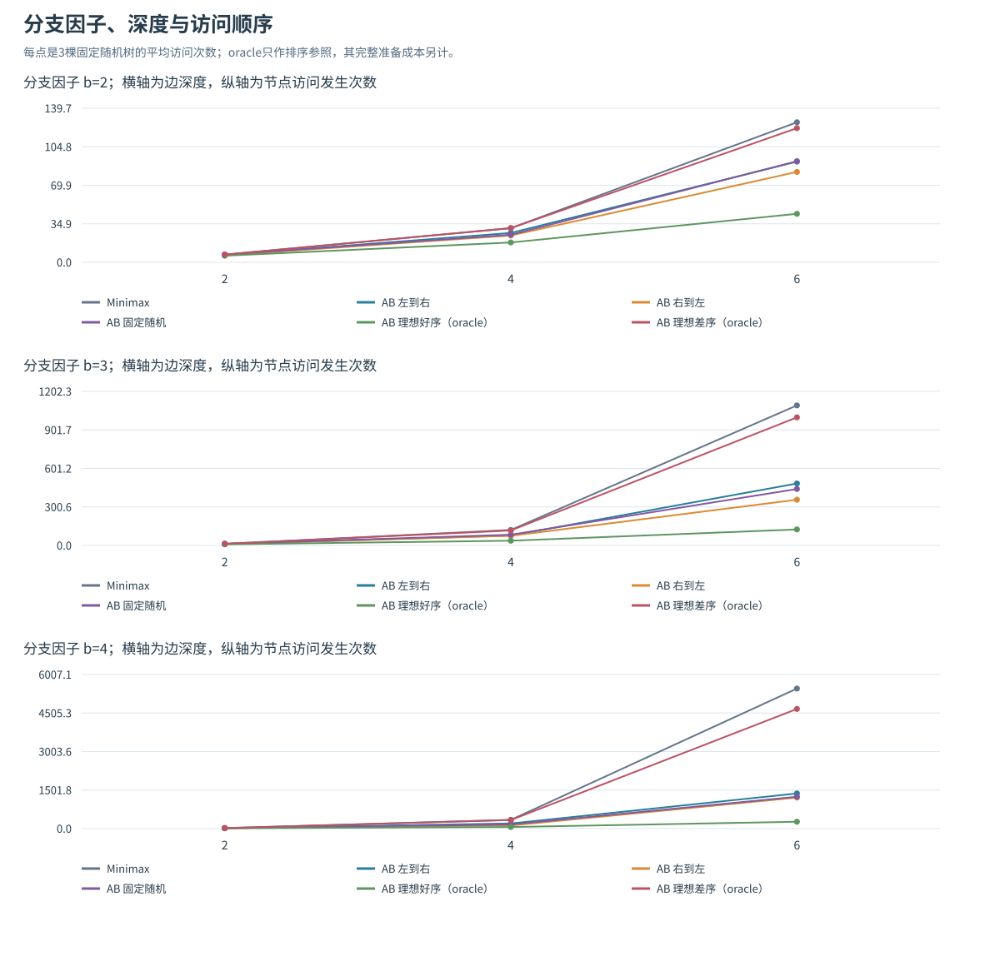
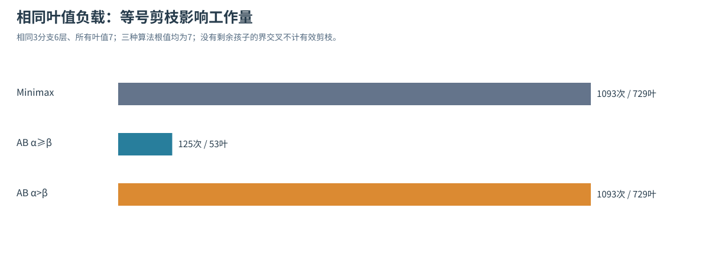
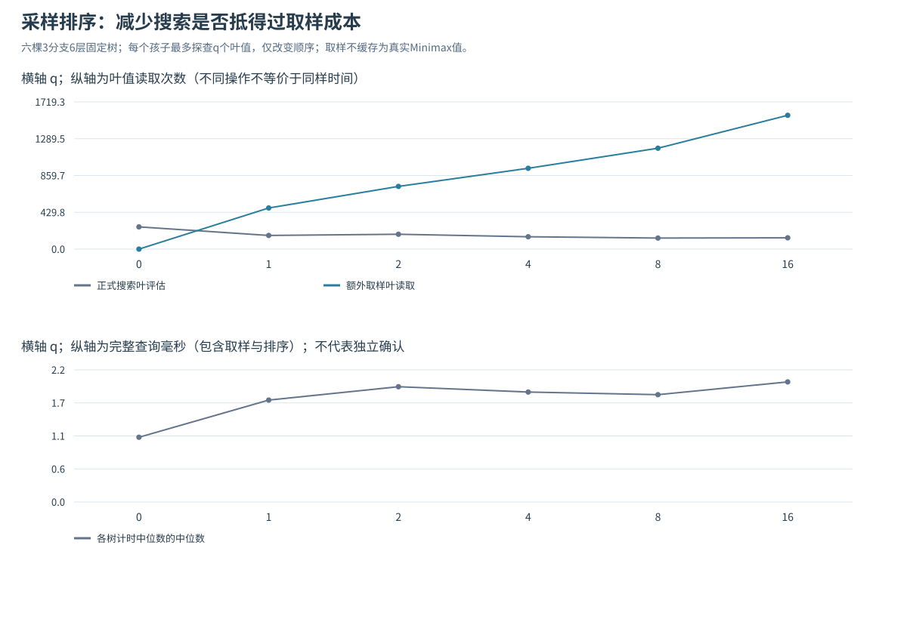

# 题三实验报告：Minimax 回传、Alpha-Beta 剪枝及访问顺序

## 1. 问题与基本原理

题三要求从博弈树根节点求出MAX玩家的最佳得分。根为MAX，逐层交替MAX/MIN，正式实现从左到右访问。本实验先核对样例的回传与剪枝过程，再比较顺序、采样排序和缓存的搜索开销。

**数值回传。** 叶子返回自身得分；MAX取孩子得分最大值，MIN取最小值。样例四个MAX子树的真实值为5、9、9、2，两个MIN为5、2，根取max(5,2)=5。

**窗口与剪枝。** α记录沿当前搜索上下文 MAX 已有的保证下界，β记录 MIN 已有的保证上界。MAX更新α，MIN更新β；当α≥β时，剩余孩子已不能改善祖先当前选择，可跳过。本题允许等号剪枝。α、β不是所有未访问子树的精确值。

**截断返回值。** 左MIN先得到5，将β收紧至5；左侧第二MAX看到6后已有α=6≥β=5，跳过它的另一个叶9，返回下界6。这个MAX的完整真值仍为9，不能把图中截断返回的6当真值。左MIN仍可精确确定为5，最终根为5。默认无限窗口的根结果精确。

**访问顺序。** 对固定孩子值取max/min与排列无关；但先出现的候选决定何时收紧窗口，影响后续是否有必要访问。正式样例正反序恰好都评估7叶，因此仅换这个小样例不能证明一般的顺序收益，需另用同一棵较大树配对对照。

**比较指标。** 实验分别记录节点访问、叶评估、排序准备、额外采样和完整时间。真值优先排序与采样排序都能减少部分搜索，但获取排序依据本身也需要工作，时间比较包含这部分成本。

## 2. 实现与统计口径

`TreeNode(value=None, children=None)`遵循题目结构。`minimax(root)`与`alpha_beta(root)`返回数值，默认根MAX、从左到右。`search()`提供额外统计、左右顺序、自定义索引排列和可选逐步轨迹，排序不修改原孩子列表。

结构预检拒绝缺失/非有限叶值、bool叶值、内部节点又带叶值、非法子节点和环；允许共享子树对象。JSON中的可选`is_maximizing_player`必须与深度交替一致。公开自定义窗口要求α<β，以避免初始窗口已经闭合时误判返回界。

无剪枝时遍历全部孩子。Alpha-Beta采用fail-soft回传：返回已观察到的最好数值，并用进入窗口判断其为`exact`、`lower`或`upper`。启用trace时，所有内部回传事件都记录界类型，search结果另给根返回界。缓存拓展另见第9节，正式默认算法仍无缓存；缓存必须连同界类型和窗口语义处理，不能直接把截断标量作为精确值。

| 指标 | 精确定义 |
|---|---|
| visited_nodes | 实际递归访问发生次数，重复进入同对象重复计数 |
| internal_nodes / leaf_evaluations | 已访问内部节点次数 / 真正搜索读取叶值次数；两者之和为visited_nodes |
| cutoff_events | 窗口交叉且仍有未访问兄弟的有效剪枝事件 |
| skipped_child_roots | 被跳过的直接孩子根数，不是全部后代节点数 |
| bound_crossings | 所有触发界条件次数，包括最后一个孩子之后、已无兄弟可省的情况 |
| ordering_probe_leaves | 采样排序另外读取的叶值次数，不混入正式搜索叶评估 |
| oracle_leaf_reads | 为真值排序完整求解输入时的叶读取次数 |

显式树本身已占用全树存储。最坏搜索工作随分支数和深度呈指数增长；良好排序可大幅剪枝，但不是所有输入都达到理想收益。递归、路径标记、自定义排序元数据和可选trace都有额外成本，不能只报调用栈而忽略已存整棵树或轨迹。

## 3. 正式样例与回传轨迹

正式输入以第10—11页完整JSON为准，四对叶子为(3,5)、(6,9)、(6,9)、(1,2)。第9页示意简略，第12页Python构建代码又共享同一(6,9)对象；这不改变博弈值，但影响“不同对象数”的统计。JSON有15个不同节点对象；共享构建有12个对象，无缓存Minimax仍有15次访问发生。因此这里按实际访问次数统计搜索工作。

1. 左MAX读3、5回传5，左MIN将β设为5。
2. 下一MAX读6，满足6≥5，剪掉尚未访问的9；回传6是下界，左MIN仍取min(5,6)=5。
3. 根更新α=5；右MIN先收到其第一MAX的9，再收到末MAX的2，回传2。
4. 根取max(5,2)=5。右MIN末孩子后虽窗口交叉，但已没有后续兄弟，所以不算有效节省事件。

| 算法 / 顺序 | 根值 | 访问发生 | 叶评估 | 有效剪枝 | 界交叉 |
|---|---:|---:|---:|---:|---:|
| Minimax / 左到右 | 5 | 15 | 8 | 0 | 0 |
| Alpha-Beta / 左到右 | 5 | 14 | 7 | 1 | 2 |
| Alpha-Beta / 右到左 | 5 | 14 | 7 | 1 | 1 |

样例仅省1叶、1节点。左到右Minimax/Alpha-Beta的时间中位数约0.0389/0.0393ms，几乎相当；剪枝判断本身有成本，小输入还受计时波动影响。完整逐事件数据在`results/sample_trace.json`。

## 4. 实验设计、正确性与可复现性

使用Python标准库，环境与SHA见`results/reproducibility.json`。固定种子从20261030开始，叶值均匀整数−100至100；终局值无需任何学习或启发估计。实验中的深度是根到叶的边数，与综合题行动次数另作定义。

| 实验 | 输入与控制 | 配置数 |
|---|---|---:|
| 正式样例 | 同树，左右序，Minimax、AB等号剪枝、AB严格剪枝 | 6 |
| 分支×深度×顺序 | b=2/3/4，d=2/4/6，每组合3种固定树；两算法×5顺序 | 270 |
| 等值负载 | b=3、d=6、全部叶值7，同样左右序与三算法 | 6 |
| 采样排序预算 | 6棵b=3、d=6树，q=0/1/2/4/8/16；仅改变排序 | 36 |

共35个输入记录、**32棵不同完整树**，不是318棵独立树：采样组有3棵复用了规模组的同一输入，目的是同负载比较。全部318配置核对独立迭代后序计算的根真值，计数守恒且不超过全树访问发生数。Minimax在各排序下必须完整访问全树。

核心实现的21个测试方法覆盖：180棵固定随机不规则树与独立路径键迭代真值核对；80棵重复值树比较等号/严格剪枝；36种孩子排列验证值不变而开销可变；共享对象、输入校验、原树不变性；320个随机树窄窗口配置中，逐个核验已访问子树返回界与真值的关系。测试真值不复用正式递归实现。缓存和进一步实验的测试分别增加16项与21项，全部58项测试通过。

计时先有一次不计入结果的运行，再采集7个随机交错重复块；每块每配置连续3次取批平均，共2226批、6678次计时调用。每次均核对值与计数稳定；保存7批的中位数和含端点插值IQR。实验在已构建、已预检的树上计时，排除输入解析、结构预检、trace和文件写入；完整查询包含排序准备、采样、比较和搜索，不含准备的搜索时间另列。IQR描述波动，不是独立输入上的置信区间或显著性结论。正式公开接口默认仍会预检，不能把这里的搜索时间当作整个命令行耗时。

## 5. 同树改变顺序：值不变，开销改变

图中每点是3棵固定随机树的平均节点访问，Minimax是完整遍历。`random`先生成固定排列，准备费用计入总时间。`oracle_best`先计算真实子树值，再在MAX降序、MIN升序访问；`oracle_worst`采用相反方向。后者只是按真值逆序的对照，不保证在有相等值的全部排列中严格达到全局最坏访问数；两者都依赖提前知道完整真值，不能当作无成本实际策略。

下面固定展示b=4、d=6、seed=20261030的整棵树，完整Minimax共5461节点、4096叶；所有根值一致。时间为7块中位数[Q1,Q3]，毫秒。

| 方法 | 搜索访问 | 搜索叶 | 准备真值叶读取 | 完整查询ms |
|---|---:|---:|---:|---|
| Minimax / 左到右 | 5461 | 4096 | 0 | 11.626 [11.504,12.065] |
| AB / 左到右 | 1817 | 1181 | 0 | 4.989 [4.471,5.335] |
| AB / 右到左 | 700 | 451 | 0 | 1.843 [1.652,2.267] |
| AB / 固定随机 | 1422 | 915 | 0 | 8.539 [8.315,8.762] |
| AB / 真值优先 | 268 | 127 | 4096 | 7.482 [6.951,7.833] |
| AB / 真值逆序 | 4720 | 3462 | 4096 | 22.915 [22.781,25.806] |

右到左在这棵树较早给出有利界，少访问1117节点；这不代表右序普遍更好，完整27棵树及另外种子都保存于CSV。随机序虽比左序少搜索395节点，却要遍历输入建立排列，并在各节点调用、检查排列，完整时间更高。

真值优先把搜索访问压到268，搜索阶段中位数约1.174ms；但先完整求值，再搜索一次，完整时间约7.482ms，反而慢于没有准备成本的左序约4.989ms。这个对照说明“排序后搜索很少”不能自动等同“实际算法更快”。真值排序用于解释界怎样提前形成；实际需要更便宜、与搜索工作相关的估计，不能提前偷看完整答案后只计后半程。

## 6. 等号剪枝：同分平台上的决定性差异

在3分支、6层、729叶全为7的树上，Minimax访问1093次。AB采用α≥β只访问125次、评估53叶，有效剪枝46次；改成α>β则访问1093次、评估729叶，没有有效剪枝，三者根值都为7。左到右完整时间分别约2.003、0.323、2.742ms。

原因是首个分支已确定相同值，后续分支往往只需达到已有界就足以排除。严格条件必须超过界，相等永远不触发，因此这组输入上退化为完整遍历，还需承担界更新成本。PDF没有禁止等号剪枝，本题正式实现使用α≥β。正确性与特定课程对精确访问轨迹的额外规定是两回事。

## 7. 排序预算探究：搜索低点与完整耗时分开看

将每个孩子子树中从左到右的前q个叶值取均值，再在MAX按均值降序、MIN升序排列。该均值只决定访问顺序，不替代叶值，不用于剪枝判断，所以不要求它可采纳，也不改变完整搜索的博弈值。每次到达内部节点重新采样，不复用成真实Minimax缓存；额外叶读取及其遍历、排序全部计时。q=0完全不排序，是必要基线。

表中对6棵树分别得到指标后取中位数；完整时间先取每树7块中位数，再在6棵树上取中位数。图上方为均值、下方为上述时间中位数，原始每树数值见CSV；各点不是同一棵树上连续变化出的6张新地图。

| 每孩子采样预算q | 搜索访问中位数 | 搜索叶中位数 | 额外采样叶中位数 | 完整时间中位数ms |
|---:|---:|---:|---:|---:|
| 0 | 438.5 | 255.0 | 0.0 | 1.087 |
| 1 | 313.5 | 159.0 | 469.5 | 1.711 |
| 2 | 337.0 | 169.0 | 721.5 | 1.935 |
| 4 | 299.0 | 146.0 | 958.5 | 1.846 |
| 8 | 253.0 | 122.5 | 1176.0 | 1.802 |
| 16 | 280.0 | 139.0 | 1608.0 | 2.016 |

在已测范围，搜索工作聚合曲线在q=8呈现两侧可比较的内部低点：q从4增到8，访问中位数299→253；继续到16又升至280。更多叶的均值并不保证更接近交替max/min的真实子树值，因此排序质量不一定单调改善。这是探索性聚合现象，不是每棵树都在q=8最优：例如seed20261032的q16访问159，少于q8的192。

**所有非零预算的完整时间均高于q=0的聚合中位数**，六棵树上的q8也均慢于q0。省下的叶评估未抵消取样和排序成本。为检查节点低点是否可复现，随后固定q8在30棵新树上确认，只有10棵同时优于两侧候选，详见第10节。q8的低点因此只适用于原六树的探索结果。

## 8. 搜索工作与时间成本

顺序改变界形成的早晚，因此可以改变搜索量；排序准备和采样又会增加额外工作。小树中省下几个节点通常不足以抵消这些成本，较大输入则可能出现明显差异。本文时间来自同一实验内的配对测量，覆盖有限的人工树与随机终局树，结论范围限于相应输入。

## 9. 界感知缓存的正确性与成本

参考[Plaat作者的AlphaBetaWithMemory](https://people.csail.mit.edu/plaat/mtdf.html)与[Stockfish官方表结构](https://raw.githubusercontent.com/official-stockfish/Stockfish/master/src/tt.h)，实现独立缓存模块；正式接口保持左到右、无缓存。每次调用新表，键包含对象及当前玩家，完整终局搜索；只复用精确项或足以关闭当前窗口的上下界。

核心错误消融：`X=MAX(6,9)`，`root=MAX(MIN(5,X),MIN(X,8))`。左侧窄窗首次返回X的下界6；误当精确项缓存会使根错算6，正确根应为8。安全缓存保留类型、第二次命中不能截断时继续搜索，返回8。错误轨迹与安全轨迹均保存。

缓存实验只改变同一有序展开树的对象共享程度，逐组核对展开指纹、根值及原始AB计数不变。固定种子20261030，展开9841节点：强共享时原AB访问958/读530叶，bounds访问167/读10叶，时间中位数4.159→1.524ms；无共享纯树均访问958，缓存时间反增4.332→9.615ms。仅精确缓存及同内核off同时作为对照，不能将原实现与新实现的差异全部归因于缓存。

缓存准入上限D只控制哪些层查写表，**不截短搜索**。D=0至6的访问958→227，至7为167，至8仍167，仅实读叶减少；时间IQR重叠，all与8语义相同，但本组重复计时的排名不同。因此6—8的收益已趋于饱和，尚未观察到稳定的内部最优点。

缓存发现实验的118配置、1062批、5310次计时调用均得到正确值，16项缓存测试通过。参考资料、反例推导、逐树数据及参数曲线见[TRANSPOSITION_STUDY.md](TRANSPOSITION_STUDY.md)。

进一步预先固定bounds/all，在3个新种子的9个对象图上确认，共36配置、540批、2700次调用；先保存协议，随后才预热与采集。强共享主比较对原始AB的配对差中位数分别为−1.209、−1.265、−1.492ms，三个IQR均在0以下，15块中分别14、15、15块更快；纯树负对照均15/15块更慢。部分共享的结果仍有不确定性；缓存的收益取决于能否复用足够多的重复子问题。这组确认保持bounds/all策略，未检验有限D的最优性。完整比较见缓存报告第8节。

## 10. 参数确认与存储预算

**10.1 固定q8的独立确认。** 事前固定q0/4/8/16，在30棵同分布新树上运行120配置。q8只有10/30棵同时少于q4和q16的访问量；本批q16访问中位数250，低于q8的292。q8对q0的逐树配对时间差中位数+0.574ms，29棵更慢。原六树低点保留为探索记录，不升级为稳定参数推荐。

**10.2 叶值相关性与排序信息成本。** 六组共同基础随机数派生五档层级混合，固定q0/1/4/8，共120配置；30输入有依赖，实际方差与相关性同时记录。λ=1合成组中q1排序一致率约0.830、时间比中位数0.923，只有4/6树更快；q8一致率更高约0.908，时间比却1.178。小预算可出现探索性低点，但预测更准仍可能因额外取样更慢，且不能将模型效应全归因于相关系数。

**10.3 有限容量缓存。** 固定LRU和完整终局搜索，比较0至无限容量，3种新展开语义/9个对象图、90配置。固定强共享图容量4淘汰987次，虽少访问仍慢于关闭；容量64达到与无限同样的186次访问。命中次数与表项数不足以替代完整成本，充分容量后访问形成平台。

这三组实验共330配置、2250批、6750次调用，值与计数均通过核验；相应21项测试通过。模型、完整对照、五张图和原始记录见[SUPPLEMENTARY_EXPERIMENTS.md](SUPPLEMENTARY_EXPERIMENTS.md)。
