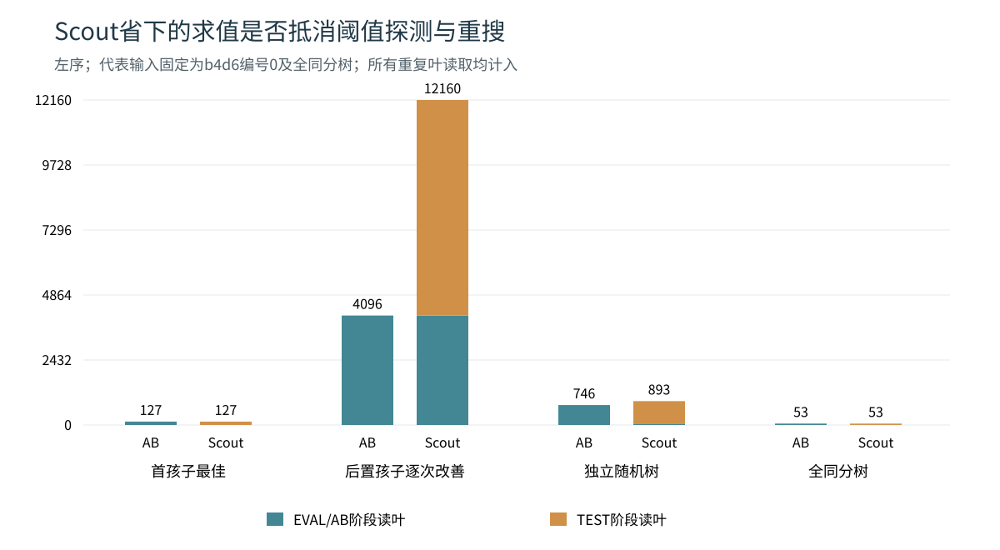

# 题三补充实验 Scout阈值探测与重搜成本

## 1 研究问题

已有实验主要通过访问顺序或共享子树缓存减少搜索。这里换一个角度：后续子树是否都需要精确求值？如果只想知道它能否改善当前候选，能否用较便宜的阈值判断代替完整求值？如果判断成功后还要重搜，额外工作又会在什么情况下抵消收益？

方法参考Pearl的[SCOUT原论文](https://cdn.aaai.org/AAAI/1980/AAAI80-041.pdf)。这里复现EVAL与TEST的区分，在同树、同顺序条件下比较现有实现，分析首候选质量及重搜成本；所有重复访问和准备工作均计入统计。

## 2 方法与正确性

### 2.1 TEST只返回布尔判断

设某个子树的真实Minimax值为V，TEST判断`V > t`或`V < t`，不把布尔结果当作数值。

| 判定 | MAX节点 | MIN节点 |
|---|---|---|
| V > t | 任一孩子满足即可返回真 | 所有孩子满足才为真 |
| V < t | 所有孩子满足才为真 | 任一孩子满足即可返回真 |

叶节点直接比较实际叶值与t。内部节点按表中的存在或全称条件递归，条件已经确定时立即返回。因此TEST通过归纳得到正确的不等式判断，而不必知道子树的确切值。

EVAL先精确求第一个孩子的值作为best。其余孩子在MAX处测试是否严格大于best，在MIN处测试是否严格小于best；只有确实改善时才调用EVAL精确重搜并更新best。处理完所有孩子后，best就是该节点真实的最大值或最小值。相等不会触发重搜，也不会改变题目要求的最优根值。

这个实现直接比较原始整数或有限浮点叶值，不构造`[α,α+1]`，也不设置人为epsilon，因此保留原接口的整数、浮点支持。内部节点没有浅层评价，本实验始终搜索原来的有限树，没有添加深度截断、迭代加深或置换表。

### 2.2 把重复工作全部算进去

新模块同时提供Scout和普通Alpha-Beta两个模式。两者共用输入检查、孩子顺序接口、结果格式及轻量统计；原`alphabeta_tree.py`另列为实际接口对照。原版与同模块AB在所有配置下的访问数、读叶数及有效剪枝次数一致，但Python实现和统计开销不同。

统计中的`exact_*`是EVAL/AB阶段的历史字段名。在Scout模式，EVAL返回精确值；在AB模式，内部递归仍可能返回上下界，不能因为字段名而称每次返回都精确。主要比较总访问和总读叶：

```text
total_visits = exact_visits + test_visits
total_leaf_reads = exact_leaf_reads + test_leaf_reads
exact_visits = exact_internal_visits + exact_leaf_reads
test_visits = test_internal_visits + test_leaf_reads
probe_calls = test_true + test_false
research_calls = test_true
```

`probe_calls`是发起一次孩子阈值探测的次数，`test_visits`才是其中全部递归访问。探测成功后的重搜、重复叶读取及顺序准备都纳入完整时间。一次读取算一次，不能把它改成不同叶对象的数量。

在固定左右顺序和单位比较成本下，令N为原树按出现次数展开的节点数、d为最大深度。EVAL对每个出现位置至多一次，但TEST可能在不同祖先的探测中重复访问同一位置，保守最坏界为`O(Nd)`，递归栈为`O(d)`，均不含输入树。固定随机序另外保存`O(N)`的顺序表；回调检查和准备也有成本。因此Scout没有“必然比完整遍历少工作”的保证。

## 3 输入与实验设置

在任何oracle、预热或正式计时前写入[固定协议](results_scout/protocol.json)，保存完整输入、固定种子、源码SHA和比较规则。共有30份有序输入记录：

- 18棵独立随机树：分支数2/3/4、完整深度4/6，每组3个新种子，叶值取整数−1000至1000。
- 4种构造语义的8份成对表示：分支数3/4、深度4/6，分别让首孩子最佳或让后置孩子逐次改善；镜像所有孩子顺序保持无序博弈语义和根值相同。这是输入边界，不是提前计算真值后的运行时排序。
- 正式样例、全同分树、非均匀浮点树、非均匀负值树，共4份特殊输入。

每份输入分别采用左序、右序、固定随机序，比较原版AB、同模块AB、Scout，共270配置。随机排列按对象固定，并在每次调用内重新建立，准备成本计入。7个计时块，每块每配置3次调用，得到5670次调用、1890个批平均值；7块重复不增加独立树数量。

每个配置先预热一次，丢弃其时间。每块打乱输入—顺序任务及方法顺序，串行执行，采用解释器默认垃圾回收。计时包括顺序准备、搜索、统计、全部TEST和重搜，排除树构建、结构预检、独立无剪枝Minimax、轨迹、文件写入和图表。因此这里的“完整时间”指策略准备加搜索，不是命令行解析和整树检查的端到端时间。

环境为Windows 11、Python 3.12.14。每块3次调用先取平均，再汇总7块的中位数和四分位范围。每棵树的快慢方向按同块配对差`T(Scout)−T(对照)`的中位数判断；耗时比则是两方法时间中位数之比，再在同组输入间取中位数。这两个统计量定义不同，接近平台时可能方向不一致。IQR是描述范围，不是置信区间。

## 4 首候选可靠性决定了额外探测是否值得

下表固定展示分支4、深度6、左序的成对构造输入，以及事先指定的随机编号0、全同分树。时间为7个批平均值的中位数，单位ms。AB均指同模块AB；总读叶包含Scout的全部重复读取。

| 输入 | 方法 | EVAL/AB读叶 | TEST读叶 | 总读叶 | 探测/重搜次数 | 完整时间 |
|---|---|---:|---:|---:|---:|---:|
| 首孩子最佳 | AB | 127 | 0 | 127 | 0/0 | 0.2043 |
| 首孩子最佳 | Scout | 1 | 126 | 127 | 18/0 | 0.1715 |
| 后置孩子逐次改善 | AB | 4096 | 0 | 4096 | 0/0 | 4.8906 |
| 后置孩子逐次改善 | Scout | 4096 | 8064 | 12160 | 4095/4095 | 10.4434 |
| 随机树编号0 | AB | 746 | 0 | 746 | 0/0 | 1.6050 |
| 随机树编号0 | Scout | 53 | 840 | 893 | 159/52 | 0.8673 |
| 全同分树 | AB | 53 | 0 | 53 | 0/0 | 0.0878 |
| 全同分树 | Scout | 1 | 52 | 53 | 12/0 | 0.0967 |



首孩子最佳时，后续探测都不能改善候选，没有重搜。Scout总读叶仍为127，与AB相同，不能说它减少了叶读取。它将大部分工作变为布尔短路判断，在这份输入中完整时间较短；配对差中位−0.0780ms，IQR为[−0.0995,−0.0369]ms，6/7块更快。

同一博弈语义改为后置孩子逐次改善后，4095次探测全部触发重搜。Scout本身的EVAL已经读取全部4096叶，TEST又增加8064次，合计12160次，约为AB的2.969倍。配对时间差中位+4.7836ms，IQR为[4.3342,7.5762]ms，7/7块更慢。这是探测和重搜都要付费的明确反例。

随机编号0中，Scout读取893叶，多于AB的746叶，却测得较短时间。这说明一次布尔比较、一次带窗口递归和统计更新并非等成本，读叶数量不能直接转换为运行时间。全同分树则没有重搜、读叶相同，但小耗时比较受重复波动影响：两方法中位数比为1.101，配对差中位却略小于0且IQR跨0，应视为近似平台，不能据此断言稳定胜负。

## 5 全部输入的结果

### 5.1 成对边界不是一般随机树的结论

下表中时间比和叶比均为Scout/同模块AB的逐输入比值中位数；快输入数以配对差判定。

| 输入组与顺序 | 有序输入数 | 完整时间比 | 总读叶比 | Scout较快输入数 |
|---|---:|---:|---:|---:|
| 首孩子最佳，左序 | 4 | 0.733 | 1.000 | 4/4 |
| 同组改为右序 | 4 | 1.950 | 2.900 | 0/4 |
| 后置逐次改善，左序 | 4 | 1.980 | 2.900 | 0/4 |
| 同组改为右序 | 4 | 0.651 | 1.000 | 4/4 |
| 独立随机树，左序 | 18 | 1.012 | 1.625 | 8/18 |
| 独立随机树，右序 | 18 | 0.978 | 1.674 | 8/18 |
| 独立随机树，固定随机序 | 18 | 1.035 | 1.640 | 10/18 |

镜像输入再反转访问顺序，收益和损失方向随之交换，说明关键是候选何时出现，不能把构造输入的名称当成方法的固有适用标签。四种构造语义是4个边界问题，8份有序记录不能说成8个独立随机问题。

18棵随机树在三种顺序下都没有普遍时间收益，总读叶比中位数均大于1.6。左、右序的完整时间比接近1，固定随机序还要承担完整排列准备。若只选随机编号0的较快结果，就会漏掉其余树的损失；完整数据不支持用Scout替换现有正式默认算法。

### 5.2 为什么还要保留原版AB

18棵随机树的左序中，Scout/原版AB时间比中位为0.335，18/18棵配对更快；与同模块AB却为1.012、仅8/18棵更快。原版AB和同模块AB访问完全相同，时间差来自Python实现、回传/统计和辅助调用的开销。因此前一个数字是实际接口比较，不能全部归因于Scout阈值搜索。

两种对照回答的问题不同：同模块AB帮助判断探测与重搜策略是否划算，原版AB显示新模块的实际运行成本。二者同时保留，避免把修改实现的收益冒充算法普遍减少搜索。

## 6 正确性和复核

新增11项测试，题三当前共69项测试通过。新测试覆盖337棵完整小二叉树的叶值全枚举，各自检查MAX/MIN根、左右顺序以及Scout/同模块AB；还包括相邻浮点ULP、巨大整数、负值、全同分、非均匀树、共享对象按出现次数计数、非法回调和环。共享对象不引入缓存，仍按每次访问发生计数。

正式实验的全部根值对照独立无剪枝Minimax，每次计时调用后检查根值和统计恒等式。独立复核进一步从保存的30棵JSON输入重新计算Minimax、整树节点和叶数，核对全部9个结果文件及4份源码的SHA，并逐组重算5670次调用到1890批、270组中位数、180组配对差和42组跨输入汇总，均一致。没有删除慢输入或修改原始时间。

## 7 复现与文件位置

在题三目录执行：

```text
python -B -m unittest test_scout_search
python -B run_scout_study.py
```

默认参数为`--seed 20261110 --repeats 7 --batch 3`。已有结果时自动另建`rerun_时间戳`子目录；`--prepare-only`仅登记设计，不运行oracle或计时。复现时根值和工作量应相同，耗时允许随机器负载变化。

- [scout_search.py](scout_search.py)：Scout与同模块AB控制，正式题目入口保持原样。
- [run_scout_study.py](run_scout_study.py)：输入、固定协议、验证、串行计时及SVG生成。
- [protocol.json](results_scout/protocol.json)、[manifest.json](results_scout/manifest.json)：完整输入、环境、种子和源码/结果指纹。
- [comparison.csv](results_scout/comparison.csv)、[summary.csv](results_scout/summary.csv)：每配置根值、阶段访问、读叶及时间汇总。
- [timing_calls.csv](results_scout/timing_calls.csv)、[timing_batches.csv](results_scout/timing_batches.csv)：逐次调用及批平均原始记录。
- [paired_deltas.csv](results_scout/paired_deltas.csv)、[aggregate_summary.csv](results_scout/aggregate_summary.csv)：同块配对差及各输入组汇总。

本实验支持的结论是有条件的：首候选较可靠时，阈值判定有机会省去不必要的精确求值；后置候选频繁改善时，重复探测可能明显增加成本。它没有证明Scout对所有有限树更快，也没有用没有合法浅层评价的迭代加深制造额外收益。
