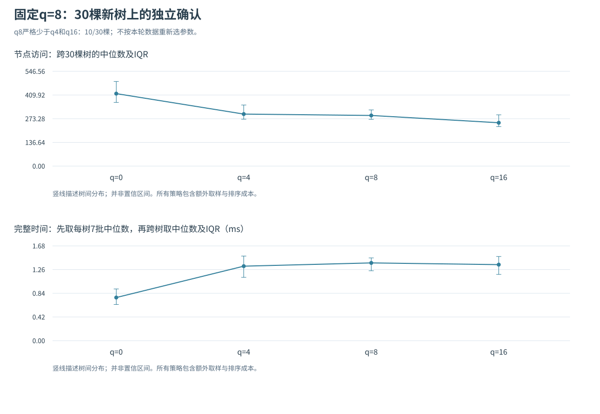
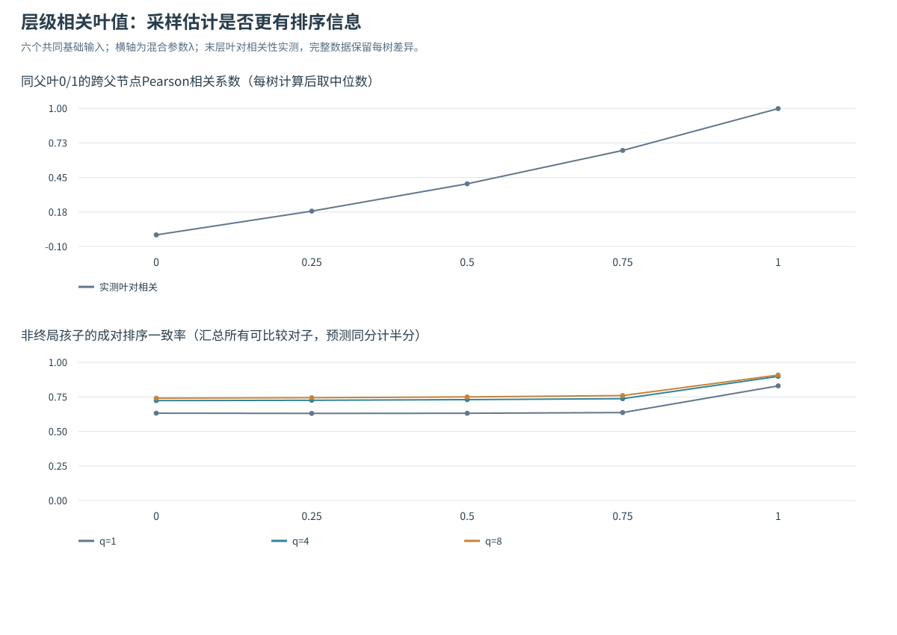
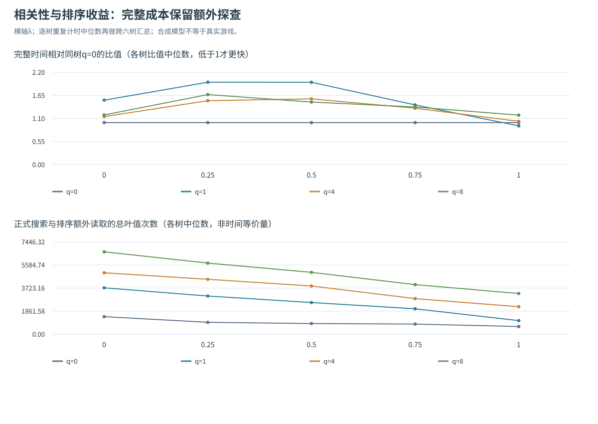
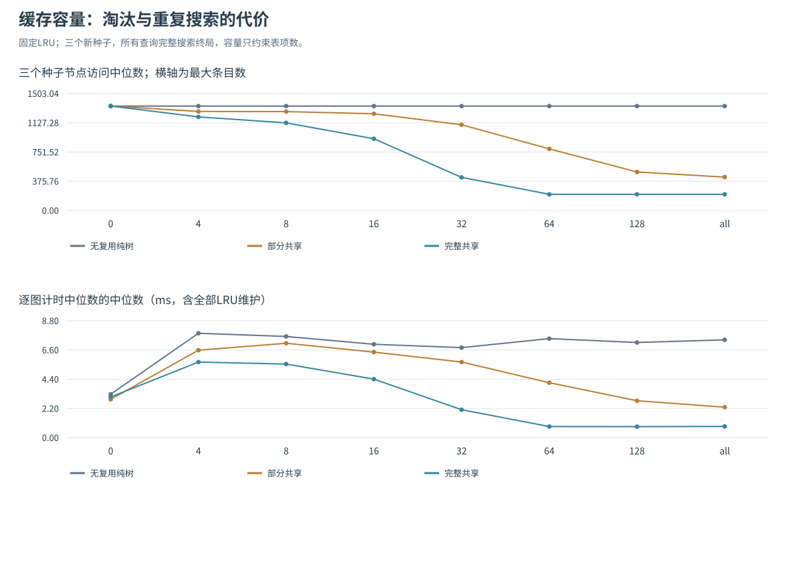
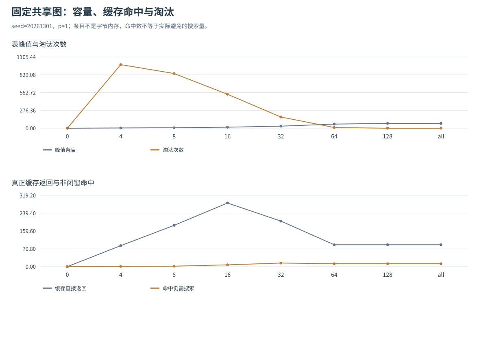

# 题三进一步实验：低点确认、叶值相关性与有限缓存

## 1. 研究问题与设置

采样排序减少了部分节点访问，完整时间却没有改善；界感知缓存则只在共享子问题较多时获得收益。围绕这两个现象，下面检查q8低点能否在新树上复现、叶值结构怎样影响排序信息，以及有限容量怎样改变缓存的收益。

三组方案在首次预热前保存输入、候选和比较方法，正式计时串行进行。题三全部58项测试通过，其中这三组实验对应21项：采样确认5项、相关性模型6项、有限缓存10项。

| 研究 | 输入的独立性口径 | 配置 | 原始重复批 | 计时调用 |
|---|---|---:|---:|---:|
| q8独立确认 | 30棵新种子独立树，3分支6层 | 120 | 840 | 2520 |
| 叶值相关性 | 6组基础随机数，每组派生5档λ；30输入相互有依赖 | 120 | 600 | 1800 |
| 容量限制 | 3种新展开语义，各派生3种共享对象图，共9图 | 90 | 810 | 2430 |

合计330配置、2250批、6750次计时调用。配置、重复批和派生对象图都不能当作独立树数。输入构建、结构验证、独立真值、诊断指标、trace与文件输出均在计时外；各策略的准备、取样、排序、建表及维护开销在计时内。IQR是描述性分布，不是置信区间或显著性检验。

## 2. 固定q=8：原低点只在10/30棵新树同时优于两侧

原发现轮六树聚合中位数在q8附近较低。确认实验固定关注q8，对照q0/4/16；30个新种子20261101—20261130，仍为3分支6层、独立整数叶值−100至100。每配置7个随机交错块、每块3次。

“单树内部低点”的判据事前规定为同一棵树上q8的访问同时严格少于q4和q16，不能用两组聚合中位数替代。30棵树中只有10棵满足；q8虽在25棵树上少于q0，但不具有稳定的两侧优势。

| q | 访问中位数 | 正式叶评估中位数 | 额外采样叶中位数 | 完整时间中位数ms |
|---|---|---|---|---|
| 0 | 418.0 | 238.5 | 0.0 | 0.764 |
| 4 | 300.0 | 145.0 | 969.0 | 1.319 |
| 8 | 292.0 | 145.0 | 1294.5 | 1.376 |
| 16 | 250.0 | 120.0 | 1491.0 | 1.346 |



上表工作量是30棵树指标的中位数；时间先取每树7块中位数，再跨树取中位数。进一步分别计算同树差值：

| q8比较对象 | 逐树访问差中位数[IQR] | 逐树配对时间差中位数[IQR] ms | 时间更快/更慢树数 |
|---|---|---|---|
| q0 | -139.0 [-193.8,-73.2] | 0.574 [0.348,0.702] | 1/29 |
| q4 | -26.5 [-57.2,12.5] | 0.107 [-0.096,0.188] | 13/17 |
| q16 | 25.5 [-15.2,76.2] | 0.017 [-0.231,0.244] | 14/16 |

访问差每树只有一个确定值；时间先在同repeat做q8−对照，再取每树配对差中位数，最后跨30棵树描述。时间差不是上表两组中位数直接相减，快慢树数也不是840个计时批的快慢数。

本批q16的访问聚合中位数250低于q8的292，q8相对q16的逐树差中位数为+25.5。q8对q0的逐树配对耗时差中位数为+0.574ms，29棵更慢、1棵更快。原六树中的q8低点没有稳定复现；确认结果也不足以确定q16是通用最优。

完整逐树判据在[per_tree_lowpoints.csv](results_sampling_confirmation/per_tree_lowpoints.csv)，跨树配对摘要在[aggregate_summary.csv](results_sampling_confirmation/aggregate_summary.csv)，每批值在[timing_batches.csv](results_sampling_confirmation/timing_batches.csv)，完整树与协议在[protocol.json](results_sampling_confirmation/protocol.json)。

## 3. 叶值相关性：估计更准仍需抵消采样成本

### 3.1 模型、控制与限制

固定3分支8层，六个基础种子20261201—20261206。每个叶子有独立噪声z，每条根到叶路径还累加共享前缀信号：第l层权重为0.65^(l−1)，除以权重平方和的平方根，得到H。终局值为：

```text
value = sqrt(1−λ) × z + sqrt(λ) × H
λ = 0, 0.25, 0.5, 0.75, 1
```

同一基础种子的所有λ复用完全相同z和层级边噪声。λ=0是独立叶值，λ=1是纯层级信号，仍存在深层变化，并非全同分树。这样在各层都有分支信号；若仅给根的三个孩子各加常数，子树内部只是正仿射变换，无法有效研究内部排序预测力，故采用层级模型。

该归一化保持生成分布上的理论边际方差，但六个有限基础样本的实际方差、边际形状和博弈难度仍会变化。**不能把λ当作仅改变实测相关系数的纯因果干预。** 每个λ内的策略比较使用同一完整输入，根值必须与独立全树计算相同。六组基础数是独立来源，30个派生输入不是30个独立样本。

### 3.2 预测质量和完整时间

固定比较q0/1/4/8。采样均值只控制顺序，不代替终局值，也不使用诊断时的真值排序。独立诊断计算每个内部父节点的孩子两两排序一致率：真实值相等的对子排除；预测同分按半分计，并保存分子、分母和同分数。主图单列“孩子仍非终局”的层次，避免直接读叶的必然正确预测淹没现象。

| λ | 实测同父叶相关系数 | 实际叶方差中位数 | q1预测一致率 | q8预测一致率 | q1/q0时间比 | q4/q0时间比 | q8/q0时间比 |
|---|---|---|---|---|---|---|---|
| 0 | -0.007 | 3363.2 | 0.632 | 0.741 | 1.535 | 1.144 | 1.184 |
| 0.25 | 0.182 | 3064.5 | 0.631 | 0.744 | 1.962 | 1.522 | 1.668 |
| 0.5 | 0.399 | 2777.6 | 0.631 | 0.750 | 1.961 | 1.566 | 1.490 |
| 0.75 | 0.665 | 2499.3 | 0.636 | 0.760 | 1.422 | 1.343 | 1.372 |
| 1 | 0.998 | 2244.5 | 0.830 | 0.908 | 0.923 | 1.031 | 1.178 |

相关系数为每个末层父节点的第0/1叶组成配对、跨父节点计算Pearson后，再跨六输入取中位数。预测一致率按六树所有可比较非终局孩子对子加权汇总；时间比先逐树计算“该q时间中位数/q0时间中位数”，再跨六树取中位数，不是两组总体中位数之比。





当λ从0到1，q1的一致率约0.632→0.830，q8约0.741→0.908，说明共享层级特征确实让少量探查更有预测力；但中间λ的质量和时间并不严格单调，实际方差也明显变化，必须同时报告。以λ=1组为例：

| λ=1时预算q | 访问中位数 | 正式叶中位数 | 额外探查中位数 | 完整时间相对q0比值中位数 |
|---|---|---|---|---|
| 0 | 1187.5 | 620.5 | 0.0 | 1.000 |
| 1 | 513.0 | 219.0 | 870.0 | 0.923 |
| 4 | 503.0 | 213.0 | 1998.0 | 1.031 |
| 8 | 506.0 | 213.0 | 3072.0 | 1.178 |

λ=1时q1的时间比中位数0.923，在固定候选中出现一个探索性的聚合低点；q0为1、q4为1.031、q8为1.178。六树中q1对q0的配对时间差有4树中位数更快，其中3树的重复批IQR在0以下。这是有限合成模型上的观察，尚不足以把q1当作稳定最优或真实游戏收益。

q8虽然排序一致率约0.908，高于q1的0.830，却多做了额外探查，完整时间反而更慢。q1的正式访问约1187.5→513，但正式叶读取与额外读取不是相同的时间操作：后者用较轻的栈遍历，正式递归还维护窗口、路径和统计。因此总读取更多也不必然更慢，仍需直接测量完整时间。这里支持“信息质量与获得信息的成本共同决定收益”，而不是“相关叶一定能提速”。

完整基础随机数在[inputs.json](results_correlation_study/inputs.json)，每层诊断在[prediction_quality.csv](results_correlation_study/prediction_quality.csv)，所有λ/q摘要在[aggregates.csv](results_correlation_study/aggregates.csv)，每树配对和原始计时分别在[paired_differences.csv](results_correlation_study/paired_differences.csv)、[timing_batches.csv](results_correlation_study/timing_batches.csv)。

## 4. 有限容量缓存：过小缓存会因淘汰拖慢，充分容量后形成平台

`bounded_transposition.py`，固定LRU规则：命中即刷新最近使用位置，即使该界不能关闭窗口；接受写入也刷新，新键入表且容量已满时淘汰最旧项。保留精确/上下界语义和玩家键，每次调用新表。容量0关闭查写，None允许无限条目；**容量不限制搜索深度**。

用三个新种子编号20261301/302/303（编号是随机种子，不表示日期），各p=0/.5/1。每种子三种对象表示保持相同展开语义。候选容量0/4/8/16/32/64/128/all；另保留原始AB和旧无限普通字典缓存，既能比较同内核关闭，又能衡量LRU维护本身的成本。

固定种子20261301、p1强共享，完整展开9841节点，原始AB访问1342、读743叶。结果如下，毫秒均为9批中位数[IQR]：

| 最大条目数 | 访问 | 正式读叶 | 缓存命中次数 | 淘汰次数 | 峰值条目 | 完整ms中位数[IQR] |
|---|---|---|---|---|---|---|
| 0 | 1342 | 743 | 0 | 0 | 0 | 3.063 [2.740,3.414] |
| 4 | 1086 | 507 | 95 | 987 | 4 | 5.458 [5.202,6.428] |
| 8 | 1044 | 400 | 187 | 849 | 8 | 5.230 [4.926,5.426] |
| 16 | 836 | 192 | 293 | 527 | 16 | 4.120 [3.649,4.161] |
| 32 | 426 | 39 | 220 | 174 | 32 | 2.166 [2.096,2.413] |
| 64 | 186 | 11 | 111 | 11 | 64 | 0.832 [0.740,0.911] |
| 128 | 186 | 11 | 111 | 0 | 75 | 0.773 [0.723,1.188] |
| all | 186 | 11 | 111 | 0 | 75 | 0.711 [0.669,0.759] |





容量4虽将访问1342→1086，但发生987次淘汰，完整时间3.063→5.458ms，比同内核关闭缓存更慢。增加到32后访问426；到64时访问186，与无限缓存完全相同。64仍淘汰11项，说明被淘汰的项并非每个都会造成后续重复搜索。128/all的峰值均为75条，已经容纳该输入所需工作集，继续扩大没有搜索量收益。

容量16有293次命中，高于容量64的111次，却访问836而非186。**命中次数多不代表节省工作多**：较大缓存能在更高层提前返回，许多后代甚至不必再探测。三个种子的聚合曲线在64以后进入访问平台；小幅时间排名与重复波动不用于宣称某个容量有稳定内部极值。

旧无限普通字典缓存与无限LRU在本固定图上都访问186、读11叶，时间中位数约0.685和0.711ms，保留这组控制以显示管理结构的开销。纯树各容量都无命中，正容量增加维护成本。表项峰值不是字节内存；本实验没有把OrderedDict、显式输入树及其他对象成本遗漏后声称整体内存节省比例。

容量测试核验键含玩家、窄窗口所有存储/回传界、错误缓存反例应为8、fresh调用、确定LRU淘汰顺序及：

```text
visited = internal + actual_leaf_reads + cache_returns
hits = exact_hits + bound_cutoffs + noncutting_hits
stores = new_insertions + entry_updates
final_entries = new_insertions − evictions
peak_entries ≤ capacity  （容量有限时）
```

图的输入引用结构在[protocol.json](results_capacity_study/protocol.json)，全部容量和基线在[comparison.csv](results_capacity_study/comparison.csv)，重复批及四种参考配对见[timing_batches.csv](results_capacity_study/timing_batches.csv)、[paired_differences.csv](results_capacity_study/paired_differences.csv)。

## 5. 复现与结论

```text
run_q3.cmd tests
run_q3.cmd sampling-confirmation
run_q3.cmd correlation
run_q3.cmd capacity
```

也可`run_q3.cmd extensions`顺序运行三组。Python入口为`run_sampling_confirmation.py`、`run_correlation_study.py`、`run_capacity_study.py`，均支持`--help`。已有结果时另建时间戳子目录，避免覆盖协议和原始数据。五张SVG可用浏览器查看。

这三组实验给出了不同的成本边界：q8的聚合节点低点在新树上没有稳定复现；层级叶值能提高排序预测质量，但更多探查仍可能拖慢运行；LRU容量不足时，重复淘汰会抵消缓存节省，容量充分后访问量进入平台。完整数据保留在各结果目录中，可据此检查这些结论适用于哪些输入。
