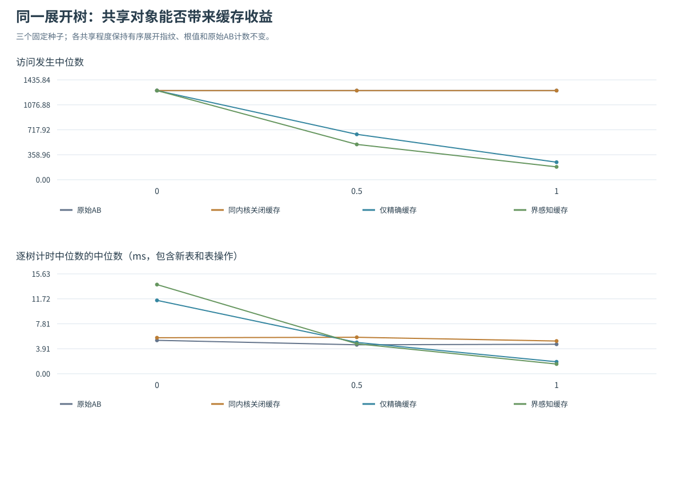
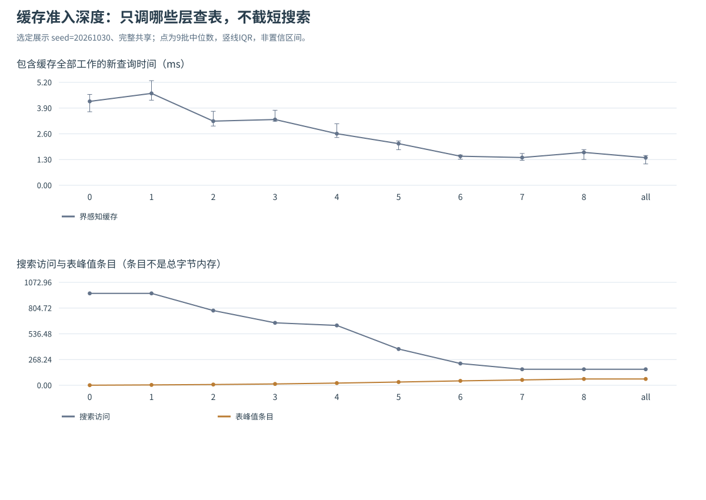

# 题三补充：界感知缓存、错误消融与性能边界

## 1. 重复子问题与缓存

同一个子问题可能经不同分支被重复访问。若能复用已得到的搜索结果，就有机会减少这些重复工作；但Alpha-Beta的截断返回往往只是界，直接缓存一个数值可能改变答案。

前面的采样排序没有获得时间收益，这里改为研究**带界类型的缓存**：哪些结果能够安全复用，重复搜索节省多少，以及查表何时会增加成本。缓存实现仍从左到右访问孩子。

## 2. 参考方法与状态假设

检索日期2026-10-30，优先阅读课程官方资料、作者页面和项目官方源码。

| 一手资料 | 本次借鉴 | 对本题的约束 |
|---|---|---|
| [Berkeley官方Minimax教材](https://inst.eecs.berkeley.edu/~cs188/textbook/games/minimax.html) | 回传、访问顺序及剪枝的理论背景 | 最终仍须用同输入的独立真值核验 |
| [Plaat作者的AlphaBetaWithMemory](https://people.csail.mit.edu/plaat/mtdf.html) | 区分精确值、下界和上界，按缓存界的适用条件使用结果 | 截断标量不能无条件作为精确值复用 |
| [Stockfish官方表结构](https://raw.githubusercontent.com/official-stockfish/Stockfish/master/src/tt.h)及[搜索实现](https://github.com/official-stockfish/Stockfish/blob/master/src/search.cpp) | 实际缓存条目带界类型，搜索检查条目适用条件 | 本题选取简化、可逐项验证的缓存规则，不据引擎规模推测本题收益 |
| [Plaat等：Nearly Optimal Minimax Tree Search?](https://arxiv.org/abs/1404.1518) | 区分重复展开的搜索树与存在置换的状态图 | 本研究通过显式共享对象构造重复子问题，收益不能推广到无共享树 |
| [CS188 Project 2](https://inst.eecs.berkeley.edu/~cs188/fa26/projects/proj2/) | 小树核验与搜索量评估 | 该作业为匹配访问计数禁止等号剪枝；本校PDF规则单独适用 |

本次实现始终完整搜索到终局。因此，同一对象加当前玩家可确定其完整终局博弈值；这是本题状态语义下的推论，不是所有博弈缓存都能省略深度。若未来引入深度截断、非终局评价或其他状态变量，键与缓存适用条件必须相应增加。对象身份缓存也不自动识别两个值相同但分别构建的子树。

## 3. 缓存规则与可核验正确性

独立模块`transposition_search.py`提供`cached_search()`，每次调用新建表，孩子仍左到右访问。键是`(id(node), is_maximizing_player)`，树在一次调用期间保持不变。三种同内核设置为：

1. `off`：关闭查写缓存，是隔离缓存收益的匹配基线。
2. `exact`：只存/复用能证明精确的项。
3. `bounds`：同时存精确值、下界、上界。精确项直接返回；下界不小于当前β，或上界不大于当前α时才直接返回。其余命中继续搜索，不把该界当真值，也不据它收紧窗口。

回传类型按进入节点时的原窗口分类，叶值是精确值。同类型保留较强界，已有精确项不被弱界覆盖。没有额外先验求值或预先计算全部子树高度。当前表没有固定容量或淘汰机制，峰值条目数不等于总字节内存。

`max_cache_depth=D`只允许绝对根深度不超过D的节点查表/写表；0仅根，`None`即all允许全部层。**它不截短搜索、不改变终局或评价函数。** 本批树深度8，D=8与all允许的节点相同，但条件判断的代码路径略有区别，应视为冗余策略对照，不能算两组独立输入。

计数拆分如下：

- `visited_nodes = internal_nodes + leaf_evaluations + tt_returns`；查到可用项仍有一次访问，但不重复展开或读叶。
- `tt_hits = exact_hits + bound_cutoffs + noncutting_hits`；命中不等于实际截断。
- `tt_returns = exact_hits + bound_cutoffs`。
- `table_peak_entries`计表中条目，`stores`计实际接受的写入；不与显式输入树、Python对象或整体内存混为一谈。

缓存阶段16项测试通过；连同21项核心测试，该阶段共37项。缓存测试包括1440个共享DAG配置、270个纯树配置、192个窄窗口配置中的内部返回和存储界、不同玩家键、叶修改后新表、原结构不变性与非法输入；真值用独立方法计算，不根据缓存自身结果判对错。

## 4. 错误缓存消融：根值8为什么会被算成6

令`X=MAX(6,9)`，两处引用同一对象，构造：

```text
root = MAX( MIN(5, X), MIN(X, 8) )
```

完整真值：X=9，左MIN=5，右MIN=8，所以根=8。左MIN已看到5后，以β=5搜索X；读6便可截断，得到下界6。若错误地存为EXACT6，右MIN复用它就会返回6，最终根误算6。

界感知缓存再次遇到X时，缓存下界6不足以关闭新窗口，因此继续搜索；最终得到正确根8。只有精确缓存、关闭缓存和原始AB也均得8。反例中的错误实现明确放在`incorrect_cache_demo()`，只用于故意错误消融；安全求解器不提供这种模式。

`results_transposition/cache_counterexample.json`同时保存错误和安全轨迹。它说明“命中率高”不是正确性证明：存错类型会以减少搜索为代价得到错误答案。

## 5. 固定展开语义，只改变共享程度

对每个种子，先构造3分支、8层、每中间层最多12个基础对象的分层无环图，再按引用发生位置选择共享同对象或复制对象。p=0、0.5、1是共享选择的概率参数，不是实测去重比例；实际不同对象数另外记录。

各p保持相同有序展开指纹、叶值、根值及原始AB的搜索计数，区别仅在对象复用。独立真值、完整展开次数和有序指纹在计时外计算。此设计避免用两棵难度不同的树冒充缓存对照。

发现阶段包含3种子×3共享设置，加正式JSON、PDF共享对象构建及错误反例，共12个对象图记录、5种不同有序展开语义。比较4种方法48配置，再对6个共享图及1个纯树负对照扫描10种准入上限70配置，共118配置。所有安全配置根值正确。

每配置先一次不计入结果的运行，再随机交错9个重复块，每块连续5次取批平均，共1062批、5310次计时调用。新表建立、探测、判断、写入和搜索均计时；输入构建、结构预检、独立核验、trace和输出不计。IQR是9批描述性波动，不是跨地图置信区间；下表时间不与原先排序实验跨轮拼接。



下面完整展示固定种子20261030，展开均有9841节点、6561叶；原始AB在三种p下均访问958次、读530叶。时间为9个重复块的中位数[Q1,Q3]，毫秒。

| p / 不同对象 | 方法 | 访问 | 实读叶 | 缓存返回 | 完整ms |
|---|---|---:|---:|---:|---|
| 0 / 9841 | 原始AB | 958 | 530 | 0 | 4.332 [3.521,4.662] |
| 0 / 9841 | 同内核off | 958 | 530 | 0 | 4.255 [3.899,4.645] |
| 0 / 9841 | bounds | 958 | 530 | 0 | 9.615 [8.730,10.287] |
| 0.5 / 859 | 原始AB | 958 | 530 | 0 | 3.510 [3.442,3.767] |
| 0.5 / 859 | 同内核off | 958 | 530 | 0 | 4.221 [3.787,5.070] |
| 0.5 / 859 | bounds | 508 | 113 | 176 | 4.213 [3.978,4.395] |
| 1 / 81 | 原始AB | 958 | 530 | 0 | 4.159 [3.637,4.638] |
| 1 / 81 | 同内核off | 958 | 530 | 0 | 3.852 [3.456,4.335] |
| 1 / 81 | exact | 283 | 10 | 136 | 1.919 [1.641,2.042] |
| 1 / 81 | bounds | 167 | 10 | 84 | 1.524 [1.272,1.648] |

纯树没有可复用对象，查写缓存只增加成本；3个种子中bounds对原始AB均为0/9批更快。强共享时，不但能复用叶值，还能用已知上下界跳过重复内部搜索：固定种子p1有24次界缓存截断，较exact少116次节点访问。缓存总返回84次少于exact的136次，并不表示收益更差，因为上层截断后已不必到达许多后代命中位置。

强共享的三个种子，bounds对原始AB均为9/9批更快；部分共享p0.5的结果则随种子与基线不同，不能宣称只要存在共享就提速。固定种子p0.5对原始AB的配对差中位数为+0.770ms，即仍偏慢；对同内核off的IQR跨0，虽节点少很多，完整时间仍未出现清晰收益。

正式JSON独立对象样例没有缓存命中，保持14次访问、7次读叶；共享代码样例读叶7→6，但访问仍14次，且时间增加。仅仅3个共享对象的微小样例不足以抵消维护表的开销。

## 6. 缓存准入深度与收益平台



固定种子20261030的p1完整共享图，逐层允许缓存：

| D | 访问 | 实读叶 | 表峰值条目 | 完整时间ms中位数[Q1,Q3] |
|---:|---:|---:|---:|---|
| 0 | 958 | 530 | 1 | 4.236 [3.711,4.586] |
| 1 | 958 | 530 | 4 | 4.639 [4.295,5.280] |
| 2 | 779 | 436 | 8 | 3.238 [2.991,3.734] |
| 3 | 651 | 359 | 14 | 3.319 [3.230,3.788] |
| 4 | 624 | 342 | 23 | 2.605 [2.413,3.108] |
| 5 | 378 | 195 | 34 | 2.103 [1.795,2.234] |
| 6 | 227 | 89 | 46 | 1.467 [1.317,1.529] |
| 7 | 167 | 29 | 56 | 1.401 [1.257,1.606] |
| 8 | 167 | 10 | 66 | 1.661 [1.305,1.802] |
| all | 167 | 10 | 66 | 1.394 [1.078,1.505] |

D从0增到6，允许复用更深的重复子问题，大幅减少重复访问；从7到8，访问已不再减少，只把19次实际叶读取换为表返回，并增加10个表项。这里有明确的**收益趋于饱和区间**。有限D的时间中位数在7有局部低点，但6/7/8的IQR重叠，且all与8允许相同节点，时间排名仍有差别，表明这些细小差异尚不足以确定稳定最优。

其他种子的收益平台和时间排名也不完全相同。纯树没有缓存命中，增加准入深度主要增加写表工作。采样预算与缓存准入深度控制的是不同成本，两者分别比较。

## 7. 数据与复现

```text
python -m unittest discover -v
python run_transposition_study.py
```

也可用`run_q3.cmd caching`。默认目录已有内容时另建时间戳子目录，保留该组数据。

| 文件 | 内容 |
|---|---|
| [comparison.csv](results_transposition/comparison.csv) | 118配置、独立真值、访问/表工作与时间IQR |
| [timing_batches.csv](results_transposition/timing_batches.csv) | 1062个原始计时批 |
| [paired_differences.csv](results_transposition/paired_differences.csv) | 同重复块bounds−基线差，负值表示更快 |
| [inputs.json](results_transposition/inputs.json) | 用稳定节点编号与引用保存共享对象图及有序展开指纹 |
| [cache_counterexample.json](results_transposition/cache_counterexample.json) | 错误精确缓存与安全缓存的轨迹 |
| [reproducibility.json](results_transposition/reproducibility.json) | 环境、种子、计时边界、源码及输入SHA |

这项优化的适用对象是一次求解期间保持不变、确有重复引用的有限无环图。它不自动合并结构相同的独立对象，也未处理真实游戏中的完整状态散列、深度截断、容量淘汰或多线程修改。强共享收益、弱共享不确定、纯树负收益共同构成优化的证据范围。

## 8. 固定策略的新输入确认

发现轮之后，固定关注策略为`bounds/all`，比较对象固定为原始AB、同内核off和exact/all；不按确认结果重选准入深度或剔除不利案例。新种子20261040/41/42，各p=0/0.5/1，得到9个对象图、3种新有序展开语义。先写`protocol.json`再进行首次预热，保存完整图、候选、主比较、旧数据与源码SHA，结束核对协议未变。

主比较事先指定p1强共享下bounds对原始AB；p0为无复用负对照，p0.5为迁移组。36配置×15块×每批5次，共540批、2700次新调用，全部安全根值与独立真值相同。下表是**同repeat配对差bounds−original**的中位数与IQR，负值表示更快，不是两组中位数直接相减。

| 种子 | p=0 无复用 ms差[Q1,Q3] | p=0.5 部分共享 ms差[Q1,Q3] | p=1 主比较 ms差[Q1,Q3] | p1更快/更慢批数 |
|---:|---|---|---|---:|
| 20261040 | +2.616 [1.467,2.989] | −0.069 [−0.611,0.320] | −1.209 [−1.505,−0.705] | 14/1 |
| 20261041 | +3.019 [2.342,3.309] | +0.040 [−0.270,0.517] | −1.265 [−1.407,−1.044] | 15/0 |
| 20261042 | +2.839 [2.499,3.550] | −0.180 [−0.747,−0.073] | −1.492 [−1.915,−1.289] | 15/0 |

三种新强共享输入均保留较快方向；三种纯树负对照均15/15块更慢；部分共享仍有两组IQR跨0。这与发现轮的机制一致：收益来自足够多且足够昂贵的重复子问题，不能推广为默认对所有树开缓存。15块不是15棵独立树，p0/.5/1也共享同一种展开语义；新确认仅检验同一生成机制的新种子，不证明任意真实游戏泛化。IQR依然是描述性波动，不是显著性或置信区间。

新确认没有检验某个有限D是最优，故不将探索曲线的最低点升级为稳定参数结论。发现轮与确认轮时间分别保存，不跨轮拼接。协议、每批值、全部27对比较和结果SHA见[确认目录](results_transposition_confirmation/)，复现命令：

```text
python run_transposition_confirmation.py
```

也可运行`run_q3.cmd cache-confirmation`。已有输出时另存时间戳子目录。


固定LRU的有限容量研究见[参数与容量实验](SUPPLEMENTARY_EXPERIMENTS.md)第4节，其中进一步比较容量不足时的频繁淘汰与容量充分后的访问平台。
