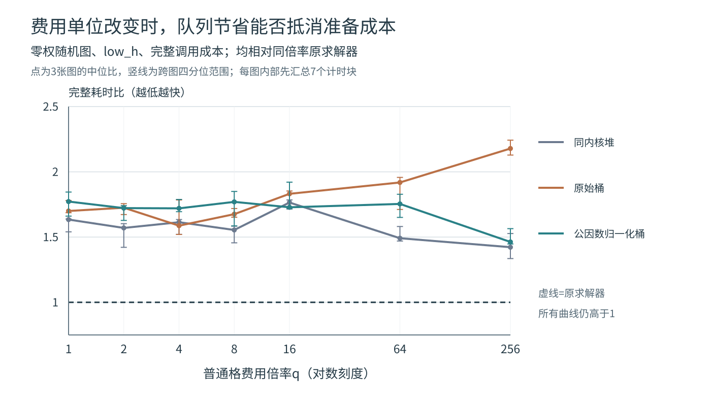

# 题二补充实验 整数桶与费用单位归一化

## 1 研究问题

此前的实验主要改善下界及同分排序，也尝试过清理过期堆项。本次保持`row_column_tight`下界和既定的FIFO或low_h次序，研究优先队列本身的成本。如果两种实现返回相同路径，连有效出队顺序都相同，时间差就不能解释成搜索了更少的状态。

主要参考[Fereday与Hansen的SoCS 2025论文](https://ojs.aaai.org/index.php/SOCS/article/download/35976/38131/40048)。该文背景部分讨论一致整数启发函数下的桶队列及同f优先小h的处理；这里借鉴这一队列结构，仍然要求最优解，不采用论文的次优搜索目标。本实验进一步检查费用表示的影响，并增加公共费用单位归一化作为精确修正。

## 2 队列实现与最优性

### 2.1 循环f桶

一致启发函数使边`u→v`上的有效优先级增量

`δ(u,v)=c(v)+h(v)−h(u)`

非负。这里`c(v)`依然是题二的进入费，指定终点E进入费为0，返回S的边依照原实现删除。构建时检查全部合法边，取最大增量D，以D+1个槽存放循环f桶；不得直接把最大地形费当作D。

取出最小f时，游标向前扫描至非空桶。同f的FIFO使用普通队列，low_h则在桶内用`(h,入队序号)`堆，不能假定最小h也单调递增。因此两种排序都保持原堆完整优先级，而不是借换容器悄悄换访问顺序。所有严格松弛、过期g检查、目标有效弹出及路径账本规则与原求解器相同。

### 2.2 公共费用单位

把全图普通格费用整体乘q时，所有路径代价及安全启发函数都同比放大，最短路和同分次序不变；原桶的数值跨度却随之增大。为避免仅因计价单位改变而增加空桶扫描，新增`bucket_gcd`：取所有正进入费的最大公约数u，只将桶索引改用`f/u`和`D/u`。原始g、h、f、路径进入费和累计账本仍保留原单位。

题二四种安全下界由进入费的最小值、求和、整数倍与max组成，故均为u的整数倍。实现仍检查整除条件；全零费用时u取1。除以同一正数不改变优先级顺序，因此该修正保持最优费用、路径和有效出队轨迹。

### 2.3 存储保护及完整成本

预先固定最多32768个桶槽。原始桶或归一化桶所需槽数超过上限时，精确回退到同一内核的二叉堆，保留`bucket_fallback=1`。它是存储保护，不是放松答案精度；回退记录不能被算作纯桶加速。

同内核heap、bucket、bucket_gcd均执行相同的输入规范化、h表、gcd与D全边检查，以控制新实现的公共准备工作；原`weighted_astar.py`另列为原求解接口对照，其准备工作更少。所有准备、槽数组分配、空桶扫描、搜索和逐格路径/费用账本都计入调用总时间。索引及待处理记录有实际存储成本，桶槽数和队列峰值不直接等同于字节内存。

## 3 固定实验设计

正式预注册由`run_bucket_study.py`在任何oracle、预热和计时前独占写入`protocol.json`。固定12张互不相同的基础地图：21、31、41三个尺度，各有均匀图、高费行列带、零权随机障碍图和稀疏高费图。确定性结构不冒称不同随机种子；随机障碍不按是否可达筛选。稀疏高费位置由结构规则指定，不按算法结果移动。

普通整数费分别乘`q=1、2、4、8、16、64、256`，S/E/X不变，E仍免费。84个地图—倍率输入各比较FIFO/low_h，以及原版、同内核heap、原始bucket、bucket_gcd，共672配置。默认7个计时块，每块每配置2次调用；块内打乱任务和方法顺序，全部串行执行，使用解释器默认垃圾回收。

独立Dijkstra只读取原始网格解释费用，核对最小费用。逐格检查边界、障碍、相邻步、起终点及全部费用账本。在计时外保留轨迹，并强制检查：同输入同排序下四种方法的路径、有效出队坐标及公共搜索计数相同；费用×q后坐标顺序不变，轨迹g/h/f恰好×q。这是本实验关键控制，不能仅以最终答案相同替代。

正式计时关闭轨迹，每次调用后在计时外再次核对费用、路径和全部计数。输出逐调用原始记录，块平均时间取中位数及四分位区间；配对差使用同图、倍率、排序、重复块。7块是重复测量，不增加基础地图数。费用倍率是输入表示敏感性，曲线交点不应写成“算法最优参数”。所有损失和回退均保留。

## 4 实测结果与分析

### 4.1 同一搜索过程仍会受到费用表示影响

672个配置全部保持最优费用、路径与同排序下的有效出队轨迹，9408次正式调用的路径、账本和计数也全部通过核验。十二张基础地图乘七个倍率形成84个输入，不是84张独立地图。全部基础图的此次查询均有解；零权、无解和S=E等边界另由正确性测试覆盖。

下面预先按31×31、zero_random类展示代表输入，使用low_h。q从1变为256后，四种方法的扩展始终为836次，费用从53变为13568；同一q内完整轨迹指纹相同。时间为7个块平均调用耗时的中位数，单位ms。

| q | 方法 | 完整时间 | 桶槽数 | 空桶扫描 | 是否回退 |
|---|---|---:|---:|---:|---:|
| 1 | 原求解器 | 5.479 | 0 | 0 | 0 |
| 1 | 同内核堆 | 7.923 | 0 | 0 | 0 |
| 1 | 原始桶 | 9.166 | 8 | 53 | 0 |
| 1 | 归一化桶 | 8.487 | 8 | 53 | 0 |
| 256 | 原求解器 | 6.090 | 0 | 0 | 0 |
| 256 | 同内核堆 | 9.937 | 0 | 0 | 0 |
| 256 | 原始桶 | 14.046 | 1793 | 13568 | 0 |
| 256 | 归一化桶 | 8.907 | 8 | 53 | 0 |

原始桶在q=256时需要1793槽，并扫描13568次空位。归一化后费用单位u=256，槽数和扫描恢复为8与53，答案仍使用原费用13568，搜索状态数没有变化。这里减少的是表示造成的容器工作，不是搜索难度。q=1时u=1，没有可消去的放大单位；该例的时间差不能解释成普遍的gcd收益。

### 4.2 三张零权随机图是否保持相同趋势

各图先取7块中位时间，再计算候选/对照比，最后取三图的中位数。快图数则按同图7个配对时间差的中位数小于0计数；接近平台时，这两种汇总可能方向不同。以下仍为low_h。

| q | 归一化桶/原始桶 | 较快图数 | 归一化桶/同内核堆 | 较快图数 | 归一化桶/原求解器 | 较快图数 |
|---|---:|---:|---:|---:|---:|---:|
| 1 | 1.031 | 1/3 | 1.084 | 0/3 | 1.772 | 0/3 |
| 256 | 0.657 | 3/3 | 1.147 | 1/3 | 1.463 | 0/3 |

放大费用后，归一化版本相对原始桶有清晰收益，但它仍未普遍胜过同内核堆，更没有胜过原求解器。全部168个基础图×倍率×排序的配对比较中，归一化桶相对原入口均未取得更短的配对中位时间。新模块需遍历全图建立h表并扫描合法边计算D，而原入口按需计算h；这部分成本在强下界仅扩展少量节点时尤其突出。因此，同内核堆的比较只能说明队列之间的差异，不能代替与原接口的总耗时比较。



图中三个候选都以同倍率原求解器为对照，点和竖线分别为三图的中位比与跨图四分位范围。归一化抑制了原始桶的大倍率扫描负担，但整条曲线仍高于原入口。时间不严格随q单调变化，输入规模和操作成本之外还存在计时波动；本次不从曲线中挑一个倍率宣称算法最优参数。

### 4.3 其他地图和存储保护

q=256、low_h下，各类全部三图的结果如下。稀疏高费原始桶此时已经按预定规则回退堆，相关比值不能称为纯桶比较。

| 地图类 | 归一化桶/原始桶 | 前者较快图数 | 归一化桶/原求解器 | 前者较快图数 |
|---|---:|---:|---:|---:|
| 均匀 | 0.977 | 1/3 | 4.295 | 0/3 |
| 高费行列带 | 1.083 | 0/3 | 4.252 | 0/3 |
| 零权随机障碍 | 0.657 | 3/3 | 1.463 | 0/3 |
| 稀疏高费 | 1.078 | 0/3 | 4.478 | 0/3 |

十二张基础图的原始桶共30个配置触发回退，全部来自稀疏高费组的q=4、8、16、64、256及两个排序；归一化桶为0次。以31×31稀疏高费、low_h为例，q=256时原始桶回退，归一化桶仍用10002槽。但两者完整时间分别5.454与6.186ms，而原求解器为1.381ms。**避免回退不等于更快**：此处没有空桶扫描，保留大桶数组和其他准备工作反而未获益。

因此，本次修正解决了原始桶对公共费用单位的表示敏感性，适合解释费用跨度与容器成本的关系；现有实现没有获得相对正式入口的完整时间收益，正式默认仍使用原二叉堆A*。这项负结果与原始桶、同内核堆的对照一起保留。

## 5 复现与文件

在题二目录执行：

```text
python -B -m unittest test_bucket_astar
python -B run_bucket_study.py
python -B summarize_bucket_study.py --data results_bucket
```

已有结果时另建`rerun_*`子目录，不覆盖原记录。可通过`--output`指定另一个目录；`--prepare-only`仅保存协议，不调用oracle、求解器或计时。正式参数为`--seed 20261110 --repeats 7 --batch 2`。

- `bucket_astar.py`：循环桶、公共费用单位和同内核堆对照。
- `test_bucket_astar.py`：独立Dijkstra、小网格布局、零权环、免费数值终点、巨大权重、倍率轨迹及归一化回退测试。
- `results_bucket/protocol.json`：全部具体地图、端点、比较和时序规则。
- `results_bucket/comparison.csv`：逐配置最优费用、搜索计数、桶槽、空桶扫描和回退标记。
- `results_bucket/timing_calls.csv`及`timing_batches.csv`：未删改的逐调用与块平均耗时。
- `results_bucket/summary.csv`、`paired_deltas.csv`、`aggregate_summary.csv`：配置汇总、配对差与各类地图结果。
- `results_bucket/manifest.json`：环境、源码与结果指纹及实际计数。
- `summarize_bucket_study.py`：从已保存CSV生成矢量图和派生图数据，全部使用标准库；若实验另存于`rerun_*`，将`--data`指向该子目录。

独立审计复算9408条原始调用到4704个块平均值，再到672组汇总、840组配对差及224组类别统计，逐项一致；manifest所列8份结果文件和3份源码指纹一致。同q的四方法轨迹指纹直接核对相同；跨q的搜索计数与费用同比放大也可从CSV复核，逐步g/h/f的倍率条件由正式运行时断言核验。这里不把轨迹指纹当成重新运行过一次全部实验。
