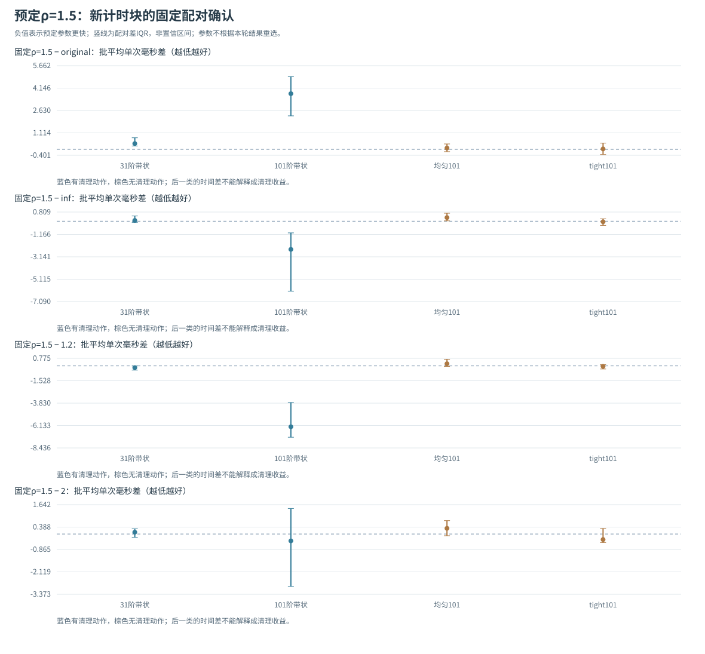

# 题二：预先固定ρ=1.5的独立计时确认

## 1. 研究问题与冻结的关注参数

先前调参在101阶带状图中观察到ρ=1.5附近较低的中位时间，但该参数也由同一批测量选出。确认实验先固定ρ=1.5，再采集新的计时块，检验该观察能否重复。

候选始终为1.05、1.2、1.5、2、inf，并同批保留原A*参照。固定配对是ρ=1.5相对original、inf及有限左右邻居1.2、2。主要比较预先指定为101阶带状图上的ρ=1.5与original。

## 2. 与原工作负载一致的确认协议

四个地图—启发组合固定为bands_31、bands_101、uniform_101、tight_bands_101。其中后两个带状组合共享同一101阶地图，实际是三个不同地图/端点输入。每个组合逐格核对原调参结果的地图、端点、启发、排序和global最小费用范围，不重新生成有利输入。

新种子20261030只改变计时配置的先后顺序。默认15个重复块、每批3次完整查询，四组共24个配置、360个计时批和1080次计时调用。整个solver调用包括规范化、open管理、过滤、heapify、搜索和路径回溯；独立Dijkstra、轨迹与正确性核验、绘图和写文件均在计时外。

脚本在首次预热之前独占写入`protocol.json`，保存候选、关注参数、比较对象、描述性判据、输入配置SHA、旧结果来源SHA和本组源码SHA。结束后核对协议未改变，并在`confirmation_reproducibility.json`中保存其SHA。默认输出目录已有内容时，脚本新建带时间戳的`run_*`子目录，保留原确认结果，不静默覆盖或混用旧数据。

## 3. 描述性判据与解释边界

对每个repeat计算`Δ=t(ρ=1.5)−t(参照)`，负数表示预定参数更快。先求每块配对差，再汇总中位数、Q1/Q3和完整范围，不用两个边际中位数之差替代。

预先声明：配对差Q3<0记为本组计时块中方向较一致的改善，Q1>0记为方向较一致的变慢，其余记为混合或方向未定。若要支持ρ=1.5的严格局部低点，左右有限邻居1.2和2的配对差都需符合前一条件。这是描述性判据，不是置信区间、显著性检验或跨地图泛化证明。

uniform与tight无清理动作对照中，参数的表面时间排名不能归因为清理收益。复用runner生成的`selection.csv`只作辅助描述；最终确认只评估预先指定的ρ=1.5，不能用本组新最低点替换它。

## 4. 运行与结果位置

```powershell
python run_heap_confirmation.py
```

默认输出到`results_heap_confirmation/`。再次运行会在该目录下生成新的`run_*`子目录；也可明确指定新的目录：

```powershell
python run_heap_confirmation.py --output-dir results_heap_confirmation/repeat_check
```

协议、原始批值、最优费用与有效顺序核验结果、固定配对统计及IQR图随结果保存。最终结果见下一节，原始数据、未重复的收益与固定判据一并保留。

## 5. 最终独立计时结果：原提速信号未重复

预先固定的24配置、360计时批、1080次计时调用已完成。全部配置达到独立Dijkstra最优费用，返回路径及有效出队顺序与原A*相同，实际输入及参数符合事前协议，协议SHA未变。确认阶段新增5项协议与固定比较测试，与此前28项合计33项。辅助selection表保留完整候选，确认结论仍评价预定ρ1.5。

| 固定组合 | original中位ms | 预定ρ=1.5中位ms [Q1,Q3] | ρ=1.5清理次数 | 堆峰值original→ρ1.5 |
|---|---:|---|---:|---|
| 带状31 | 3.848 | 4.368 [4.178,4.525] | 26 | 131→98 |
| 带状101（主比较） | 50.232 | 54.844 [53.669,56.786] | 105 | 1192→386 |
| 均匀101（无清理对照） | 5.022 | 5.255 [5.128,5.830] | 0 | 199→199 |
| tight带状101（无清理对照） | 5.222 | 5.218 [4.986,5.645] | 0 | 199→199 |

101阶带状主比较的固定配对结果如下。差值由同repeat先相减再汇总，不能用两个时间中位数的差替代：

| 主比较：ρ1.5减参照 | 配对差中位ms [Q1,Q3] | ρ1.5更快/更慢批数 | 描述性结果 |
|---|---|---|---|
| original | 3.769 [2.268,4.924] | 2/13 | 配对差偏向更慢 |
| inf | -2.485 [-6.165,-1.030] | 12/3 | 配对差偏向更快 |
| 1.2 | -6.256 [-7.336,-3.767] | 13/2 | 配对差偏向更快 |
| 2 | -0.384 [-2.933,1.428] | 9/6 | 混合，不能确认方向 |

原发现批曾观察到ρ=1.5相对original约1.11倍的中位数比；新确认批中，ρ=1.5相对original的配对差中位数反为+3.769ms，IQR[2.268,4.924]，15块仅2块更快、13块更慢。新计时没有复现原提速信号，因此继续保留原A*作为默认实现。具体运行波动来源未单独隔离，本组也不据此推断任意机器上的因果结论。

对同内核inf，ρ=1.5的配对差中位数仍为−2.485ms，IQR全负；它说明清理在已经承担open维护成本的内核中可能有用，但不能替代与原实现的比较。ρ=1.5较1.2偏快，较右侧2的IQR跨0，因此预定参数严格优于两侧的局部低点也未确认。物理堆峰值1192→386仍是确定的队列计数变化，但不能等同总内存或时间收益。

小带状图相对original也偏慢。均匀图和tight对照中清理次数与删除数均为0，时间差即使偏向某候选，也不能称为清理收益。保留这些对照能区分真实维护动作与测量排名。



这是在同三个地图上的新计时，不是跨地图独立泛化验证。辅助selection表和完整候选曲线保留供追溯，确认结论只评价事前固定ρ=1.5；未确认的收益如实写入报告，原正式求解器无需因发现批的有利排名而替换。
