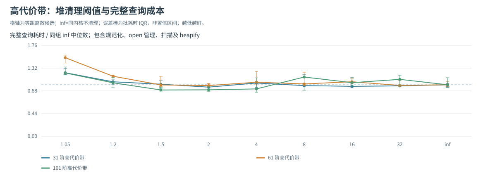
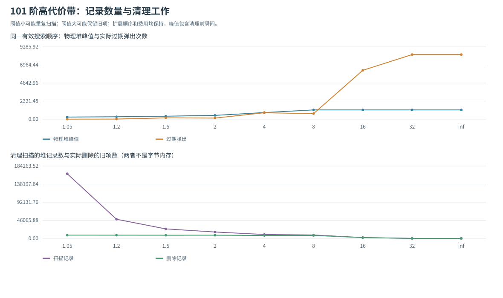
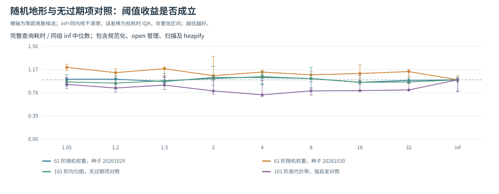

# 题二：堆清理阈值的性能调参

后续已用预先固定参数的新计时块作[独立计时确认](HEAP_CONFIRMATION.md)。本页属于调参发现阶段；最终结论应同时阅读确认结果，不能只选择较有利的一轮。

本研究调整搜索器的维护策略，保持地图、启发函数、并列排序和最优费用目标不变。它与地形高费 K 的路线切换实验回答不同问题：K 改变问题输入，ρ 改变同一搜索过程如何处理已经失效的队列记录。

## 1. 参数、触发时机和正确性

原 A* 允许同一格子以更小 g 再次入堆，旧记录出堆时跳过。新模块 `heap_compaction.py` 维护一个有效 open 状态集合。设 H 为物理堆记录数，O 为不同有效 open 状态数，在一次有效扩展的所有邻居松弛完成后检查：

`H > ρ × O`

触发时，仅保留记录中 g 等于当前 `best_g[node]` 的项，然后调用 `heapify`。当 O=0 而 H>0，所有剩余项均已过期，有限阈值会一并删除。ρ 必须大于1；正无穷表示同内核不清理。旧项出堆不能从 open 集合删除该格子，因为它可能仍有一条更优记录等待出队。

清理保留整个 `(f, secondary, serial, node, g)` 元组，不重新计算启发、不重新编号，也不改变父指针。因而留下的有效记录的全序相同，下一条有效记录及其后续松弛也相同。按有效出队次数归纳，费用、路径、有效扩展顺序、成功入堆次数及重新扩展次数保持不变。变化的是过期记录何时被删除、物理堆大小和这些维护操作的成本。

每次调用核验记录守恒：

`generated_nodes = popped_nodes + removed_stale + final_heap_size`

不能用“原版过期弹出数−新版过期弹出数”替代删除数：清理也可能删除原版直到终点弹出时仍留在堆中的旧项。

## 2. 为什么可能出现内部最优

较小 ρ 更早删除旧项，可能减少后续堆操作，但会更频繁地扫描和重建；较大 ρ 减少重建，却允许更多旧项占据堆。在相同有效搜索量下，这两种成本存在权衡，因此应观察总时间随参数的变化，而不是期待扩展节点数形成极值。

若一次清理前有 H 条记录、O 个有效 open 状态，则删除 R=H−O 条旧项。触发条件保证 `H < ρR/(ρ−1)`，所以过滤与建堆的线性工作可以按被删除的旧项摊销。ρ 接近1时这一常数增大，说明即使渐近上界不变，也不能忽略过于积极清理的实际成本。

实验不预设必须出现 U 形。最好值落在候选边界、候选之间波动重叠，或不清理更快，都是应保留的结果。只将当前输入和已测参数范围内的选择写为局部结果。

## 3. 两种基线与公平计时

- 同内核 `ρ=inf`：保留 open 集合与新增结果核算，但不清理，用于隔离阈值的影响。
- `original`：调用原来的 `weighted_astar.astar_search`，在同一计时批中交错运行，反映新内核维护 open 集合等额外工作相对原求解器是否值得。

有限 ρ 比同内核 inf 快，不能直接解释为比原求解器快。结果同时保留两种参照。

默认候选为 `1.05,1.2,1.5,2,4,8,16,32,inf`，默认7个固定地图/启发组合，包括31/61/101阶高代价带、61阶异质随机权重的两个种子、101阶均匀图与101阶高代价带的 tight 强启发对照。其中两个组合使用同一101阶地图但启发不同，合计为6个不同地图与端点输入，不称为7张独立地图。

候选是否处于内部只按有限 ρ 的左右邻居判断。inf 是“不清理”这一独立对照，不能把最大有限候选和 inf 之间的比较当成有限区间的两侧证据；若最佳有限值落在最大候选，仍应补更大有限值或只承认边界最优。

每组预热1次，随后9个批次、每批连续运行3次完整查询；每个批次按固定随机种子打乱各阈值及 original 的先后顺序。计时包括验证、规范化、行列准备、open 管理、过滤、heapify、堆搜索、路径回溯及结果核算；独立 Dijkstra、轨迹记录、有效顺序核验、绘图和写文件不计入。

在计时外，所有配置逐项核对独立最优费用、实际路径费用及原求解器的有效出队轨迹。`max_frontier` 在每次入堆后、任何清理前记录真实瞬时峰值；它是记录条数，不是总内存字节。`scanned_entries` 是过滤时检查的记录次数，不是包含 heapify 比较在内的精确指令数；重建的实际开销已进入完整时间。

## 4. 阅读结果

实测文件在 `results_heap_tuning/`：

| 文件 | 内容 |
|---|---|
| `comparison.csv` | 每组每阈值与 original 的搜索计数、清理成本、完整时间中位数/IQR/最小最大值 |
| `timing_batches.csv` | 全部批平均单次耗时、批号与当批执行位置 |
| `selection.csv` | 已测候选最低中位数、是否边界、两种参照下加速比与 IQR 重叠候选 |
| `rho_time_bands.svg` | 高费带的阈值曲线，按同组 inf 中位数归一化 |
| `rho_time_controls.svg` | 随机权重、无过期项与强启发对照的曲线 |
| `rho_heap_work.svg` | 最大带状图中的物理队列峰值、过期弹出与清理扫描量 |
| `outcomes.json`、`reproducibility.json` | 核验结果、完整输入/路径、参数、计时顺序、环境与源码哈希 |
| `previous_timing_ranges.csv`、`previous_timing_sources.json` | 基础和前轮补充共1844条已有配置的批间波动及原数据哈希 |

图中误差棒为批耗时IQR，经同一固定分母归一化，描述重复计时的波动。较低ρ增加重建频率，较高ρ保留更多旧记录；两种成本共同决定曲线。IQR不作置信区间使用。

## 5. 最终实测：有限区间低点、波动与代价

### 5.1 范围扩展和验证结果

首轮最大有限候选为8，61阶带状图的最低中位数落在这个上界。该结果不足以支持有限区间内部最优，因此补入16、32，并将全部7组在新候选集合下重新同轮计时。以下数字全部来自这次最终轮，不将首轮更有利的时间拼入结果。

最终共有6个不同地图/端点输入、7个地图/启发组合，比较9个ρ与同批 original，共70个配置、630个计时批。70个配置的费用全部达到独立 Dijkstra 的最优值，所有路径与有效出队顺序均与原 A* 一致，63个新内核配置全部通过记录守恒。inf 的原有统计字段与原 A* 全部相同。

调参阶段新增9项测试，与此前19项合计28项；后续确认阶段再增加5项，当前共33项。新测试含60张随机图×4启发×2排序×2最小权值范围×4阈值，共3840个新内核随机配置，并检查可采纳但不一致启发的重开、无有效open时清理剩余旧项、无旧项负对照以及参数边界判定。

### 5.2 候选低点与时间波动

时间单位为毫秒/次。ρ 最低值只在新内核候选内选择，original 是外部参照；括号内为批耗时IQR，不是置信区间。

| 固定组合 | 本组最低ρ | 最低中位数（IQR） | 同内核inf | original | original/最低时间 |
|---|---:|---|---:|---:|---:|
| 带状31，corrected | 2 | 4.786（4.681—4.976） | 5.016 | 4.353 | 0.909 |
| 带状61，corrected | 2 | 21.277（20.649—22.095） | 21.620 | 20.137 | 0.946 |
| 带状101，corrected | 1.5 | 61.954（59.454—65.533） | 68.920 | 68.810 | 1.111 |
| 异质61，种子20261029 | 16 | 16.946（16.308—19.035） | 17.683 | 16.321 | 0.963 |
| 异质61，种子20261030 | inf | 16.653（16.176—17.829） | 16.653 | 16.465 | 0.989 |
| 均匀101，corrected | 1.2 | 5.820（5.656—6.350） | 6.164 | 6.254 | 1.075 |
| 带状101，tight | 4 | 5.877（5.641—7.755） | 7.860 | 6.031 | 1.026 |

三个带状corrected组的最低中位数位于有限候选内部，说明范围扩展后没有继续停在右边界。但31、61阶与多种较大阈值、inf的IQR广泛重叠；101阶的1.2/1.5/2/4/8也与最低候选存在IQR重叠。当前结果支持存在合理的成本权衡和本组候选低点，不能据此锁定唯一、跨地图稳定的最佳ρ。

对原求解器而言，小带状图承担新增open维护后反而更慢；101阶的ρ=1.5本组约为1.11倍加速，也只适用于本组输入和测量。异质随机图的一组最好值是inf，说明不清理本身也是合理选择。



### 5.3 队列缩减为何不等于总时间下降

101阶带状corrected的有效扩展数固定不变。下表的峰值包含清理前瞬间，扫描数为过滤检查次数：

| ρ/参照 | 中位时间ms | 物理堆峰值 | 清理次数 | 清理删除旧项 | 扫描记录 | 过期弹出 |
|---|---:|---:|---:|---:|---:|---:|
| original | 68.810 | 1192 | 0 | 0 | 0 | 8291 |
| inf | 68.920 | 1192 | 0 | 0 | 0 | 8291 |
| 1.05 | 84.697 | 275 | 1018 | 8280 | 164521 | 11 |
| 1.5 | 61.954 | 386 | 105 | 8123 | 24192 | 168 |
| 2 | 62.174 | 491 | 54 | 8148 | 16240 | 143 |
| 4 | 63.379 | 853 | 17 | 7461 | 9940 | 830 |
| 8 | 79.248 | 1192 | 8 | 7578 | 8657 | 713 |
| 16 | 71.730 | 1192 | 2 | 2017 | 2151 | 6274 |
| 32 | 76.144 | 1192 | 0 | 0 | 0 | 8291 |

ρ=1.05将物理堆峰值从1192降到275，约减少76.9%，但执行1018次清理并检查164521条记录，完整时间高于两种不清理参照。ρ=2的峰值491，约减少58.8%，只执行54次清理、扫描16240条；它牺牲一部分队列压缩换来较低的维护成本，与本组低点1.5接近。

同样现象也出现在31/61阶：ρ=1.05的峰值分别由131/461降至75/159，却分别扫描11031/55351条记录；ρ=2的峰值为116/281、扫描1028/5367条。保持相同有效扩展时，清理频率、扫描和堆操作共同决定实际时间。

这些峰值只是堆记录数。新内核还持有open集合，过滤过程会短暂生成列表，距离快照和其他字典也占空间，因此不能把峰值下降76.9%写成“总内存下降76.9%”。



### 5.4 按repeat配对检查，而非只比两个中位数

每个repeat在同一固定输入上随机交错全部配置。以该repeat的批平均单次耗时相减，定义 `Δ=t(候选ρ)−t(参照)`，负数表示候选更快。以下IQR由9个配对差直接计算，不能以两个时间中位数之差代替配对差的中位数；这9个配对差仍不是9张独立地图。

| 固定组合/候选 | Δ对inf中位数（IQR），ms | 快于inf批数 | Δ对original中位数（IQR），ms | 快于original批数 |
|---|---|---:|---|---:|
| 带状31，ρ=2 | -0.169（-0.447—0.134） | 5/9 | 0.475（0.309—0.700） | 2/9 |
| 带状61，ρ=2 | -0.172（-1.149—0.085） | 6/9 | 1.157（-0.590—2.748） | 4/9 |
| 带状101，ρ=1.5 | -9.121（-18.904—2.660） | 6/9 | -4.520（-11.882—-2.301） | 7/9 |

这加强了对小带状图“没有明确提速依据”的判断。101阶候选对original本组大多更快，但对inf的配对差IQR仍跨0、对original也有2个批次更慢；而且候选是在同一批数据中选出的，不能把这些描述统计称为独立验证或显著性结论。固定ρ1.5后的新计时见 [HEAP_CONFIRMATION.md](HEAP_CONFIRMATION.md)，该实验没有复现相对原版的提速。

无过期项负对照更能约束因果解释：均匀101与tight带状101在全部ρ下都没有实际清理、没有删除旧项，物理堆峰值也都为199。tight的ρ=4中位数5.877低于inf的7.860，配对差中位数为-0.575ms、7/9批更快，但清理动作始终为0，不能把该差异称为“清理收益”。它相对original的配对差中位数为0.036ms、仅4/9批更快。随机交错能降低先后顺序与漂移的关联，却不能消除所有运行波动。

因此，负对照中表面最低ρ只代表本组排名；具有实际清理动作的工作量变化、完整成本和额外确认，才能共同支持参数解释。



### 5.5 已有实验计时的范围补充

本组还从已有基础1140条和前轮补充704条配置中整理出1844条时间范围，写入 `previous_timing_ranges.csv`，同时保存来源哈希。它们使用原批值计算中位数、IQR、最小和最大值，没有重跑或覆盖旧结果。旧轮多为3个计时批，范围仅帮助看出小差异和重叠，不是置信区间；也不与本组9批混成新的独立地图或统一基准。

## 6. 复现与调用

```powershell
python -m unittest test_heap_compaction -v
python run_heap_tuning.py
```

聚焦验证可以另存目录，保持原始扫描完整：

```powershell
python run_heap_tuning.py --rhos 1.01,1.05,1.1,1.2,1.5,2,4,8,16,32,inf --cases bands_101 --repeats 15 --output-dir results_heap_tuning/focused
```

上述命令只是可用的复现方式，是否需要继续补点应由第一轮边界位置与波动决定，不应只选择有利曲线。

```python
from heap_compaction import compacted_astar_search

result = compacted_astar_search(start, end, grid,
    heuristic='corrected', tie_break='low_h', rho=1.5)
print(result.cost, result.stats, result.compaction_stats)
```

原题目的正式接口与原结果文件均保持独立；该模块用于比较合理优化的成本与适用条件。
