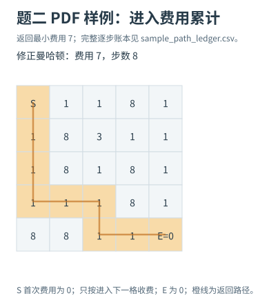
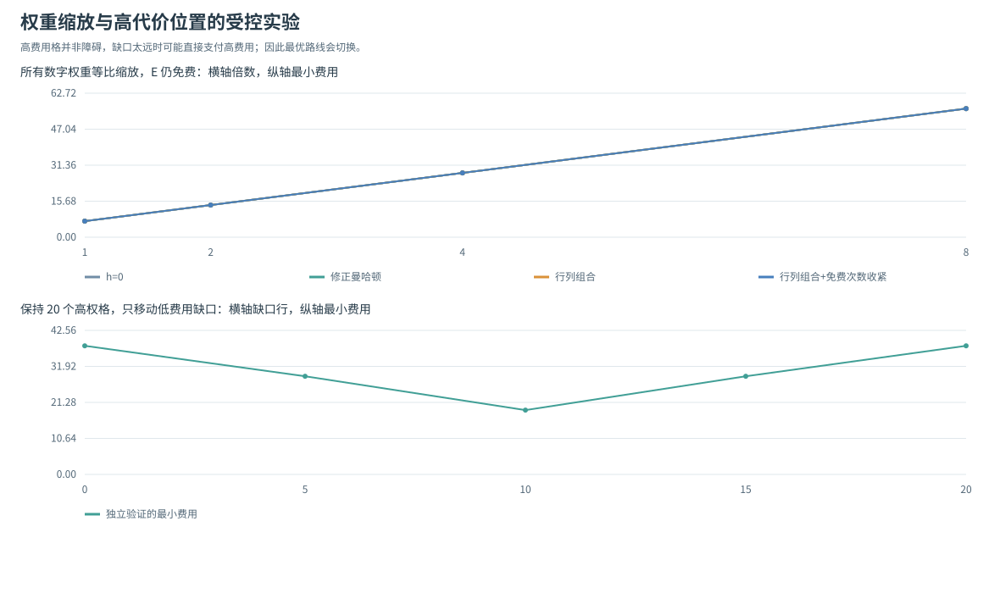
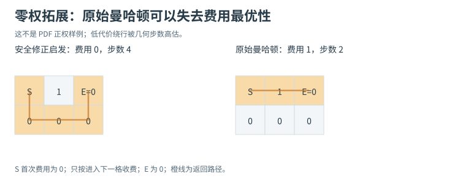
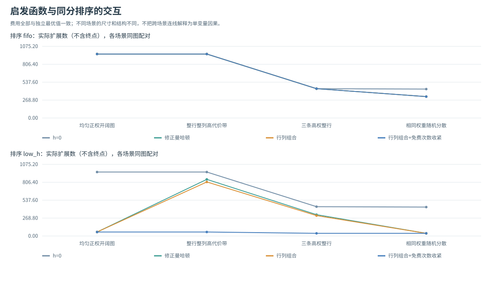
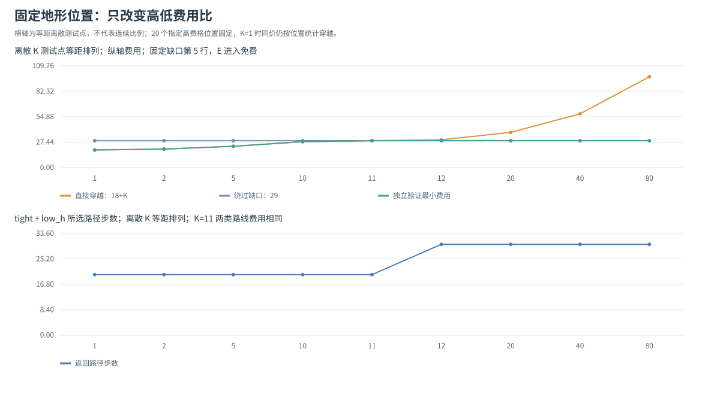
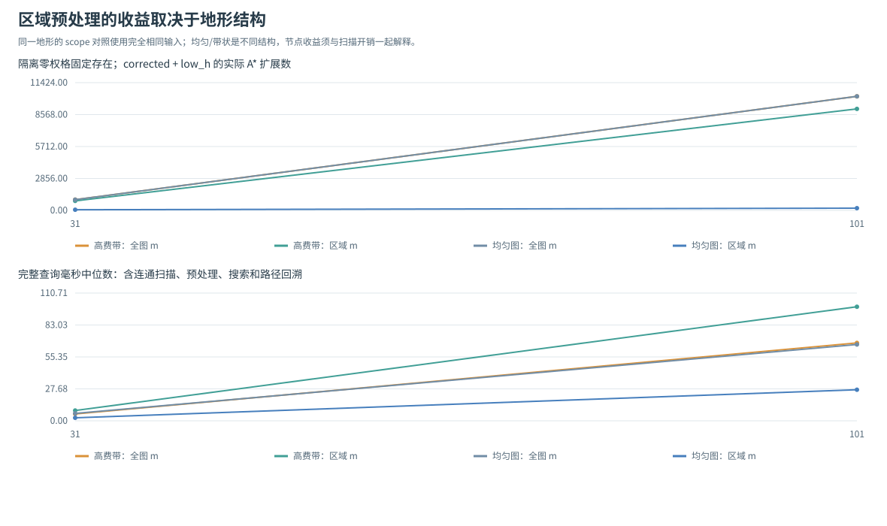
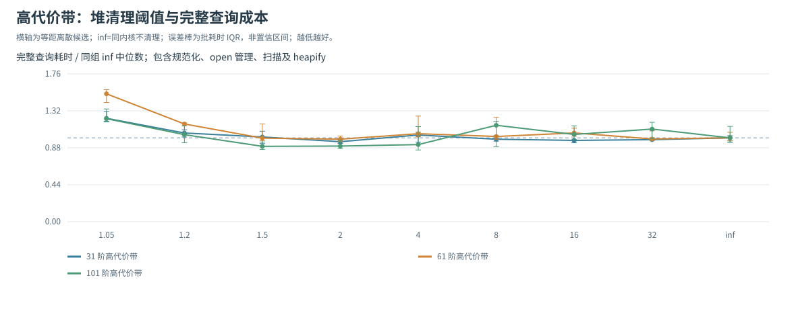

# 题二：加权地形最小费用与启发函数探究

## 1. 实验目标与问题建模

题二要求使用 A* 在二维地图中求最小移动代价。状态是当前位置 `(r,c)`，只能沿上、下、左、右移动。原边 `u→v` 的费用为进入 v 的地形权值 `w(v)`，终点 E 的进入费按 PDF 特别规定为 0。正式接口返回最小总代价，无解返回 `-1`。

本章围绕四个问题组织证据：费用如何逐步累计；免费终点怎样影响启发函数；权重尺度、比例和位置怎样改变路线与搜索量；保留部分地形信息的更强下界是否值得使用。0 权普通格和 X 障碍作为明确标注的拓展，不与 PDF 正权样例混淆。

补充实验进一步拆开三种机制：启发强度与同分排序的交互、相对费用比导致的路线切换，以及不可达便宜格对全局最小费用下界的影响。三组实验分别检验这些机制的收益条件与额外开销。

起点 g=0，搜索删除所有返回起点的边。对非负权值，任何返回起点的路径都包含一个可以删除的非负环，删除后费用不增加，因此该限制不损失从给定起点出发的最优解。它也避免为没有指定地形权重的 S 人为定义再次进入费。

### 1.1 关键问题

**问题一：加权地形下，普通曼哈顿距离仍可采纳吗？** 本题E进入费为0，所以不能普遍采用普通曼哈顿：相邻状态到E的真实剩余费是0，曼哈顿却为1，已经高估。令m为非起终点通行格的最小进入费，可使用 `m×max(Manhattan−1,0)`，其可采纳性与一致性证明见第3.2节。一次样例结果正确不构成启发安全性的证明；第3.5节区分正权特殊条件与其他零权格反例。

**问题二：如何累计费用，为什么样例走8步却输出7？** 从u到v支付进入v的权值，起点初始g=0，终点E收费0。样例中间7次各支付1，最后一步支付0，合计7；第5.1节逐格列出进入费与累计费，并用独立Dijkstra核对最小值。路径步数与加权费用分别记录，不能相互替代。

**问题三：怎样区分节点节省与完整耗时收益？** 对同一输入保持目标、启发/排序等非研究因素不变，报告最优费用、有效扩展、堆操作和包含预处理的完整时间。第5.6节拆开启发与同分排序，第5.8节保留扫描收益与代价，第5.9节对真实策略参数比较两种基线；独立确认另冻结候选后重新计时，检查原发现是否保留，而不是在同一批数据上既挑参数又宣称验证。

## 2. 算法实现与统计

### 2.1 A* 的 g、h、f 与状态更新

初始化 `g(S)=0`，优先队列的第一关键字为 `f=g+h`。对合法邻居 v 计算 `new_g=g(u)+w(v)`；只有严格改进 v 的已有费用，才更新父指针和最小费用表并入堆。找到终点后沿父指针回溯，另行按进入格权值计算费用账本，核对总和。

堆可以保留旧项，但出队后必须检查 g 是否过期。终点以有效记录从堆中取出才结束，不能在首次生成终点时结束。同优先级采用 FIFO 或较小 h 优先，均保持 f 为第一关键字。严格改进避免 0 权环反复入堆或形成回溯环。

输入支持非负整数和数字字符串，S/E 若提供须对应指定端点。起点和终点费用规范化为 0；其他负数、小数、布尔值、非法标记、非矩形和越界输入被拒绝。权重快照不可变，原图不被修改。空图、障碍端点和不可达图按约定返回无解。

### 2.2 正确性核验

本次33项单元测试通过，包括15项核心、4项补充口径、9项堆清理及5项独立确认协议测试。200 张固定种子随机图分别运行 4 个安全启发、2 个 m 范围与 2 个并列策略，共 3200 个最短性配置；48 张小图逐点检验可采纳性、逐边检验一致性，其中 24 张正权、24 张含零权，分别覆盖 tight 新项与退化分支。global 检查全图，reachable 仅检查 S 可达区域；40 个 3×3 图再用简单路径穷举核对。另以三条高权整行的 21×21 图核验目标特化下界：旧行列估计 62，tight 估计 63，独立最优费用也为 63。独立 Dijkstra 不复用正式程序的转换与邻居逻辑，同时检查路径首尾、通行性、四方向连续性、每步费用和累计费用。

4 项补充口径测试还验证：平台统计排除终点且无解不以 -1 作阈值；费用比的精确阈值及固定地形位置；隔离格配对不改变可达问题；可达扫描在经过 E 后仍继续，并保留可达普通零权格。

用于启发检查的反向 Dijkstra 需要反转带权边，而不只是反转邻居方向。原边 `u→v` 的费用是 `w(v)`，所以反向边 `v→u` 仍应收 `w(v)`；在反向扩展 v 时加当前格费用，不能误加邻格 `w(u)`。删除进入起点的原边，对应反向图从起点没有后继。

`expanded_nodes` 是有效出队后实际生成邻居的次数，不含目标；`generated_nodes` 是含起点的入堆次数；`popped_nodes` 包含过期记录与最后目标；`max_frontier` 为物理堆峰值，不是总内存字节。安全启发一致，重新实际扩展应为 0，但首次扩展前的 g 改进仍可能留下过期堆项。

## 3. 启发函数与理论条件

### 3.1 普通曼哈顿：问题来自费用下界与免费终点

加权本身不会使曼哈顿自动失效。若每步费用至少 1，至少 M 步就至少收费 M，较高的地形权值不会破坏这个下界。本题的关键是 E 进入费为 0：相邻可达状态到 E 的真实剩余费用为 0，但普通曼哈顿为 1，已经高估。

因此，样例输出正确不能用来证明普通曼哈顿可采纳；启发条件必须结合边的真实费用判断。

### 3.2 校正几何下界

令 m 为除起终点之外可通行格的最小进入费，缺少这类格时取 0。程序使用：

\[
h_c(n)=m\max(M(n,E)-1,0).
\]

任意到 E 的合法路径至少走 M 步，最后一步免费，其余至少 M−1 次进入费不低于 m，所以它可采纳。对非终点相邻边，h 最多下降 m，不大于实际进入费；进入 E 前 `M=1`、h=0，也满足免费边的一致性。目标值为 0，删除返回 S 的边后不必给 S 的进入费用补充假设。

若有其他 0 权格，则 m=0，校正几何下界退化为 h=0。这是安全但可能很弱的退化，不能为了增加引导性仍无条件假定 m=1。

### 3.3 行列最小费用下界

全局最小权值会丢失地形所在位置的信息。本实验自设一个放松：令 `a_r` 为第 r 行通行格的最小进入费，`b_c` 为第 c 列的最小进入费，包含规范化后的 S/E=0；空通行行列取 0。将当前位置单调移向目标行所需各次进入行的最小费相加，再加移向目标列的最小费之和，得到 `h_rc`。

对一条竖直边，列项不变。若向目标行靠近，行项下降量为本次进入行的最小进入费，不高于实际进入格费用；若远离目标行，h 不下降。横向边同理。终点值为 0，因此该行列和一致且可采纳。最终取：

\[
h_{safe}(n)=\max(h_c(n),h_{rc}(n)).
\]

两个一致下界的最大值仍一致，并且不弱于校正几何下界。规范化时预先构造每行/列到目标的下界数组，单次 h 估计只需常数次查表，没有在每个节点重新计算整段和。该策略是对放松问题的自设探索，不声称发明了新的通用算法。[Berkeley 启发搜索教材](https://inst.eecs.berkeley.edu/~cs188/textbook/search/informed.html)给出了下界、松弛与支配关系的理论依据。

### 3.4 只允许一次免费终点进入的收紧

旧行列放松把目标行的最小进入费取为 0，也把目标列的最小进入费取为 0。当当前行、列都与终点不同，实际路径需要先进入目标行或目标列；这两次进入不可能同时都是进入 E。因此至少其中一次进入发生在非终点格，费用不低于 m。定义：

\[
B(n)=h_{rc}(n)+m\,\mathbf{1}[r\ne r_E\land c\ne c_E],\qquad
h_t(n)=\max(h_c(n),B(n)).
\]

`row_column_tight` 使用 h_t。它只增加一次两轴是否对齐的判断，单次估计仍为 O(1)，并逐点支配 `row_column`。

一致性可以直接检查相邻边。指示项不变时沿用行列下界的证明。指示项从 1 降到 0 时，此步刚进入目标行或目标列；对应行/列最小值因含 E 而为 0，但当前位置另一轴仍未对齐，目的格并非 E，实际进入费至少为 m，正好覆盖新增的下降量。指示项从 0 增到 1 时，沿远离目标的方向移动，B 不会下降。进入 E 的最后一步，指示项在前后都为 0，行列下降也为 0。因此 B 一致、目标值为 0，与 h_c 取最大值后仍一致且可采纳。删除返回 S 的边保证上述非终点目的格不会是没有正权下界的 S。

若 m=0，新增项自动消失，tight 与旧行列启发完全相同。保留 `row_column` 作为消融对照，可以把行列结构信息的收益与“免费终点只一次”的额外收益分开检查。

### 3.5 正权时仍答对的特殊性质与零权反例

当所有非终点进入费都至少 1 时，合法下界 `h_1=max(M−1,0)` 与普通曼哈顿在非终点上只差常数 1。因此在目标尚未生成时，对非终点的主要优先级和对应并列顺序保持相同。目标的前驱在 h_1 下为 0；第一个有效出队的目标前驱已具有最优代价，否则更低费用路径上仍有更低优先级的前沿状态，应先取出。由此，普通曼哈顿虽然不可采纳，在这个特定条件下仍能返回正确的目标费用。

这里使用的是单位下界 h_1，不是 m 可能大于 1 的实际 `corrected`。也不能说包括目标在内的完整出队顺序、扩展数都相同：目标的普通曼哈顿值仍为 0，可能更早弹出。这一特殊性质不适用于其他进入费为 0 的情形。

零权拓展中的反例为：

```text
S 1 E
0 0 0
```

直达收费 1，绕行收费 0。普通曼哈顿会提前返回 1，四个安全配置得到 0。这个例子显示启发结论需要费用条件，并不表示 PDF 正权样例必错。普通曼哈顿仅作为分析配置保留，不作为默认有保证的选项。

### 3.6 只在起点可达区域求最小进入费

全图最小费用 m 会受到完全不可达的格子影响。可选 `min_scope='reachable'` 先完整扫描从 S 出发可达的集合 R，定义 `m_R=min{w(v):v∈R 且 v≠S、v≠E}`，集合为空时取 0。随后把校正几何下界与 tight 附加项中的 m 替换为 m_R。默认仍为 `global`，行列最小值也仍按全图计算，便于隔离“m 的范围”这一变量。

R 对合法后继封闭；所有会被搜索的非起终点目的格均在 R 中，进入费不低于 m_R。因此前述校正和 tight 的一致性证明在 R 上仍成立，与旧行列下界取最大值也安全。该结论针对搜索可达子图，不主张新 m_R 在其他不可达分量的边上仍满足一致性。若 R 本身包含普通零权格，m_R 必须为 0，不能过滤这些真实可达的便宜格。

实现使用栈式遍历完整计算 R，扫描到 E 后仍继续；本实验也不利用扫描结果提前判无解，以便单独观察下界变化。空图与障碍端点沿用无解约定；起终点相同且可通行时仍返回费用 0。额外扫描需要 O(|R|+|E_R|) 时间与 O(|R|) 辅助空间，端到端计时必须包含它。

## 4. 实验设置与数据口径

基础对照固定 low_h 与 global，仅改变启发：zero、corrected、row_column、row_column_tight；另保留 raw_M 分析对照并记录费用差异。计时预热 1 次，再测 3 批、每批 3 次，报告批平均单次耗时的中位数、最小值与原始批值。计时关闭追踪，包含规范化快照、共同行列最小值和下界数组准备以及路径回溯；独立参考、条件检查、绘图和写文件不计入搜索耗时。

补充实验 A 在同一输入上交叉改变启发与 FIFO/low_h，B 固定地形位置只改变高费值 K，C 固定排序并比较 global/reachable。补充轨迹在计时外采集；可达区域模式的整次调用时间包含完整分量扫描，不提前缓存区域或借扫描提前结束无解查询。基础与补充两轮的毫秒结果分别在其同轮对照中分析。

补充实验也预热 1 次，测 3 批、每批 3 次；在预热和每批计时前按固定种子打乱配置先后次序，降低系统漂移与固定顺序关联。C 另独立测量完整 `prepare_terrain`，其范围包含规范化、可达扫描（若启用）及行列数组。独立预处理计时不是总时间的严格分解，不用两个中位数相减推算精确搜索时间。

每个配置都核对返回路径的实际费用，安全配置还须达到独立参考最优值；raw_M 和 BFS 最少步数路线是分析对照，若非最优则如实记录。地图是输入场景样本，重复计时不是新的地图。正权和零权拓展、有解和无解分别解释，不用无解 `-1` 参与正常路径费用平均。

正式运行环境为 Windows 11、64 位 Python 3.12.14，基础种子为 20261028；完整版本、处理器信息及原始批值保存在复现文件中。毫秒结果反映本机本组运行，算法比较同时报告更可复核的节点和队列计数。

## 5. 实验结果与机制分析

本次正式运行共有 228 个输入记录：9 个结构场景、4 个等比缩放输入、5 个缺口位置输入、180 个正权规模输入和 30 个零权随机拓展，去重后为 200 个不同的地图与端点组合。重复来自无障碍固定带状场景在不同种子下相同，以及缩放倍数 1 与原样例相同。每条记录比较 5 种配置，共 1140 个搜索配置；其中 912 个安全配置全部达到独立 Dijkstra 的最小费用，228 个 raw_M 配置属于分析对照。正式实验另对 18 个结构或受控输入执行逐状态、逐边检查，共 90 个启发配置，其中 72 个安全配置全部满足条件；这与单元测试中的 48 张随机小图检查相互补充。完整输入和源码哈希保存在 `results/reproducibility.json`，以下数值直接来自最终同轮 CSV/JSON。

补充实验另有 95 个输入记录、89 个不同的地图与端点组合：A 为 72×8=576 个配置，B 为 9×8=72 个，C 为 14×4=56 个，共 704 个安全配置，全部与独立参考最优费用一致。按不重复的“输入—启发—m 范围”组合检查启发条件，共 352 条，全部通过；同一启发在两种并列排序下不重复计为新的条件证据。无障碍带状图跨种子的重复仍保留为输入记录，不称为独立地图。完整证据在 `results_supplementary/`。

### 5.1 PDF 样例的逐步费用

样例返回路径与 PDF 一致：

```text
(0,0)→(1,0)→(2,0)→(3,0)→(3,1)→(3,2)→(4,2)→(4,3)→(4,4)
```

| 次序 | 进入位置 | 本步费 | 累计费 |
|---:|---|---:|---:|
| 0 | S `(0,0)` | 0 | 0 |
| 1 | `(1,0)` | 1 | 1 |
| 2 | `(2,0)` | 1 | 2 |
| 3 | `(3,0)` | 1 | 3 |
| 4 | `(3,1)` | 1 | 4 |
| 5 | `(3,2)` | 1 | 5 |
| 6 | `(4,2)` | 1 | 6 |
| 7 | `(4,3)` | 1 | 7 |
| 8 | E `(4,4)` | 0 | 7 |

9 个坐标对应 8 次移动，但只有中间 7 次进入需要支付 1，最后一步免费，所以答案为 7。不能用 `len(path)−1` 代替本题费用。独立 Dijkstra 也得到 7。

样例中 zero/corrected/row_column/row_column_tight 的扩展数为 14/10/10/10，四个安全版本都返回 7。三个非零安全下界的起点估计都为 7，而原始曼哈顿为 8，已高于真实最小费用。逐状态检查还发现 raw_M 在 25 个有限真距离状态中有 20 个高估；它最后仍输出 7，恰好说明“输出正确”和“启发可采纳”不能互相代替。

从 row_column 的有效出队轨迹选取几行可看出 g、h、f 的区别：

| 出队次序 | 位置 | g | h | f=g+h |
|---:|---|---:|---:|---:|
| 1 | `(0,0)` | 0 | 7 | 7 |
| 2 | `(0,1)` | 1 | 6 | 7 |
| 3 | `(0,2)` | 2 | 5 | 7 |
| 4 | `(1,0)` | 1 | 6 | 7 |
| 10 | `(4,3)` | 7 | 0 | 7 |
| 11 | E `(4,4)` | 7 | 0 | 7 |

同为 f=7 的分支也可能被扩展，出队序列不等于最终父指针路径。尤其在 `(4,3)`，g 已为 7、h 为 0；免费进入 E 后 g 仍为 7，明确体现最后一步只改变位置、不再增加费用。

完整费用账本见 `sample_path_ledger.csv`，搜索轨迹见 `sample_trace.csv`，路径图见 `sample_path.svg`。



### 5.2 最少步数与最低代价

受控地图为 3×5：中间一行是 `S,9,9,9,E`，上下两行费用均为 1，起终点为 `(1,0)` 和 `(1,4)`。

| 方法 | 移动步数 | 路径收费 | 是否最小费用 |
|---|---:|---:|---|
| BFS 最少步数 | 4 | 27 | 否 |
| 加权 A* | 6 | 5 | 是 |

BFS 直接经过三个费用 9 的格子，最后进入 E 免费，因此付 27；A* 沿下方一行绕行，只进入五个费用 1 的格子，最后免费进入 E，付 5。BFS 路线本身合法，错误来自把边数目标当作了费用目标，不是 BFS 实现故障。数据见 `bfs_vs_cost.csv`，双路径图见 `bfs_vs_cost.svg`。


### 5.3 地形缩放、权重位置与路线选择

把 PDF 的全部数字地形分别乘 1、2、4、8，S/E 仍按规则为 0：

| 倍数 | 最小费用 | 路径步数 | zero 扩展 | corrected 扩展 | row_column 扩展 | tight 扩展 |
|---:|---:|---:|---:|---:|---:|---:|
| 1 | 7 | 8 | 14 | 10 | 10 | 10 |
| 2 | 14 | 8 | 14 | 10 | 10 | 10 |
| 4 | 28 | 8 | 14 | 10 | 10 | 10 |
| 8 | 56 | 8 | 14 | 10 | 10 | 10 |

统一缩放使所有路径费用乘同一正数，g、m 与安全 h 同步缩放，f 的相对关系不变；同一并列规则下路径和节点数均保持。脚本还逐一断言四个安全版本在各倍数下的路径相同、完整搜索统计相同且费用等比增加，结果均通过。它是代价尺度的受控检查，不意味着绝对权值越大搜索就一定越难。数据见 `weight_scaling.csv`。

另一组在 21×21 地图的第 10 列固定放置 20 个费用 20 的格子，只移动唯一的费用 1 缺口；其余格费用 1，端点为 `(10,0)`、`(10,20)`：

| 缺口行 | 高权格数 | 最小费用 | A* 返回步数 |
|---:|---:|---:|---:|
| 0 | 20 | 38 | 20 |
| 5 | 20 | 29 | 30 |
| 10 | 20 | 19 | 20 |
| 15 | 20 | 29 | 30 |
| 20 | 20 | 38 | 20 |

本构造中最优费用为 `min(19+2×|缺口行−10|,38)`：经低费缺口需要上下绕行，直接跨越高权列则把一次费用 1 换为 20。缺口位于最远端时，绕行收费 39，反而不如直接收费 38，因此程序选择较短但经过高权格的路线。这和“高权格等于不可通行墙”不同，权重位置会触发路线切换。数据见 `high_cost_gap.csv`，图见 `weight_and_position.svg`。



### 5.4 安全下界的收益与无收益

代表结构场景的节点数如下；全部安全版本都返回表中的最小费用：

| 场景 | 最小费用 | zero 扩展 | corrected 扩展 | row_column 扩展 | tight 扩展 |
|---|---:|---:|---:|---:|---:|
| PDF 样例，5×5 | 7 | 14 | 10 | 10 | 10 |
| 均匀正权，31×31 | 59 | 960 | 60 | 60 | 60 |
| 高费行列带，31×31 | 83 | 960 | 850 | 811 | 60 |
| 高费带加一个 0 权格，31×31 | 82 | 960 | 960 | 902 | 902 |
| 三条高权整行，21×21 | 63 | 440 | 320 | 306 | 40 |
| 相同权重频数随机分散，21×21 | 39 | 434 | 40 | 40 | 40 |
| 障碍隔断无解拓展，2×5 | -1 | 4 | 4 | 4 | 4 |

高费行列带中 corrected 的起点下界为 59、row_column 为 82、tight 为 83，真实费用为 83；在目标可达状态上的平均低估依次为 11.634、0.853、0.021。旧行列下界虽减少平均低估，节点只从 850 降至 811；补回一次非终点进入费后则降至 60。三条高权整行场景中，tight 对全部 441 个状态都等于真实剩余费，节点从旧行列的 306 降至 40。这一消融显示，看似仅差 1 的估计也可能改变大量 f 并列或接近最优边界的状态顺序，不能把平均估计误差的改善比例当成节点减少比例；low_h 在最优 f 平台上沿低 h 方向推进，也参与了这里的节点收益。

加入一个 0 权格后，m=0，corrected 退化为 h=0，扩展与零启发同为 960；两个行列版本的起点仍估计 80、真实费用 82，扩展降至 902。它们保留了仍需跨越高费行列的信息，但 tight 的新增项为 0，无法获得额外收益。均匀图和分散权重图中，三个非零安全下界也没有节点差异，说明改进依赖地形结构与费用下界。

三条高权整行与随机分散对照的尺寸、端点及完整权重频数相同。集中成整行时需要支付较高穿越费，最小费用 63；相同数目的高权格分散后存在全由低费格组成的单调路径，费用 39。不是只有高权格的比例重要，摆放位置也决定了能否绕过它们。两者的 corrected 扩展为 320 与 40。

时间是另一项指标。下表单位为毫秒/次，来自同轮 3 批的批平均中位数：

| 场景 | zero | corrected | row_column | tight |
|---|---:|---:|---:|---:|
| PDF 样例 | 0.080 | 0.068 | 0.076 | 0.074 |
| 均匀正权 | 3.731 | 0.706 | 0.719 | 0.769 |
| 高费行列带 | 4.379 | 4.443 | 4.421 | 0.823 |
| 高费带加 0 权格 | 3.547 | 3.740 | 5.152 | 4.837 |
| 三条高权整行 | 1.577 | 1.580 | 1.623 | 0.400 |
| 相同频数随机分散 | 1.591 | 0.403 | 0.422 | 0.441 |

更强下界不是全局提速保证。高费行列带中，corrected 与旧 row_column 的物理堆峰值为 131 和 781，成功入堆为 1506 和 1592；旧行列虽少扩展，却保留了更多旁支。corrected 实际跳过 626 条过期项，旧行列在结束前没弹出过期项，但堆中仍有很多记录；不能把“过期弹出少”解释成“总空间小”。tight 在同图仅入堆 119 次、堆峰值 59，耗时由 corrected 的 4.443 降至 0.823 毫秒，节点与队列两方面都得到改善。

反例也必须保留：零权高费带中两个行列版本统计完全相同，耗时却略有波动，且都慢于 zero；均匀图节点相同，tight 本次计时高于旧版本。行列值查表、额外条件判断、堆操作、公共预处理和运行环境都会影响端到端时间。样例等亚毫秒场景尤其不宜据一次中位数差异宣称稳定加速。本批支持 tight 对某些正权结构图有效，不支持它在所有地图上普遍更快。

数据见 `comparison.csv`、`heuristic_checks.csv`，结构图见 `heuristic_nodes.svg`。

完整结构节点图另见 [heuristic_nodes.svg](results/heuristic_nodes.svg)；正文用上表核对精确场景条件。

### 5.5 多尺寸、权重分布和零权外推

正权规模部分为边长 15/30/60 × 三种分布 × 障碍概率 0/0.15 × 10 种子，共 180 个输入。分布分别偏低费、异质高费和固定高费带；另有 30 张含 0 权的随机拓展。X 概率作为无解扩展保留，不根据是否有解重新抽样。正权规模图中 178 张有解、2 张无解；零权随机图中 29 张有解、1 张无解。

30×30、无障碍的正权分层中，四个安全版本的扩展中位数为：

| 分布，每组 10 个输入记录 | zero | corrected | row_column | tight |
|---|---:|---:|---:|---:|
| 偏低费随机分布 | 897 | 329.5 | 329.5 | 329.5 |
| 异质随机分布 | 877.5 | 722.5 | 722.5 | 722.5 |
| 固定高费带 | 899 | 809 | 770 | 58 |

随机分布往往在每行每列都包含便宜格，行列最小费退化得较强，因此三个非零安全下界在这些分组的节点中位数相同。固定高费带仍能从位置结构中提供额外信息，tight 的目标特化进一步减少扩展。需要特别说明：固定带状生成器在 X 概率为 0 时不随随机种子改变地图，10 条记录是同一地形的重复输入，不是 10 种独立地形，IQR=0 不表示对任意地图都稳定。

普通曼哈顿在本次全部正权输入上仍返回正确代价，符合 3.5 的特殊条件，但启发检查继续发现邻 E 等状态的高估，所以不能反向证明其可采纳。含 0 权的随机拓展中，raw_M 在 29 个有解输入上有 11 个返回非最优费用，1 个无解输入也完整保留；固定 2×3 零权反例另有一次明确失败。安全版本全部最优。无解时有限启发无法凭估计证明不可达，通常仍需耗尽起点能到达的部分，因此应分开统计无解搜索。

全部分层中位数与四分位数保存在 `safe_summary.csv`；它们描述本批输入，不是置信区间。结构、比例和规模一起变化时也不据此拟合普遍的“权越大就越难”规律。



### 5.6 启发函数与并列排序的交叉消融

接口默认 FIFO，而基础实验选择 low_h。因此需要在完全相同的地图上比较 4 个安全启发 × 2 个排序：第一关键字均为 f，仅在 f 相同时分别按入堆顺序或较小 h 决定。每个配置核对独立最优费用，记录扩展、入堆、堆峰值和总时间。

为解释原因，另在不计时的有效出队轨迹中去除终点，再按独立最优费用 C* 分成 `f<C*`、`f=C*`、`f>C*`。三类之和应等于实际扩展数；安全配置在有解输入上的 `f>C*` 扩展数应为 0。无解输入没有 C*，不以 -1 作为平台阈值。`f=C*` 状态有机会在目标弹出之前被扩展，其数量受同分排序影响，所以“更强下界”与“更少扩展”之间还需要检查平台行为。

A 的 72 个输入包括 9 个结构场景和每类 3 种子的 63 个规模/零权输入。高费行列带的 C*=83，实际扩展分类如下；表中各行 `f>C*` 都为 0，终点不计入扩展：

| 启发 | FIFO：f<C* | FIFO：f=C* | FIFO 合计 | low_h：f<C* | low_h：f=C* | low_h 合计 |
|---|---:|---:|---:|---:|---:|---:|
| zero | 958 | 2 | 960 | 958 | 2 | 960 |
| corrected | 840 | 120 | 960 | 840 | 10 | 850 |
| row_column | 800 | 160 | 960 | 800 | 11 | 811 |
| tight | 0 | 960 | 960 | 0 | 60 | 60 |

tight 把低于 C* 的扩展从 800 降到 0，但形成大的最优 f 平台。FIFO 仍扩展 960 个状态；low_h 沿较小剩余估计推进后只扩展 60 个。因此原来的“811→60”需要限定为相同 low_h 下的启发对照，并结合本表解释：更强下界改变平台结构，排序决定在平台上多走多少旁支。均匀图的三个非零启发也都是 FIFO 960、low_h 60；三条高权整行则为 FIFO 440，low_h 下 corrected/row_column/tight 分别为 320/306/40。

在本批 72 条输入记录中，low_h 相对 FIFO 的节点数减少/不变分别为 corrected 的 58/14、row_column 的 59/13、tight 的 59/13；zero 的 72 条全部相同，因为所有 h 都为 0，第二关键字没有区分力。这些计数描述本批输入，不能据此证明任意地图上 low_h 都更好。

同轮计时中，带状图 tight 的 FIFO 与 low_h 耗时分别为8.330和1.431毫秒；corrected 从960降至850个扩展，其对应耗时为6.167和8.121毫秒。节点、实际堆操作、预处理与运行波动共同影响时间，不能用节点下降比例直接预测提速比例。数据见 `tie_break_comparison.csv` 与 `tie_break_paired.csv`。



平台分类的图形版本另见 [optimal_f_platform.svg](results_supplementary/optimal_f_platform.svg)，正文以上表保留精确计数。

### 5.7 相对费用比与路线切换阈值

固定 21×21 地图、端点 `(10,0)`/`(10,20)`，第 10 列除第 5 行缺口外的 20 个格子费用为 K，其余费用为 1。只改变 K，保持高费格的数量和位置不变。这与全部权重一起缩放的实验不同：本组改变的是不同路线之间的相对费用。

K≥1 时，任意经过高费格的路线至少走 20 步，最后进入 E 免费；至少一次把通常费用 1 替换为 K，费用下界为 `18+K`，直行可达到。避开全部高费格则必须经过第 5 行缺口，至少走 30 步，费用下界为 29，也可达到。因此：

\[
C^*(K)=\min(18+K,29).
\]

K<11 时直行最优，K>11 时绕缺口最优；K=11 时 20 步直行和 30 步绕行都是最优，具体输出由本实现的排序和邻居顺序决定，不能据所选路径声称最优步数唯一。实验将费用公式、返回步数、高费区域进入次数与扩展量一起核验。

9 个参数各比较 4 个安全启发 × 2 个排序，72 个配置均符合公式与独立 Dijkstra。下表只保留 tight+low_h 在阈值两侧的精确结果；其余候选由下方趋势图展示，完整九行数据留在 CSV。指定带位置始终固定，K=1 时也按原位置统计进入次数：

| K | 最优费用 | 返回步数 | 指定高费带进入次数 | 扩展数 |
|---:|---:|---:|---:|---:|
| 10 | 28 | 20 | 1 | 100 |
| 11 | 29 | 20 | 1 | 100 |
| 12 | 29 | 30 | 0 | 107 |

K=11 的本次路径选择直行，符合多最优条件。超过阈值后，费用和搜索量在此构造中均保持：更高的 K 不再迫使最优路径支付更多费用，因为路线已转向低费缺口。这给出由公式预测、再由结果验证的机制解释，不能外推为所有地形的搜索量都随 K 单调变化。



原始数据见 `cost_ratio.csv`；实际路径可查看 [K=10](results_supplementary/ratio_path_10.svg)、[K=11](results_supplementary/ratio_path_11.svg)、[K=12](results_supplementary/ratio_path_12.svg)。

### 5.8 不可达零权格与扫描成本

在主地图旁增加由 X 隔开的不可达单格，配对只把它的费用从 1 改为 0。起点可达区域、可走路径与最优费用都不变，但 global 的 m 可从 1 降至 0。比较 global 与 reachable，可直接检查这种全局退化是否来自一处与真实路线无关的输入。

保留三类条件：隔离格为 1 时没有需要修复的最小权值；隔离格为 0 时可以恢复可达区域的正下界；可达区域内本身已有 0 时仍必须退化。另保留无解及不同规模场景，避免只挑选有节点收益的情况。两种模式均与原图的独立参考费用核对，reachable 的逐状态下界和逐边一致性只检查 S 可达区域。

可达扫描访问数与 A* 扩展数分开记录。即使 A* 扩展减少，也不能直接解释为总工作或总时间减少；扫描本身可能已访问大部分地图。端到端总时间包含规范化、完整扫描、行列准备、搜索与路径回溯，能据此判断何种输入值得承担额外预处理。

C 对 4 个带状规模的隔离格配对、2 个均匀规模的配对、可达零权和无解共 14 个输入，分别运行 corrected × 2 种排序 × 2 种 m 范围，共 56 个配置。下表均为 low_h，箭头表示 global→reachable，总耗时单位为毫秒/次：

| 主体场景 | 最优费用 | m 的变化 | A* 扩展变化 | reachable 扫描格数 | 完整查询耗时变化 |
|---|---:|---|---|---:|---|
| 带状31，隔离格0 | 83 | 0→1 | 960→850 | 961 | 5.935→8.923 |
| 带状101，隔离格0 | 223 | 0→1 | 10200→9078 | 10201 | 67.504→98.846 |
| 均匀31，隔离格0 | 59 | 0→1 | 960→60 | 961 | 6.421→2.606 |
| 均匀101，隔离格0 | 199 | 0→1 | 10200→200 | 10201 | 66.126→26.931 |
| 均匀101，隔离格1 | 199 | 1→1 | 200→200 | 10201 | 9.552→28.033 |
| 带状31，可达区域内有0 | 82 | 0→0 | 960→960 | 961 | 5.967→7.611 |
| 障碍隔断无解 | -1 | 0→1 | 4→4 | 4 | 0.042→0.046 |

隔离格从 1 改为 0 不改变主区域的任何路线费用；reachable 对这对输入的 m 和同排序扩展数均相同，核验通过。但带状图只恢复较弱的几何下界，节省的 A* 工作不足以抵消完整扫描，本组反而更慢。均匀图恢复后下界精确，结合 low_h 将大量堆搜索替换为一次分量扫描，节点和总时间都有收益。

收益还依赖排序：均匀101、隔离格0在 FIFO 下两种 m 范围都扩展10200个状态，完整时间为68.306→87.346毫秒。即使恢复了 m，平台上仍可能遍历大量状态，不能把表内 low_h 的收益推广到默认 FIFO。

负对照说明触发条件：隔离格为1时本来就有m=1，均匀101的搜索统计相同，扫描增加开销；可达区域本身含0时必须保留m=0，无法修复；无解时虽然m变强，两种模式仍完整扩展4个起点可达状态，reachable额外再扫描4个，未通过提前判无解混入另一种优化。带状101、隔离格1的扩展也同为9078，本组总时间87.712→101.723毫秒，同样体现额外扫描的代价。

扫描与搜索是不同操作，`scan_plus_search_node_visits` 只是两阶段访问次数之和，不能当成单位成本相同的总运算量或内存字节。例如均匀101恢复后有10201次扫描和200次A*扩展，虽然该和大于原来的10200次扩展，仍能因避免大量堆操作而更快。独立预处理与完整查询分开测量，二者都会波动；报告只用完整查询作端到端判断，不相减制造精确的“纯搜索时间”。

带状规模扫描的完整曲线见 [component_minimum.svg](results_supplementary/component_minimum.svg)；正文保留以下结构对照。



数据见 `component_minimum.csv`，逐点/逐边检查见补充目录的 `heuristic_checks.csv`。这组实验支持把 reachable 保留为可选策略，并保持 global 为默认；是否值得使用取决于便宜格是否可达、几何下界能减少多少平台搜索，以及额外扫描的实际成本。

### 5.9 过期堆清理阈值的成本权衡

地形 K 是问题输入，K=11 表示路线切换，不是求解器的性能最优参数。本组另引入策略参数 ρ：在每次有效扩展的全部松弛结束后，若物理堆记录数超过有效 open 状态数的 ρ 倍，就扫描堆、删除 g 已过期的记录并 heapify。保留项的完整优先级元组和入队序号不变，所以各候选的有效出队、最优路径与费用均应相同。

初扫中最大有限候选8曾出现最低中位耗时，因此扩展到16、32后重新整组计时。最终候选为1.05、1.2、1.5、2、4、8、16、32、inf；inf为同内核不清理，仍维护有效open集合，另保留原A*作为同批外部参照。7个地图—启发组合对应6个不同地图与端点输入，共70配置、630批计时，每批3次完整调用。全部费用、路径、有效出队顺序和物理记录守恒核验通过；9项新增测试还包含3840个随机配置。



以下均为同轮毫秒/次中位数。“最低”只表示已测候选中的描述性排序；IQR重叠也不是显著性检验。

| 场景 | 原 A* ms | 同内核不清理 ms | 本批中位数最低 ρ | 该候选 ms | 与 inf 的 IQR 重叠 |
|---|---:|---:|---|---:|---|
| 31 阶高代价带 | 4.353 | 5.016 | 2 | 4.786 | 是 |
| 61 阶高代价带 | 20.137 | 21.620 | 2 | 21.277 | 是 |
| 101 阶高代价带 | 68.810 | 68.920 | 1.5 | 61.954 | 否 |
| 61 阶随机权重，种子 20261029 | 16.321 | 17.683 | 16 | 16.946 | 是 |
| 61 阶随机权重，种子 20261030 | 16.465 | 16.652 | inf | 16.652 | 是 |
| 101 阶均匀图，无过期项对照 | 6.254 | 6.164 | 1.2 | 5.820 | 是 |
| 101 阶高代价带，强启发对照 | 6.031 | 7.860 | 4 | 5.877 | 是 |

阈值很小时重建频繁，较大时又保留更多旧项，确有可解释的代价权衡。但多组低耗时候选与inf的IQR重叠，不能把曲线上轻微的最低点称为稳定或通用最优。本组有4/7组原A*的中位耗时低于同内核最好的阈值，说明维护open集合与清理本身的成本必须纳入评价。无过期项对照中各ρ根本不触发清理，其微小时间排名主要是测量波动。

101阶带状图中，原A*扩展9078个状态，过期弹出8291次，物理堆峰值1192。ρ=2保持相同有效搜索，却把峰值降至491，总时间由68.810变为62.174毫秒。ρ=1.05进一步把峰值降至275，但扫描了164521条堆记录、重建1018次，耗时84.697毫秒。减少过期弹出或堆记录并不自动带来端到端加速；峰值条目也不是包括open集合和临时过滤列表在内的总内存字节。

完整参数、记录守恒、双基线、IQR范围与负结果见 [HEAP_TUNING.md](HEAP_TUNING.md)。原核心与历史数据保持独立，新增模块作为可选优化探究，正式整数答案仍由原安全接口提供。

已有基础与三组补充的1844条计时记录也从各自保存的批值汇总了中位数、Q1/Q3、最小/最大值，见 `results_heap_tuning/previous_timing_ranges.csv`；来源文件哈希随表保存。它是已有计时的描述性汇总，没有冒充新增地图或新实验，跨轮毫秒值不直接拼接比较。

### 5.10 固定ρ后的新计时验证

第5.9节用发现数据提出ρ=1.5，本节在预热前保存协议，冻结关注参数及左右比较，不根据新排名重选冠军。4个组合复用原3张地图，固定ρ=1.05/1.2/1.5/2/inf和original，15个新重复块、每批3次完整调用，共24配置、360计时批，全部最优费用、路径及有效顺序核验通过。

主比较固定为101阶带状ρ1.5对original。同repeat配对差中位数为+3.769ms、IQR[2.268,4.924]，仅2/15块更快；原发现批约1.11倍的提速未在确认批中重复。ρ1.5对同内核inf仍偏快，但较右邻ρ2的差值IQR跨0，也未确认严格内部最低点。确认实验始终评价预定ρ1.5。

| 主比较：ρ1.5减参照 | 配对差中位ms [Q1,Q3] | ρ1.5更快/更慢批数 | 描述性结果 |
|---|---|---|---|
| original | 3.769 [2.268,4.924] | 2/13 | 配对差偏向更慢 |
| inf | -2.485 [-6.165,-1.030] | 12/3 | 配对差偏向更快 |
| 1.2 | -6.256 [-7.336,-3.767] | 13/2 | 配对差偏向更快 |
| 2 | -0.384 [-2.933,1.428] | 9/6 | 混合，不能确认方向 |

队列峰值1192→386仍保留，但open维护、扫描和重建进入完整耗时；无动作负对照不用于声称清理提速。该结果补强了对优化适用边界的解释，原安全求解器继续作为正式接口。完整预先声明、原始批值、配对图和未支持结果见 [HEAP_CONFIRMATION.md](HEAP_CONFIRMATION.md)。老师要求的普通曼哈顿可采纳性与费用账本，另在第1.1节显式回答。

## 6. 复杂度与结论

地图为 R×C，通行状态 V、四方向边 E。规范化快照和行列数组需要 `O(RC+R+C)` 时间与空间，可简为 O(RC)。四个安全启发一致，每个状态最多有效扩展一次；允许重复入堆时，完整时间上界为 `O(RC+(V+E)log(V+E+1))`，辅助空间为 `O(RC+V+E)`。四方向网格下空间可简为 O(RC)，不能仅统计字典 O(V) 而忽略包含障碍的完整快照。

reachable 额外扫描需要 O(V_s+E_s) 时间与 O(V_s) 空间，其中 V_s、E_s 是起点可达子图的状态数与边数。这部分仍包含在上述网格渐近上界中，但常数开销进入每次查询，不能因大 O 不变就忽略。

任意自定义启发不自动具有以上最优性与一致性，负权不被接受。强启发也不保证耗时按节点数同比下降；规范化、下界数组与堆操作都进入实际计时。

实验表明，本题的正确性首先依赖进入格收费与终点免费的准确建模，路径步数不能替代总代价。启发函数需要从实际边费用证明下界；加强下界后，还要结合最优 f 平台上的排序解释扩展量。地形的相对费用和空间位置会改变最优路线；预处理则可能用额外扫描换取更强下界，是否值得必须看包含扫描的整次查询。因而结论同时报告正确性、搜索计数、耗时和适用条件。

## 7. 复现与参考

```powershell
.\run_q2.cmd tests
.\run_q2.cmd --input samples/pdf_sample.txt --details
.\run_q2.cmd experiments
.\run_q2.cmd supplementary
.\run_q2.cmd tuning
```

已配置 Python 时，基础实验使用 `python run_experiments.py --seeds 10 --repeats 3 --batch 3 --seed 20261028`，三组补充使用 `python run_supplementary_experiments.py`，堆阈值调参使用 `python run_heap_tuning.py`。结果分别保存在 `results/`、`results_supplementary/` 与 `results_heap_tuning/`，完整输入、环境、原始批值与对应源码哈希随数据保存。正式接口只用安全启发，原始曼哈顿和 BFS 路线为明确标注的分析对照。

- 题目规则：《实验二要求_new(1).pdf》第 5—7、16—17 页。
- [Berkeley CS188：Informed Search](https://inst.eecs.berkeley.edu/~cs188/textbook/search/informed.html)：放松、下界与支配关系。
- [Red Blob Games：A* Implementation](https://www.redblobgames.com/pathfinding/a-star/implementation.html)：进入格权重和代价改进实现的参考；免费终点与输出约定仍以 PDF 为准。
