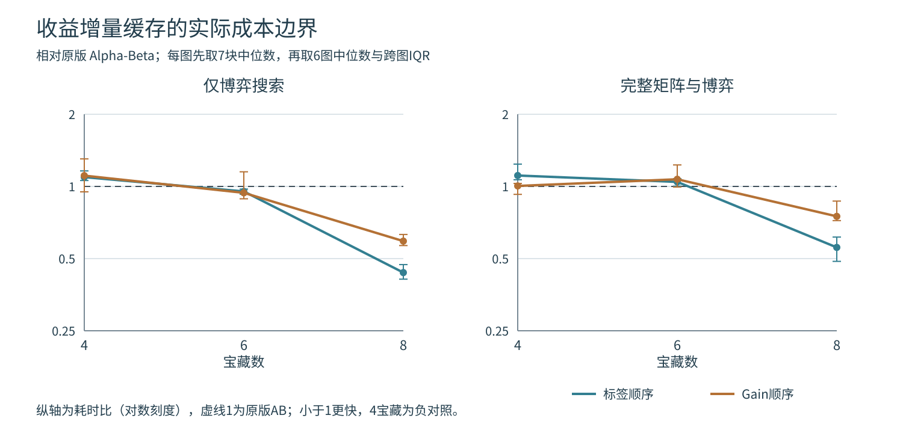

# 题四补充实验 收益增量缓存与规模回本条件

## 1 研究问题

题三的缓存按树节点对象识别重复引用，不能直接解决题四的状态合并。宝藏博弈中，不同选宝历史可能留下相同的位置、剩余集合和玩家，但双方已经获得的收益不同。如果不加区分地缓存最终收益差，就可能把一个历史的答案用于另一个历史。

本实验研究能否利用收益的可加性，缓存“从当前局面开始还能产生的最优收益差增量”。需要同时回答两个问题：这种合并是否正确；省下的后续搜索是否足以抵消查表、建表和保存主变例的成本。四宝藏原题必须保留，因此把4宝藏作为预先指定的负对照，另设6、8宝藏输入考察复用规模。这里没有改变正式样例的评分函数、行动次数或取宝规则。

界感知缓存的参考是[Plaat的AlphaBetaWithMemory说明](https://people.csail.mit.edu/plaat/mtdf.html)。本次借鉴精确值、上下界分开处理的原则，没有实现MTD(f)驱动器；收益增量的分离由本题公式自行推导。

## 2 怎样合并状态而不丢失收益

### 2.1 收益平移不变性

令当前收益差为`U=score_A-score_B`，后续结构状态为：

```text
x = (pos_A, pos_B, remaining_mask, turn)
```

`F_h(state)`表示按老师规则，在剩余深度h下得到的最优最终评价。可以写成：

```text
F_h(state) = U + V_h(x)
```

这里`V_h`是未来增量。达到深度、宝藏取完或没有合法行动时，老师评价为当前U，因此增量为0。若A选取宝藏t，带符号增量是`δ=V_t-d(pos_A,t)`；若B选取，增量是`δ=-(V_t-d(pos_B,t))`。递归为：

```text
A回合：V_h(x) = max_t [δ(x,t) + V_(h-1)(x')]
B回合：V_h(x) = min_t [δ(x,t) + V_(h-1)(x')]
```

未来行动是否合法、走多远、能取得什么价值，都不依赖过去累计的U。对孩子使用归纳假设后，当前U可以移到max/min之外，故分离成立。状态本身仍保存双方累计收益，只在缓存键和值中使用这个等价关系。

### 2.2 一个错误缓存反例

在单位费用的一行地图上，A位于0，B位于7，T1至T6依次位于1至6，价值为`(9,6,7,7,8,5)`。考虑前四步的两条合法历史：

| 历史 | A位置 | B位置 | 剩余宝藏 | 当前U | 完整最终值F | 未来增量F−U |
|---|---:|---:|---|---:|---:|---:|
| T1→T2→T3→T4 | 3 | 4 | T5、T6 | 7 | 10 | 3 |
| T2→T1→T3→T4 | 3 | 4 | T5、T6 | 3 | 6 | 3 |

若只删除分数字段，却仍把最终值10放进缓存，第二个状态会错误得到10。正确做法是保存增量3，第二次用当前U=3还原为6。该反例和两条历史的账本均包含在`test_incremental_cache.py`中。

### 2.3 Alpha-Beta的界也要平移

缓存键为`(pos_A,pos_B,remaining_mask,turn,remaining_depth)`。保存结果时减去当前U，读取时加回本次U。表项继续区分：

- exact：加回U后可直接返回。
- lower：加回U后的下界达到β时可直接截断。
- upper：加回U后的上界不高于α时可直接截断。

其余界命中不能直接当作答案，本实现按原输入窗口继续搜索，不用命中界收紧窗口。表项类别根据本次原窗口判断。深度必须精确匹配，不能把完整终局值当作浅层截断值使用；每个顶层调用新建表，不跨地图或调用保留。

终止状态在查表之前直接返回U，不保存只值0的增量叶节点。因此缓存命中统计只反映非终止子问题的复用，不含四宝藏中廉价的终局重复。为避免浮点加减重排误差，可选缓存模块限定整数费用、价值和已有分数；原正式模块的输入支持保持原样。

## 3 四宝藏为什么未必适合缓存

全连通、每个宝藏最多取一次时，走过k步的历史数是`N!/(N-k)!`。k≥2时，选中的k个宝藏集合有`C(N,k)`种，双方最后位置有`k(k−1)`种，因此不计过去收益的结构状态数为`C(N,k)k(k−1)`。同一结构键对应`(k−2)!`条历史。

| 宝藏数N | 全树非终止历史数 | 不同非终止结构键数 |
|---|---:|---:|
| 4 | 41 | 41 |
| 6 | 1237 | 457 |
| 8 | 69281 | 3537 |

四宝藏在第4步才会产生同结构历史，此时已经终局。6、8宝藏的第4步之后仍有行动，才出现值得复用的非终止子问题。这是完整树的结构计数，**不是Alpha-Beta实际命中数或提速比例**。Alpha-Beta可能提前剪去其中一些历史。

结构键数量上界为`O(N²2^N)`，不等于当前实现的字节内存。本实现表项还保存界类别和整个主变例后缀，递归也会复制主变例元组；以下只报告表项峰值，不据此宣称相同比例的内存节省。

## 4 实验设计与校验

正式预热之前将地图、种子、方法、顺序、计时边界和源码指纹写入[protocol.json](results_incremental_cache/protocol.json)。新输入为4/6/8宝藏×三类地图×每类两个种子，共18张不同地图。三类分别是开放加权、单缺口绕行墙和随机障碍；只按连通分量大小、命名点互异等结构条件接收，不按搜索结果筛选。命名点进入费统一设为1，其他可通行格费用来自1、2、4、8，宝藏价值为1至16。

每张图比较标签序和即时Gain序，四种实现均分别运行Minimax和Alpha-Beta，共8个算法配置：

| 前缀 | 缓存方式 | 保存值 | 作用 |
|---|---|---|---|
| original | 现有正式模块，无缓存 | 无 | 原求解接口对照 |
| none | 新模块的同内核无缓存 | 无 | 控制实现和统计差别 |
| fullscore | 键含双方累计分数 | 绝对F | 直接按完整语义状态缓存 |
| incremental | 键省去累计分数 | F−U | 本次模型适配 |

fullscore包含双方各自分数，并非仅含收益差U。本实验没有另外加入“键只留U”的中间版本。原版作为实际基线，避免只与开销较大的缓存版本比较。

每配置先预热一次，再串行运行7个块，块内打乱输入、方法和阶段顺序。两个阶段的输出合同分别为：

1. game：使用已经独立核验的完整矩阵，计入状态校验、建表、查表、排序、搜索和主变例返回。
2. end_to_end：从重新运行A*构建完整有序矩阵开始，到返回博弈首步、根值和主变例为止；4/6/8宝藏每次分别需要30/56/90次A*，不使用对称性少算。

两阶段分别测量，不能相减其中位数来估算矩阵成本。完整任务每次输出相同的全部矩阵和博弈结果，不拿只求首步的任务替代。原始分项时间只辅助解释，主要以总时间比较。

独立Dijkstra核验所有距离和路径，非缓存完整枚举给出每个根分支真值，另逐动作核对主变例账本。官方H2的T2/−1、H4的T3/3在所有8配置、两顺序下共32次检查全部通过。新增12项测试还覆盖错误抽象反例、相对上下界、不同深度、B行动状态、负收益、无可达行动、输入不变和每次新建缓存；本题目前59项测试通过。

正式记录包括288个博弈配置、576次预热和4032次顶层计时调用，计时中的完整矩阵共运行118272次A*。这些调用重复使用18个独立输入，不能视为4032张地图。每图先取7块中位数；时间比为同图两个方法中位数之比，再取6图中位数。快图数另按同图7个配对时间差的中位数小于0统计，少数接近持平的比较可能方向不同。IQR是重复块或跨图的描述范围，不是置信区间。

## 5 实际结果

### 5.1 完整任务何时回本

下表均为增量缓存Alpha-Beta除以对应基线的完整任务时间比；每格括号为6张图中配对更快的图数。小于1表示增量缓存较快。

| 宝藏数 | 顺序 | 相对原版AB | 相对同内核无缓存 | 相对完整分数缓存 |
|---|---|---|---|---|
| 4 | 标签 | 1.110（1/6） | 1.048（4/6） | 0.998（2/6） |
| 4 | Gain | 1.005（4/6） | 0.824（3/6） | 0.970（4/6） |
| 6 | 标签 | 1.044（2/6） | 1.098（1/6） | 1.000（3/6） |
| 6 | Gain | 1.071（3/6） | 1.183（2/6） | 0.951（3/6） |
| 8 | 标签 | 0.557（6/6） | 0.671（6/6） | 0.516（6/6） |
| 8 | Gain | 0.750（6/6） | 0.931（5/6） | 0.828（6/6） |

8宝藏标签序相对原版的时间比中位数为0.557，跨图IQR为[0.487,0.615]，6图全部更快，42个同图配对块中41个更快；Gain序时间比为0.750，IQR为[0.720,0.869]，同样6图全部更快，42块中34块更快。收益没有只停留在博弈内核，在重新构建完整矩阵后仍保留。

4宝藏的增量缓存命中数在所有图和顺序下均为0，访问数与无缓存相同；若完整任务时间偶有较小变化，也不能据此称为重复状态合并的收益。6宝藏已经有可复用状态，但相对原版完整任务只有标签序2/6图、Gain序3/6图更快，尚未形成稳定回本。

四宝藏Gain序的0.824时间比与3/6快图数看似不一致，原因是前者取每方法各自中位数之比，后者先在同块配对相减。它们不是同一个统计量。尤其在没有搜索量收益的小任务上，不应挑选其中一个数字宣称成功。

### 5.2 博弈阶段与完整任务的区别

| 宝藏数 | 顺序 | 博弈阶段增量/原版AB | 完整任务增量/原版AB |
|---|---|---:|---:|
| 4 | 标签 | 1.093 | 1.110 |
| 4 | Gain | 1.109 | 1.005 |
| 6 | 标签 | 0.953 | 1.044 |
| 6 | Gain | 0.940 | 1.071 |
| 8 | 标签 | 0.437 | 0.557 |
| 8 | Gain | 0.591 | 0.750 |

6宝藏相对原版的博弈阶段比值中位数略低于1，却没有转为完整任务稳定获益。8宝藏在博弈阶段的节省较大，加入矩阵开销后比值向1靠近，但仍在全部6图保留优势。对已经有较好剪枝的Gain序，剩下可复用的工作更少，因此不能把标签序的收益比例直接移用。



图中点是每组6图的时间比中位数，竖线为跨图IQR；同一张图内部先汇总7块。连接线只辅助观察三个已测规模，不表示已经定位精确回本阈值。

### 5.3 固定代表输入中的搜索工作

以下选取8宝藏开放加权组的较小种子`open_weighted_n8_s202619120`，固定标签顺序。该规则不按速度或命中率挑输入。时间为7块中位数，单位ms。

| 方法 | 博弈阶段 | 完整任务 | 访问数 | 实际叶评价 | 缓存直接返回 | 表项峰值 |
|---|---:|---:|---:|---:|---:|---:|
| 原版AB | 113.999 | 126.854 | 15355 | 5150 | 0 | 0 |
| 同内核无缓存AB | 93.052 | 125.140 | 15355 | 5150 | 0 | 0 |
| 完整分数缓存AB | 126.565 | 122.871 | 13550 | 4081 | 743 | 8602 |
| 增量缓存AB | 47.090 | 56.499 | 5402 | 478 | 2306 | 1922 |

原版与同内核无缓存访问数相同，但时间不同，说明实现和统计开销不能忽略。完整分数缓存把访问15355降至13550，收益有限；增量缓存将不同过去收益的相同后续问题合并，进一步降至5402。这里增量AB实际展开2618个内部节点，另有478次叶评价和2306次缓存直接返回，三者之和正好为5402。表峰值1922小于内部展开2618，原因是不能截断的界命中仍会重新搜索并更新同一个键。

同图Minimax能更直接展示结构合并。无缓存完整遍历109601次，内部69281次、叶40320次；增量缓存访问10817次，内部3537次、叶336次、缓存返回6944次。内部3537与第3节结构计数一致。Alpha-Beta先有剪枝，实际访问只是这些历史的一部分，不能拿69281→3537直接当作Alpha-Beta的缩减比例。

## 6 适用边界与复现

本次支持的结论是：对所测整数收益模型，收益平移可以在不改变最优值和主变例合同的前提下合并后续子问题；所测8宝藏输入中，收益足以抵消缓存管理与完整矩阵成本。4宝藏没有非终止复用，6宝藏的复用仍不足以稳定降低完整任务时间，原正式四宝藏入口继续使用原版。

不同规模使用不同固定种子的地图、端点和价值，并非同一地图上逐个添加宝藏。因此不能把4/6/8组间所有时间差都归因于宝藏数，也不能声称回本阈值必定位于6与8之间。结构计数只依赖宝藏数；实际速度还受距离、价值、顺序、剪枝和机器负载影响。本实验也没有把8宝藏的优势外推到任意更大地图或浮点收益。

在题四目录执行：

```text
python -B -m unittest test_incremental_cache
python -B run_incremental_cache_study.py --repeats 7
python -B summarize_incremental_cache.py --data results_incremental_cache
```

复跑实验另建`rerun_*`目录；汇总时将`--data`改为对应目录。汇总脚本不重新运行搜索，不改原始计时，只独立复算统计、核对保存的PV账本和文件指纹，并生成跨图表和SVG。

- [incremental_cache_search.py](incremental_cache_search.py)：三种缓存模式、界平移及主变例返回。
- [test_incremental_cache.py](test_incremental_cache.py)：独立枚举、错误抽象、平移和规则回归。
- [run_incremental_cache_study.py](run_incremental_cache_study.py)：预先固定输入与串行正式实验。
- [protocol.json](results_incremental_cache/protocol.json)、[manifest.json](results_incremental_cache/manifest.json)：协议、环境和源码/结果指纹。
- [oracle.json](results_incremental_cache/oracle.json)、[search_stats.csv](results_incremental_cache/search_stats.csv)：精确根分支值、矩阵与每配置的工作量。
- [timings_raw.csv](results_incremental_cache/timings_raw.csv)、[timing_summary.csv](results_incremental_cache/timing_summary.csv)、[paired_deltas.csv](results_incremental_cache/paired_deltas.csv)：4032次完整原始计时及同图配对结果。
- [aggregate_summary.csv](results_incremental_cache/aggregate_summary.csv)、[analysis.json](results_incremental_cache/analysis.json)：独立复算后的跨图汇总、固定代表输入和审计结果。

本说明独立重算576组计时汇总、576组配对差和288条保存的主变例账本，核对5份源码与7份原始结果文件SHA，均与记录一致。统计数量、不同输入和重复计时分别解释，全部未受益结果保留。
