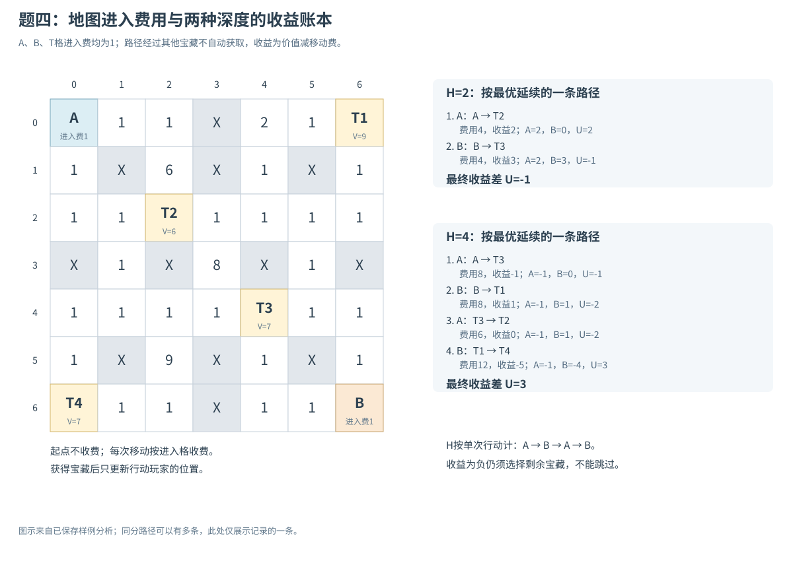
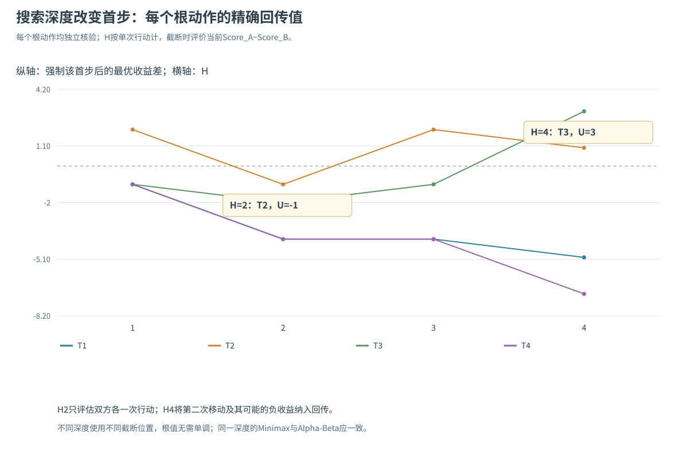
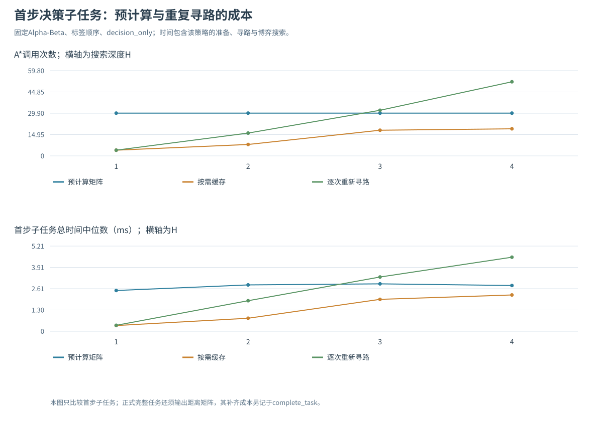
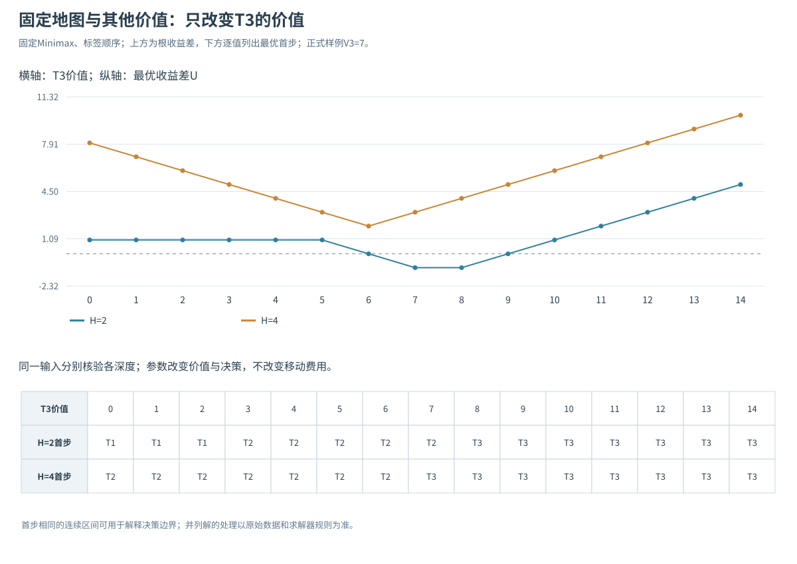

# 题四实验报告：竞争环境中的寻路与宝藏分配

## 1. 任务与模型

本题依据《实验二要求_new(1).pdf》第14—17页。A为MAX、B为MIN，按A→B→A→B行动，每次选择一个未获得宝藏。移动沿最小进入费用路径，只能上下左右；A、B、T格进入费用均为1。每次Gain=价值−移动费，评价U=Score_A−Score_B；到指定深度或取完宝藏停止，不能自行增加pass或替换评价函数。

**距离与费用。** 使用A*逐个计算30个有序不同位置对，对角为0，输出完整6×6矩阵。起点不重复收费，进入目标格必须收费1。题二的E免费约定不适用于本题。h=m×Manhattan，m为所有可通行格最小进入费；样例m=1。

**状态与转移。** 状态为(pos_A,pos_B,remaining_mask,Score_A,Score_B,turn)，递归另传depth_left。选Ti后只将当前玩家位置更新到Ti、清除该位、累计其Gain并换玩家。经过其他宝藏不自动拿取，已拿宝藏格仍可通行，另一玩家不挡路。累计收益决定当前U，不能从状态语义中丢掉。

**深度与首步。** H2只考虑A和B各拿一次，T2得到−1，是该深度最大值；H4再计双方第二次移动，T3保证3，优于首选T2的1。沿示例的一条最优延续，A总收益−1、B为−4，收益差仍为3；其他并列最优延续可以有不同的双方绝对分数。

**访问顺序。** 同一输入和深度，Minimax与Alpha-Beta根值一致；访问顺序影响界形成和成本。同分时按访问先后保留首个最优目标，所以额外顺序可能选出不同但同样最优的目标。样例H2/H4最优首步唯一。正式默认按T1、T2、T3、T4访问，拓展比较逆序与当前行动者即时Gain降序。

**参考方法。** [Berkeley官方A*教材](https://inst.eecs.berkeley.edu/~cs188/textbook/search/informed.html)用于核对下界和费用；[官方Minimax教材](https://inst.eecs.berkeley.edu/~cs188/textbook/games/minimax.html)用于理解深度截断；[CS188 Project 2](https://inst.eecs.berkeley.edu/~cs188/fa26/projects/proj2/)的一层包含Pacman及所有ghost一整轮，且为计数要求禁止等号剪枝。本题H按单次行动，评价已指定当前U，不能直接移植其层数或另换评价函数。检索日期2026-11-01。

## 2. A*与进入费用的正确性

将所有可通行格记为位置状态，g为从起点实际支付的进入费用，优先队列按f=g+h排序；较短费用松弛、父指针回溯、有效目标弹出终止。支持h=0对照。路径同时保留每一步坐标、该格费用和累计费用，验证器另用独立Dijkstra，不复用正式邻居与路径逻辑。

四方向一步只能使曼哈顿距离最多减少1，每次进入费用不小于m，因此h不高估；相邻边满足h(x)−h(y)≤m≤cost(y)，也满足一致性。若其他输入含0费，m=0时安全退化；正式样例费用均至少1。路径起点费为0，但最后进入宝藏的1必须累计。

进入收费的一般图不能预设距离对称：反向同一路的费用差只来自端点。样例六个端点费都为1，因此反向费用相同，矩阵自然对称；程序仍实际运行全部30个有序A*，没有以对称性少算一半。

## 3. 样例地图与完整距离矩阵

标签A、B、T1、T2、T3、T4的坐标依次为(0,0)、(6,6)、(0,6)、(2,2)、(4,4)、(6,0)，价值为9、6、7、7。地图和主要账本如下：



| 来源/目标 | A | B | T1 | T2 | T3 | T4 |
|---|---|---|---|---|---|---|
| A | 0 | 12 | 10 | 4 | 8 | 8 |
| B | 12 | 0 | 8 | 8 | 4 | 10 |
| T1 | 10 | 8 | 0 | 6 | 6 | 12 |
| T2 | 4 | 8 | 6 | 0 | 6 | 6 |
| T3 | 8 | 4 | 6 | 6 | 0 | 6 |
| T4 | 8 | 10 | 12 | 6 | 6 | 0 |

两种启发的全部60次路径结果、逐格账本均核对独立最短费，6个对角值核对为0。完整路径在[paths.json](results/paths.json)，原始距离表在[distance_matrix.csv](results/distance_matrix.csv)。

## 4. 状态、回传、深度与剪枝

MAX在孩子值中取最大，MIN取最小。α为MAX已有保证下界，β为MIN已有保证上界；α≥β时跳过尚未访问的兄弟。内部截断返回可能只是界，trace明确记录；所有根动作的精确对照值另用全枚举计算，不把被剪分支返回值误写成真值。

H是一共执行多少次选宝动作，H2为A→B，H4为A→B→A→B。每步都从该玩家**更新后的位置**出发，两人位置互不覆盖。负Gain必须参与搜索，因为规则没有跳过选项。地图连通，正式样例始终可选；扩展输入若当前玩家没有任何可达目标，本实现终止该分支并返回当前U，不暗中为其增加pass。

有k个宝物时，每层候选数依次k、k−1等；无剪枝完整节点数为Σ P(k,d)，d从0到min(H,k)。样例H1—4分别为5、17、41、65节点，H4的24叶对应4!种选取排列。递归深度至多min(H,k)，距离矩阵、A*队列、候选列表和可选轨迹另占空间。

主要统计口径：visited=internal+leaf；有效cutoff只计还有兄弟可跳过的事件；skipped_child_roots不是全部后代数。因为先生成各候选及Gain，generated_actions=visited−1+skipped_child_roots。距离查询包括最终可能被剪孩子的候选费用，不能简单按访问边数计算寻路调用。

## 5. 深度改变决策：完整根动作值与收益账本

| H | 首选T1 | 首选T2 | 首选T3 | 首选T4 | 最优首步 | 截断时U |
|---|---|---|---|---|---|---|
| 1 | -1 | 2 | -1 | -1 | T2 | 2 |
| 2 | -4 | -1 | -2 | -4 | T2 | -1 |
| 3 | -4 | 2 | -1 | -4 | T2 | 2 |
| 4 | -5 | 1 | 3 | -7 | T3 | 3 |



### H=2 的最优路线账本

| 回合 | 玩家 | 移动 | 宝物价值 | 移动费 | 当次Gain | Score_A | Score_B | U |
|---|---|---|---|---|---|---|---|---|
| 1 | A | A→T2 | 6 | 4 | 2 | 2 | 0 | 2 |
| 2 | B | B→T3 | 7 | 4 | 3 | 2 | 3 | -1 |

### H=4 的最优路线账本

| 回合 | 玩家 | 移动 | 宝物价值 | 移动费 | 当次Gain | Score_A | Score_B | U |
|---|---|---|---|---|---|---|---|---|
| 1 | A | A→T3 | 7 | 8 | -1 | -1 | 0 | -1 |
| 2 | B | B→T1 | 9 | 8 | 1 | -1 | 1 | -2 |
| 3 | A | T3→T2 | 6 | 6 | 0 | -1 | 1 | -2 |
| 4 | B | T1→T4 | 7 | 12 | -5 | -1 | -4 | 3 |

H4的一条最优线为A:T3→B:T1→A:T2→B:T4。A先付8拿7，后付6拿6，最终−1；B先付8拿9，后付12拿7，最终−4。由于不能跳过负收益动作，这条延续中的最后昂贵移动必须支付。目标是最大化相对收益差，A自己的绝对分数并不是这个优化目标。例如另一条同样最优的延续T3→T2→T1→T4得到A=2、B=−1，U同为3。

H2/H4的−1和3来自不同截断时点，不能直接把差4当作完整博弈的策略改进。若都用H4完整后续评价，浅层所选T2的值为1，完整最优T3为3，因此该首步的完整博弈后悔值为2。H1/H3也选T2；不同深度的当前U无需单调。

完整回传事件见[sample_traces.json](results/sample_traces.json)，独立根向量和账本见[sample_analysis.json](results/sample_analysis.json)。

## 6. A*与博弈搜索的同输入对照

### 6.1 零启发与曼哈顿

| 启发 | A*调用 | 累计扩展 | 累计入堆 | 完整矩阵时间ms [Q1,Q3] |
|---|---|---|---|---|
| zero | 30 | 650 | 821 | 3.863 [3.054,4.767] |
| manhattan | 30 | 329 | 497 | 2.569 [2.140,2.790] |

30个相同有序查询上，曼哈顿累计扩展650→329；两种方式的矩阵费用完全相同。时间是本轮7个重复块的中位数与IQR，不是独立地图的置信区间。这里只覆盖一张地图，不据此推断所有地形的提速比例。

### 6.2 Minimax、Alpha-Beta与访问顺序

以下在已准备好相同距离矩阵上计时，包含候选生成、排序与博弈递归；不包含矩阵构建，后者在上一节及下一节单独计入。

| H | 方法 | 顺序 | 根值 | 访问 | 叶评价 | 有效剪枝 | 距离查询 | 搜索ms [Q1,Q3] |
|---|---|---|---|---|---|---|---|---|
| 2 | minimax | label | -1 | 17 | 12 | 0 | 16 | 0.148 [0.106,0.188] |
| 2 | alphabeta | label | -1 | 13 | 8 | 2 | 16 | 0.115 [0.077,0.124] |
| 2 | alphabeta | reverse | -1 | 16 | 11 | 1 | 16 | 0.147 [0.101,0.161] |
| 2 | alphabeta | gain | -1 | 11 | 6 | 3 | 16 | 0.132 [0.074,0.145] |
| 4 | minimax | label | 3 | 65 | 24 | 0 | 64 | 0.410 [0.402,0.419] |
| 4 | alphabeta | label | 3 | 47 | 16 | 5 | 52 | 0.371 [0.277,0.388] |
| 4 | alphabeta | reverse | 3 | 46 | 16 | 4 | 50 | 0.322 [0.235,0.458] |
| 4 | alphabeta | gain | 3 | 37 | 12 | 6 | 44 | 0.315 [0.188,0.447] |

H4的标签、逆序、Gain序AB分别访问47、46、37节点，根值均3。即时Gain排序让有利界更早出现，但排序只改变顺序，不能用即时Gain替代Minimax。在MIN节点同样优先自身Gain较大的目标，因为对B而言这通常更快降低U。

H2中Gain序虽11节点少于标签序13节点，该组中位时间约0.132ms却高于0.115ms；准备和排序成本及短查询波动会影响结果。H4各时间IQR也有重叠，不能把节点比例直接当作稳定时间收益。完整配置和同repeat配对差保留于[comparison.csv](results/comparison.csv)、[paired_differences.csv](results/paired_differences.csv)。

## 7. 寻路复用：分开两种输出要求

同一博弈内有许多重复位置对。实验用同一搜索接口比较：precompute预先算完整矩阵；on_demand首次需要才A*并缓存；repeated每次请求重新A*，不复用。所有策略包括各自准备、A*、费用访问和博弈时间。

比较采用两种输出要求：decision_only只求最优首步和值；complete_task还要求完整6×6矩阵。后者与正式题目一致，按需策略也要补齐未查询点对。

### 只求首步的子任务

| H | 策略 | A*次数 | A*累计扩展 | 博弈距离请求 | 总耗时ms [Q1,Q3] |
|---|---|---|---|---|---|
| 2 | precompute | 30 | 329 | 16 | 2.837 [2.131,3.256] |
| 2 | on_demand | 8 | 84 | 16 | 0.798 [0.537,0.952] |
| 2 | repeated | 16 | 170 | 16 | 1.870 [0.867,2.116] |
| 4 | precompute | 30 | 329 | 52 | 2.801 [2.052,3.443] |
| 4 | on_demand | 19 | 188 | 52 | 2.221 [1.527,2.478] |
| 4 | repeated | 52 | 517 | 52 | 4.532 [3.161,4.955] |
### 还须输出完整矩阵的完整任务

| H | 策略 | A*次数 | A*累计扩展 | 博弈距离请求 | 总耗时ms [Q1,Q3] |
|---|---|---|---|---|---|
| 2 | precompute | 30 | 329 | 16 | 2.852 [2.071,3.024] |
| 2 | on_demand | 30 | 329 | 16 | 2.607 [2.122,3.416] |
| 2 | repeated | 46 | 499 | 16 | 4.607 [2.517,5.684] |
| 4 | precompute | 30 | 329 | 52 | 2.934 [2.547,3.252] |
| 4 | on_demand | 30 | 329 | 52 | 3.703 [3.176,3.944] |
| 4 | repeated | 82 | 846 | 52 | 7.547 [4.700,9.369] |



H4只求首步时，标签序AB产生52次距离请求，按需只做19次A*；完整任务补齐后仍需30次，和预计算相同。完全不复用则先为决策做52次，再为完整输出做30次，共82次。这是工作量的确定差异；完整任务中预计算与补齐按需的时间有波动，不按单次排名宣称普遍胜出。

H1/2的decision_only中，无复用只做4/16次A*，少于预计算30次；深度增加到H3/4后为32/52次，体现准备成本什么时候可能回本。实际每个查询难度不同，调用次数交叉不是毫秒耗时严格相等的阈值。原始两种输出模式完整保存在[routing_comparison.csv](results/routing_comparison.csv)。

## 8. 自设参数：T3价值的决策边界与收益转折

固定地图、费用、T1/T2/T4价值和评价公式，仅把T3价值v从0扫到14。H2/H4、两算法、三顺序共180配置，逐输入对照独立枚举。并列目标集合也保存，图中的首步仅是默认标签顺序选出的一个代表。



H2若先取T2，A即时Gain为2，B会选剩余最大Gain，因此：

```text
Q_H2(T2) = 2 − max(1, v−4, −3)
Q_H2(T3) = v−8 − max(1, −2, −3) = v−9
```

当v≥5，前者为6−v，与v−9在v=7.5相交。因此实测整数7仍选T2，整数8选T3。v≤2时T1/T2有并列最优，不能把默认T1误写成唯一最优。

完整H4在已扫范围的根分支分别为T1:2−v、T2:8−v、T3:v−4、T4:−v，故最优值为max(8−v,v−4)，在v=6时T2/T3并列、U=2；v>6选T3。样例v=7正落在两个深度的切换边界之间，解释了H2取T2而H4取T3。另用两算法、三顺序对v=6/H4与v=7.5/H2进行12次非计时边界核验，两处都得到T2/T3并列，分别为2和−1.5；保存在[decision_boundary_checks.json](results/decision_boundary_checks.json)，不混入308个正式计时配置。

H4最优U随v先从8下降到2，再升至10。这是输入价值与对手分配导致的**收益差转折**，不是算法耗时最优：在T2分支中，B有能力让提高的T3价值更多地改善自己的收益；当v充分大，A改为首选T3。不能以收益曲线低点代替运行性能的内部极值。所有240个精确根动作值见[root_action_values.csv](results/root_action_values.csv)。

## 9. 状态管理反例：相同位置不代表相同U

合法历史T1→T2→T3→T4与T2→T1→T3→T4，最后均为A在T3、B在T4、宝藏取空、轮到A，但U分别为1和7。两条收益账本保存在sample_analysis的state_alias_counterexample中。

因此若将绝对U作为缓存结果，键不能只含位置、剩余集合、玩家和深度；还须包含当前收益或等价信息。若另缓存“未来增量”，才可在证明成立后省略当前U，并相应平移α/β窗口。本实现使用距离缓存，不缓存博弈状态。若引入状态缓存，累计分数及返回值语义仍需按上述条件处理。

## 10. 验证、复现与证据边界

核心25项测试通过：60正权及40零权随机地图的Dijkstra和路径账本；样例36矩阵元素、30条路径；一般数值端点非对称回归；H1—4全根向量；20个随机四宝博弈、24个带既有分数/B回合的子局面；PV费用账本；负Gain不得pass、经过不拾取、已取格可行、另一玩家不阻挡、H0/空集合、非法输入与无可达动作扩展。正式测试与实验校验不复用正式状态转移作为真值。

样例与价值扫描的308配置包括30个样例深度/顺序配置、180个价值扫描、96个路由/输出合同配置、2个矩阵启发配置。7个随机交错块，每块3次，共2156批、6468次顶层计时调用；内部A*次数另记。输入只有一张地形和15组固定价值，不是308张独立地图。每次调用核对值及计数守恒，协议在首次预热前保存，SHA和完整原始批值可追溯。

每个时间窗在已构建输入上开始，包含本策略的准备和完整求解工作；参考最优值、验证、trace、文件写入在窗外。IQR描述本机固定输入重复波动，不是显著性或跨地图泛化证据。价值扫描用于分析决策边界，各配置在同一轮内配对比较。

本题的模型将路径费用与博弈收益连接起来。正确的费用矩阵和完整状态保证两种搜索求解同一问题；深度截断决定看见哪些后续代价，访问顺序则决定为得到该值需要多少搜索。后续实验分别检验这两类影响。

## 11. 跨地图验证与延迟距离查询

完整设计、四张图、反例及复现命令见[跨地图与延迟查询实验](SUPPLEMENTARY_EXPERIMENTS.md)。以下概括主要结果。

跨地图部分在开放加权、单缺口绕行墙、随机障碍三类中各固定10个种子，改变地图及六个命名位置，宝藏价值仍为9、6、7、7；仅按连通性接收输入，不根据算法表现筛选。逐图核对完整30有序A*及独立Dijkstra、H1—4两算法三顺序与全枚举。H4的Gain序相对标签序在22/30图访问更少、3/30相同、5/30更多；不能把样例的排序优势推广成全部输入优势。标签序H1/H2/H3/H4完整最优首步命中数为19/19/23/30，但个别输入H2到H3会变差；补充报告用同图完整后续值解释截断深度及奇偶层的影响，避免直接比较不同H的截断U。

实现改进使用可选`lazy_game_search.py`，保留原版，并加入同一统计内核的`matched_eager`对照。延迟的是被剪枝候选的距离查询及Gain准备；原版本来就只在访问时构造子状态，因此**子状态构造数和访问树不变**。正式样例标签序AB的H2请求16→12，H4请求52→46，根值、首步和PV一致。Minimax无剪枝及Gain须预先排序的条件下，请求量不变。31输入H4标签序的请求比中位数约0.885；相对同核预生成，逐图配对时间差中位数约−0.00523ms，但相对原版约+0.01443ms，尚不能称为全面提速。

完整矩阵任务中，预计算与按需缓存的A*次数仍固定30；仅决策的少算不能替代PDF完整输出。每次全任务计时包含准备、实际A*、搜索和矩阵补齐，验证及文件写入在窗外。7图路由子集在求解前固定；第二组复用前一组30图并加PDF样例，不是又新增30图。

两组实验共780+1620配置，5重复块×每块3次，共12000批、36000次顶层计时调用，保存逐调用时间与配对汇总。题四全部47项测试通过，另核对了最短路、根向量、PV账本和首步后悔值。结果表明，排序的收益取决于输入，减少无用查询也未必减少完整任务时间。
