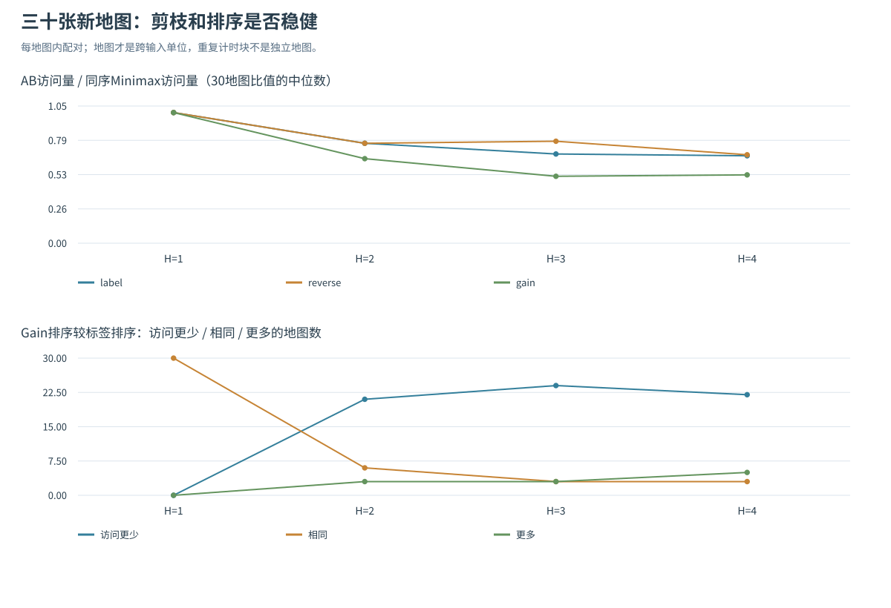
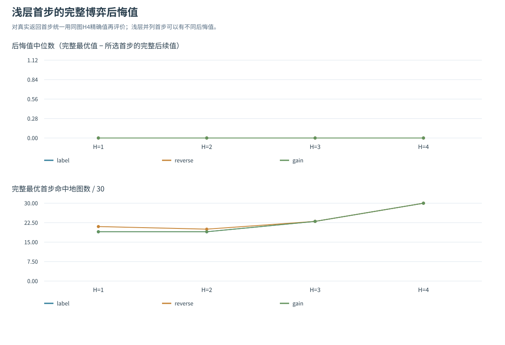
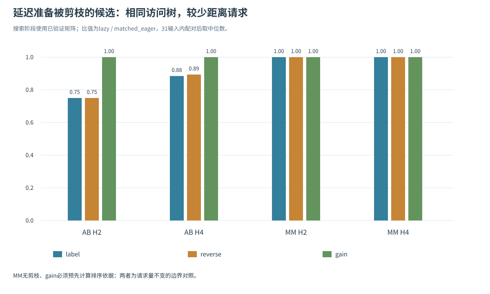
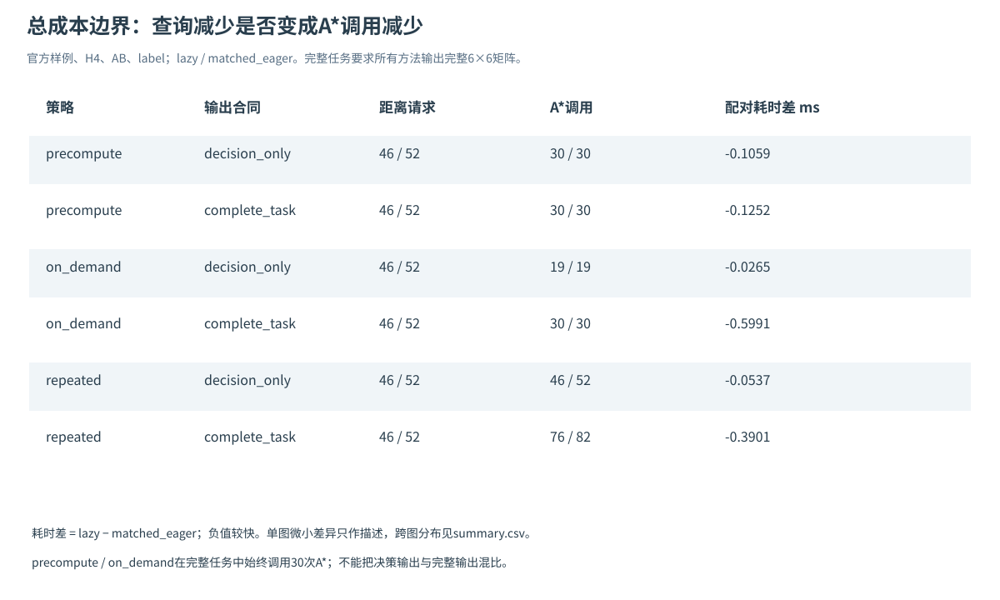

# 题四补充实验：跨地图稳健性与延迟距离查询

本次补充回答两个问题：原有剪枝、排序和浅层决策结论能否迁移到其他地图与宝藏位置；保持同一访问顺序、访问树和决策结果时，延后查询被剪枝候选的距离能否节省工作与总时间。实验结果支持“可以减少部分距离请求”，同时显示实际耗时收益依赖距离供应方式和输出要求。计数减少不能直接等同于整体提速。

本报告与[题四主报告](REPORT.md)配合阅读。跨地图实验检验样例结论的适用范围；延迟查询实验比较同一访问树下的候选准备成本，均以 `treasure_game.py` 为原版基线。

## 1. 模型与实验设置

所有方法沿用老师题四规则：进入 A/B/宝藏格费用为 1；A 先手，H 每增加 1 代表一名玩家选择一个宝藏；Gain=宝藏价值−实际最小路径代价；必须行动，即使 Gain 为负；中途经过其他宝藏不收集；只更新当前行动玩家的位置；叶节点用当前 U=scoreA−scoreB。Alpha–Beta 使用 α≥β 剪枝。正式任务仍输出全部 6×6 距离矩阵，30 个有序点对均实际调用 A* 并核验。

研究问题、输入生成、固定种子、配置范围、计时边界和源文件哈希均在第一次正式 A*/博弈预热之前登记于各自 `protocol.json`。独立 Dijkstra 和穷举参考只用于校验、构建分析基准，不进入被测算法、候选排序或计时。参考值可在登记时算出，但不依据求解效果挑选地图、改变方法或删除失败样本。

每配置运行 5 个随机交错的重复块，每块分别计时 3 次，保留每次调用时间于 `timing_calls.csv`。`timing_batches.csv` 中每行是该块 3 次调用的每调用均值。配置中位数和四分位区间 [Q1,Q3] 根据 5 个块均值计算；同一地图、同一重复块的方法差值先配对，再取其中位数。跨地图汇总时，每张地图贡献一个观测，重复块不增加地图样本量。“更快”按该图配对时间差中位数<0 计数。下表与文中的 IQR 均为描述性统计，不作置信区间或显著性结论。


| 实验 | 输入范围 | 配置数 | 计时批次 | 被计时顶层调用 |
| --- | --- | --- | --- | --- |
| 跨地图稳健性 | 30 张新地图，3 类各 10 张 | 780 | 3900 | 11700 |
| 延迟查询：搜索阶段 | 上述 30 图 + PDF 样例，共 31 图 | 1116 | 5580 | 16740 |
| 延迟查询：含寻路与输出 | 预先指定的 7 图子集 | 504 | 2520 | 7560 |
| 合计 | 30 张新图被复用，另有 1 张原样例 | 2400 | 12000 | 36000 |


两组补充中的新地图是同一批 30 张，不能把它们写成 60 张独立地图；7 图子集也包含在这 31 图之内。所有正式计时串行执行。

## 2. 实验一：跨地图、起点与宝藏位置的稳健性

### 2.1 研究问题与控制

固定四个宝藏价值为 (9,6,7,7)，改变地图与六个命名点的位置。每图保留全部 H=1,2,3,4、Minimax/Alpha–Beta、label/reverse/gain 的 24 个博弈配置；另测零启发与 Manhattan 的两种完整距离矩阵构造，共 30×(24+2)=780 配置。gain 只按当前行动者的即时 Gain 降序访问候选；它不改变极大极小的目标，也不使用未来真值。


| 地图族 | 结构与费用 | 固定 RNG 标识 |
| --- | --- | --- |
| open_weighted | 7×7，无墙，普通格费用 1..9 | 202611101..202611110 |
| detour | 9×9，中间竖墙仅一个缺口，其他位置约 7% 障碍，费用取 1/2/4/8 | 202611201..202611210 |
| random_obstacles | 9×9，约 23% 随机障碍，费用取 1/2/4/8 | 202611301..202611310 |


数字种子是 RNG 标识。每图只按结构条件接受：最大连通分量至少有 20 格，六个命名点互不相同且处于该分量中，随后将命名格费用统一为 1。detour 额外让 A/B 起点位于竖墙两侧。`inputs.json` 保存全部地图、位置、命名格归一化前的费用、尝试次数和输入指纹；拒绝条件不涉及搜索结果。

三类地图同时改变尺寸、地形、障碍和位置分布，适合检验结论在异质输入下的表现；族间差异不能归因于某一个因素。连通条件也意味着本研究的结论不覆盖全部不连通地图。

### 2.2 路径与决策校验

独立 Dijkstra 给出每图真值矩阵，两种启发各自执行 30 次 A*，共核验 1800 条路径的起终点、相邻移动、逐格费用和累计代价。所有距离与路径核验通过。720 个博弈配置的根值和所选首步均与独立完整穷举一致；主变化线（PV）由独立账本核验，其长度、首步、费用、得分与叶 U 正确，重复调用的计数和 PV 稳定。H4 的全部所选首步完整后悔值为 0。

矩阵构造时间包括当次全部 30 次 A*；博弈搜索时间使用提前构造并校验的矩阵，包含候选准备、排序和递归。两阶段分别报告，不能把两个独立中位数相加当成端到端时间。

### 2.3 H4：剪枝收益能否跨地图保留

下表访问比为每张地图的 Alpha–Beta 访问节点数 / 同序 Minimax 访问节点数，再对 30 个比值汇总。时间输赢也比较同图、同序两方法；时间差为 Alpha–Beta 减 Minimax，负值表示 Alpha–Beta 更快。


| 顺序 | 访问比中位数 [Q1,Q3] | 访问更少/相同/更多图数 | 时间更快/更慢图数 | 最差配对时间差 ms |
| --- | --- | --- | --- | --- |
| label | 0.669 [0.542, 0.785] | 30/0/0 | 24/6 | +0.0668 |
| reverse | 0.677 [0.577, 0.904] | 26/4/0 | 20/10 | +0.0489 |
| gain | 0.523 [0.477, 0.569] | 30/0/0 | 28/2 | +0.0121 |


三种顺序的 Alpha–Beta 均保持正确根值。label 在 30/30 图减少访问，但仅 24/30 图耗时更小；reverse 在 4 张图完全没有减少访问。说明正确剪枝带来的节点节省，并不保证 Python 层判断与管理开销能在每张小博弈树上摊薄。

同为 Alpha–Beta 时，gain 相对 label 的 H4 访问比中位数为 0.842 [0.666, 0.985]；22 图访问更少、3 图相同、5 图更多，时间则为 19 图更快、11 图更慢，最差配对时间差为 +0.1090 ms。即时 Gain 对较早形成有效界通常有帮助，但它并不等于完整博弈价值，排序本身也有费用，因此本实验不能推出 gain 在任意输入上最优。



完整数据见 `results_robustness/comparison.csv`、`paired_differences.csv` 和 `order_summary.csv`。上图随 H 改变的点属于同一批 30 图。

### 2.4 深度变化：统一用完整博弈价值评价首步

不同 H 的叶节点处在不同决策阶段，直接比较 H2 与 H4 返回的 U 会混合截断效应。这里对实际返回首步 a 使用同一张图的 H4 精确根向量 Q4 定义：后悔值 R(a)=max_b Q4(b)−Q4(a)。它度量只固定该首步后、双方完整最优续走所损失的 U；值越小越好。浅层并列首步逐一按实际返回动作评价，不将并列动作合并。

先固定 Alpha–Beta、label 顺序，比较全部 30 图：


| H | 完整最优首步命中 | 后悔值中位数 [Q1,Q3] | 最大后悔值 |
| --- | --- | --- | --- |
| 1 | 19/30 | 0.00 [0.00, 1.00] | 32 |
| 2 | 19/30 | 0.00 [0.00, 2.50] | 32 |
| 3 | 23/30 | 0.00 [0.00, 0.00] | 26 |
| 4 | 30/30 | 0.00 [0.00, 0.00] | 0 |


中位数均为 0，单看中位数会漏掉长尾错误；H2 仍有 11/30 图选到完整次优首步，最大损失 32。因此同时列出命中率、四分位和最大值。H4 看完四个选择动作，对该四宝藏问题已是完整博弈；继续增大 H 不会产生新的决策层，不能人为制造更深的实验规模。

不同地图族的分布如下（Alpha–Beta、label；每格为“命中图数/10；最大后悔值”）：


| 地图族 | H1 | H2 | H3 | H4 |
| --- | --- | --- | --- | --- |
| open_weighted | 8/10；1 | 8/10；1 | 7/10；6 | 10/10；0 |
| detour | 4/10；32 | 5/10；32 | 8/10；26 | 10/10；0 |
| random_obstacles | 7/10；5 | 6/10；23 | 8/10；5 | 10/10；0 |


detour 的浅层误选及最差损失较突出，说明只在官方地图上展示深度改进不够；由于地图族同时改变了多个因素，这仍是分布观察，不能解释为“单独增加墙就导致多少损失”。顺序还会影响浅层并列动作的实际返回：H1 的完整最优命中数为 label 19、reverse 21、gain 19；H2 为 19、20、19；H3 三序均为 23；H4 均为 30。这些差别不构成浅层 Minimax 正确性差异，相关首步在各自截断深度仍是最优。

深度收益并非每一步都单调。按登记的地图族与种子顺序，第一张出现 label 下 H2→H3 后悔值增加的图为 `open_weighted_s202611104`。下表根向量均按 T1,T2,T3,T4 排列，来自保存的独立参考值：


| H | 精确根向量 | 所选首步 | 该 H 根值 | 首步的 H4 值 | 后悔值 |
| --- | --- | --- | --- | --- | --- |
| 1 | -4, -1, 0, -7 | T3 | 0 | 2 | 1 |
| 2 | -6, -3, 2, -9 | T3 | 2 | 2 | 1 |
| 3 | 0, -3, -1, -3 | T1 | 0 | -3 | 6 |
| 4 | -3, 3, 2, -4 | T2 | 3 | 3 | 0 |


该图 H3 的后悔值出现局部峰值 6，H4 降为 0。H3 截止于 A 的第二次行动，尚未计入 B 的最后一次选择；H2 截止于 B 的第一次行动。使用当前 U 截断时，奇偶层缺失的收益不同，不能保证浅层动作质量随 H 逐级改善。在全部 30 图中，H2→H3 变差的图数为 label 2、reverse 3、gain 2；多数图未出现该反例。该案例从已登记输入中选出，用于解释截断的奇偶层影响；它并不是各图共有的规律。



### 2.5 Manhattan 与零启发：矩阵预处理的成本

启发仅作用于寻路，得到的距离矩阵和后续博弈根值相同。30 张图上，Manhattan 的累计扩展量均小于零启发；逐图扩展量比的中位数为 0.639 [0.606,0.720]。完整矩阵时间在 29/30 图更小，同图配对时间差的中位数为 −0.2758 ms，跨图四分位为 [−0.5552,−0.1571] ms；最慢反例为 +0.0333 ms。因此可以支持“该批输入普遍减少扩展并改善矩阵构造时间”，不能推出所有环境下必然加速。

作为规模与分布参考，三地图族的矩阵构造时间中位数（先求每图中位数，再在族内汇总）分别为：open_weighted 的零启发 2.039 ms、Manhattan 1.701 ms；detour 为 3.030、2.446 ms；random_obstacles 为 2.822、2.167 ms。各族明细见 `matrix_summary.csv`，逐图配对结果见 `paired_differences.csv` 的 `manhattan_vs_zero` 行。

## 3. 实验二：延迟距离查询与候选 Gain 准备

### 3.1 优化对象与三种实现

原版在访问一个内部节点时，先查询全部剩余目标的距离并计算 Gain，随后逐个递归。若较早的孩子触发剪枝，后续候选的这些查询与 Gain 准备已经发生。`lazy_game_search.py` 让 label/reverse 顺序在真正访问某个孩子之前才请求该距离、计算其 Gain。gain 顺序需要先知道所有候选的即时 Gain 才能排序，保持预先查询，作为控制条件。

原版的 `_transition` 本来就在即将递归孩子时才调用。本优化保持实际进入的子状态数 `materialized_actions=visited_nodes−1` 不变，节省对象是被剪枝候选的距离请求和 Gain 准备。计数也区分“列出的候选槽”“实际查询”“实际进入的子状态”；新旧 `generated_actions` 的含义随准备时机不同，不能单独拿它当作递归规模的统一指标。正式输入均连通；不连通情况下，未查询槽是否为合法可达孩子尚不可知，不能将所有跳过槽都声称为已确认合法后继。

为区分准备时机与统计开销，比较三个实现：


| 实现名 | 作用 | 比较解释 |
| --- | --- | --- |
| original | 未改动的原版 `game_search` | 实际工程基线，保留其真实耗时 |
| matched_eager | 新模块的同一统计内核，generation=eager | 与 lazy 使用相同计数逻辑，主对照 |
| lazy | 新模块，generation=lazy | 主比较为 lazy−matched_eager；gain 仍需预查 |


31 图搜索阶段覆盖 H2/H4、两算法、三顺序、三实现，共 1116 配置，计时排除提前构造的完整矩阵。所有相同输入和顺序下，三个实现的根值、首步、PV、访问节点数、内部节点数、叶数均一致；930 条预备矩阵路径通过独立校验。

[Berkeley CS188 的多智能体作业](https://inst.eecs.berkeley.edu/~cs188/fa26/projects/proj2/)强调避免生成没有必要的后继，为分析准备工作的发生时机提供参考。本实验仅借鉴这一问题意识；H 的定义、等号剪枝及本地顺序比较均按老师题四要求执行，未移植其 Pacman 回合定义或自动评分计数约定。

### 3.2 31 图搜索阶段：请求减少，耗时收益较小且不稳定

下表查询比为 lazy/同图 matched_eager，括号表示 [Q1,Q3]；时间差均先在图内按重复块配对，再跨 31 图汇总，负值表示 lazy 更快。


| H | 算法/顺序 | 查询比中位数 [Q1,Q3] | 查询减少图数 | lazy−主对照 Δms [Q1,Q3] | lazy更快（对主对照） | lazy−原版 Δms中位数 | lazy更快（对原版） |
| --- | --- | --- | --- | --- | --- | --- | --- |
| 2 | AB/label | 0.750 [0.625, 0.875] | 28/31 | -0.0021 [-0.0060, +0.0024] | 20/31 | +0.0059 | 7/31 |
| 2 | AB/reverse | 0.750 [0.750, 0.906] | 27/31 | +0.0007 [-0.0051, +0.0058] | 13/31 | +0.0062 | 6/31 |
| 2 | AB/gain | 1.000 [1.000, 1.000] | 0/31 | -0.0007 [-0.0059, +0.0055] | 16/31 | +0.0072 | 6/31 |
| 2 | MM/label | 1.000 [1.000, 1.000] | 0/31 | -0.0018 [-0.0072, +0.0013] | 21/31 | +0.0066 | 6/31 |
| 4 | AB/label | 0.885 [0.839, 0.926] | 31/31 | -0.0052 [-0.0165, +0.0051] | 20/31 | +0.0144 | 3/31 |
| 4 | AB/reverse | 0.894 [0.847, 0.974] | 27/31 | +0.0020 [-0.0077, +0.0080] | 14/31 | +0.0172 | 6/31 |
| 4 | AB/gain | 1.000 [1.000, 1.000] | 0/31 | +0.0000 [-0.0097, +0.0096] | 15/31 | +0.0205 | 2/31 |
| 4 | MM/label | 1.000 [1.000, 1.000] | 0/31 | -0.0071 [-0.0175, +0.0036] | 21/31 | +0.0221 | 3/31 |


H4 的 AB/label 在 31/31 图减少查询，查询比中位数 0.885，说明此机制确实消除了部分被剪枝候选的准备；访问树未变，收益并非来自改变决策精度或多剪枝。相对同统计内核，它的时间差中位数为 −0.0052 ms，但四分位区间跨 0，11/31 图仍更慢。相对更轻的原版，时间差中位数反而为 +0.0144 ms，仅 3/31 图更快。新增统计、函数路径和惰性管理开销在这个至多四层的小博弈中不可忽略，因此正式入口仍采用原版。

Minimax 没有剪枝，label/reverse/gain 的距离查询全部不变；gain 即使使用 Alpha–Beta，也必须先查询全部候选才能排序，查询全部不变。这些控制条件仍出现正负时间差：例如 H4 MM/reverse 相对 matched_eager 的差值中位数为 −0.0071 ms，25/31 图更快，但查询量没有降低。这只能说明执行路径、调度和计时波动会影响短时运行；不能把这些时间差归功于被消除的距离查询。控制条件的全量数据均保留于 `summary.csv`，表中 MM/label 是其一。

PDF 样例的 AB/label 给出直观核对（每格耗时为 ms 中位数 [Q1,Q3]，排除寻路）：


| H | 一致决策 | 一致访问/叶数 | 原版与主对照查询→lazy | original 时间 | matched_eager 时间 | lazy 时间 |
| --- | --- | --- | --- | --- | --- | --- |
| 2 | T2, U=-1 | 13/8 | 16→12 | 0.0644 [0.0617, 0.0677] | 0.0760 [0.0725, 0.0826] | 0.0657 [0.0656, 0.0800] |
| 4 | T3, U=3 | 47/16 | 52→46 | 0.1766 [0.1714, 0.1808] | 0.2020 [0.1944, 0.2300] | 0.2124 [0.1876, 0.3168] |


H2 查询 16→12，节省 25%；H4 查询 52→46，节省约 11.54%。样例 H4 的 lazy 搜索时间中位数高于主对照和原版，实际数据保留这一失败边界。表中的独立中位数只展示分布，不用它们相减替代保存的配对块差值。



### 3.3 计入 A* 与完整矩阵输出：统一输出要求再比较

预先指定路由实验子集为 PDF 样例，以及每个地图族的前两个固定种子，共 7 图。没有依据搜索、查询或时间结果挑图。覆盖 H2/H4、AB、label/gain、三实现、三距离策略、两种输出要求，共 504 配置。计时从新建距离提供器开始，包含相应的寻路、博弈与所要求的矩阵补全。

三距离策略为：precompute 提前查询全部 30 对并缓存；on_demand 按需查询并缓存点对距离；repeated 每次请求重新运行 A*。两种输出要求分别为 decision_only（只返回首步与 U）和 complete_task（同时给出完整 6×6 矩阵）。decision_only 用于解释条件收益，不能替代 PDF 的完整矩阵任务。不同输出要求分别汇总。

PDF 样例 H4、AB/label 的六种组合如下。查询数只列决策阶段；主对照在本表中与原版查询数、A* 次数相同。总时间覆盖当前行的全部输出要求。


| 距离策略 | 输出要求 | 决策查询 eager→lazy | 总 A* eager→lazy | original ms | matched_eager ms | lazy ms | lazy−主对照配对Δms |
| --- | --- | --- | --- | --- | --- | --- | --- |
| precompute | decision_only | 52→46 | 30→30 | 1.5751 | 1.7229 | 1.6262 | -0.1059 |
| precompute | complete_task | 52→46 | 30→30 | 1.5938 | 1.7898 | 1.8153 | -0.1252 |
| on_demand | decision_only | 52→46 | 19→19 | 1.0901 | 1.1306 | 1.0529 | -0.0265 |
| on_demand | complete_task | 52→46 | 30→30 | 1.6445 | 2.1544 | 1.6238 | -0.5991 |
| repeated | decision_only | 52→46 | 52→46 | 3.1540 | 2.5432 | 2.4458 | -0.0537 |
| repeated | complete_task | 52→46 | 82→76 | 4.0350 | 3.9057 | 3.7311 | -0.3901 |


独立时间中位数相减不等于逐块时间差的中位数，符号也可能不同。例如 precompute+complete_task 中 lazy 的独立中位数 1.8153 ms 高于主对照 1.7898 ms，但配对块差中位数为 −0.1252 ms；两者回答不同的统计问题，所有逐块时间可在原始数据中核对。

样例中 on_demand 的 H4 决策阶段虽少了 6 次请求，但两实现都实际需要 19 个不同点对；缓存使它们的决策 A* 次数仍为 19。complete_task 再补 11 个点对后均为 30 次；precompute 从一开始就是 30 次。repeated 则把少请求直接转为少运行 A*，decision_only 为 52→46 次，complete_task 为 82→76 次（额外 30 次用于完整矩阵）。这里节省的是重复工作，并未绕过完整矩阵要求。

下面跨预选 7 图汇总 H4、AB/label，时间仍使用图内配对差后再求跨图中位数；完整明细中保留原版次要比较。


| 距离策略 | 输出要求 | 实际 A*减少图数 | lazy−主对照 Δms [Q1,Q3] | lazy更快（对主对照） | lazy−原版Δms中位数 | lazy更快（对原版） |
| --- | --- | --- | --- | --- | --- | --- |
| precompute | decision_only | 0/7 | -0.0515 [-0.0943, -0.0181] | 6/7 | +0.0909 | 1/7 |
| precompute | complete_task | 0/7 | +0.0679 [-0.1131, +0.1438] | 3/7 | +0.0839 | 2/7 |
| on_demand | decision_only | 0/7 | -0.0265 [-0.1275, +0.0102] | 5/7 | +0.0388 | 2/7 |
| on_demand | complete_task | 0/7 | -0.0241 [-0.1377, +0.1265] | 4/7 | +0.1118 | 2/7 |
| repeated | decision_only | 7/7 | -0.5982 [-0.7067, +0.0303] | 5/7 | -0.3833 | 6/7 |
| repeated | complete_task | 7/7 | -0.6334 [-0.7883, -0.4922] | 7/7 | -0.4820 | 7/7 |


在最贴近完整提交要求且缓存距离的 complete_task 中，precompute/on_demand 的实际 A* 均固定 30 次；相对主对照的耗时表现分别为 3/7、4/7 图更快，不能声称稳定端到端加速。repeated+complete_task 在 7/7 图减少实际 A* 并更快，配对差中位数为 −0.6334 ms；这表明当每次查询都触发昂贵寻路时，节省请求有实际收益，但 repeated 本身缺少缓存，不能把这个收益推广到已经高效缓存的基线。

本次预选 7 图的 H4 on_demand/decision_only 也没有减少实际 A* 次数（0/7），表明少请求不一定意味着少查不同点对。更大地图、不同宝藏数量、其他位置分布下是否出现更多未查询点对，需要另行实验，当前不外推。



### 3.4 结果解释与适用条件

延迟准备省下了被剪枝目标的距离请求，但缓存已经消除了其中许多重复寻路。只有每次请求都重新运行A*时，少请求才直接转化为更少的寻路调用。对已缓存的完整矩阵任务，主要差别留在轻量候选准备上，收益较小且容易被统计和调度开销抵消。

这里的缓存对象是位置对距离。正式输入只有四个宝藏且均可达，计时来自一台Windows机器；小树和毫秒级寻路对运行环境较敏感，这也是时间差小于工作量差异时需要考虑的条件。

## 4. 复现与证据索引

题四全部47项测试通过，覆盖核心、延迟查询、地图生成和实验校验；正式结果另与独立路径和完整枚举核对，并检查重复调用的计数稳定性。

在题四目录中执行：

```text
python -B -m unittest discover -v
python -B run_robustness_study.py --repeats 5 --batch 3
python -B run_lazy_study.py --repeats 5 --batch 3
```

两个正式实验顺序运行即可；默认输出目录已有内容时，程序会在其中新建带时间标识的 `run_...` 子目录，保留已有结果。新的计时会受当时系统状态影响；输入、距离、决策和计数应与同配置一致。四张 SVG 均由对应实验脚本根据结果生成。


| 证据 | 路径与用途 |
| --- | --- |
| 预先登记与输入 | 两目录的 `protocol.json`、`inputs.json`：输入、拒绝日志、范围、边界、固定种子与哈希 |
| 逐配置与原始时间 | 两目录的 `comparison.csv`、`timing_batches.csv`、`timing_calls.csv` |
| 跨地图统计 | `results_robustness/order_summary.csv`、`depth_regret_summary.csv`、`matrix_summary.csv` |
| 配对统计 | `results_robustness/paired_differences.csv`；`results_lazy/paired_differences.csv`、`paired_blocks.csv`、`summary.csv` |
| 核验和可复现记录 | 两目录的 `outcomes.json`、`reproducibility.json`：协议、被测源码、输入及结果文件 SHA-256 |


`results_robustness` 与 `results_lazy` 保存这两组结果，样例和价值扫描结果在 `results/`。三组分别计时，不跨组拼接时间排名。反例用于解释已观察到的现象；由此提出的新方法仍需要新的输入检验。
